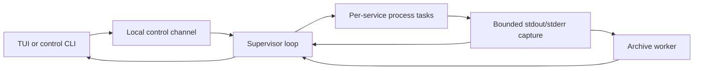

# Architecture and invariants

The [requirements](docs/requirements.md) define scope; the
[usage reference](docs/interaction.md) defines user-visible operations. This document
owns implementation mechanisms, resource budgets, and consequential tradeoffs.
The initial Linux/WSL2 MVP was accepted as 1.0.0. Logging shipped in 1.1.0; independent
self-update shipped in 1.2.0 and moved to release manifests in 1.2.1. Proposed dependency
orchestration, probes, and restart recovery remain separate from implemented behavior.

## Data flow and ownership



Keep one Cargo package. Configuration becomes read-only after loading. Projects
identify directories; services define argument arrays. The supported interactive
workspace has one service per project. The supervisor owns the Manager, service
states, stop senders, and task handles. Each process task exclusively owns its Child
and process-group identity until cleanup and reaping finish. Clients own presentation
and requests, not service resources; leaving a client does not drop process owners.

Independent long-running commands run concurrently rather than waiting for one
command to exit before starting another. There is no plugin engine, public SDK,
local HTTP API, or remote-control layer.

## Configuration identity

Resolve the selected path once at the CLI boundary using the
[discovery rules](docs/interaction.md#configuration). Explicit selection never falls
back; only missing default candidates are skipped. Loading errors do not trigger
a second search. Pass the selected canonical path explicitly to the supervisor.

Project paths resolve from the configuration directory. Service cwd defaults to the
project directory; an explicit relative cwd resolves from that project. Execute argv
without an implicit shell and inherit the supervisor's startup environment.
Configuration validation completes before any selected command starts. Preserve
existing dependency validation and planning, but reject dependencies unsupported by
the runtime rather than ignoring them. Reject unsupported multi-service TUI mappings
rather than silently choosing one service.

Canonical configuration identity determines the run lock and control endpoint.
Relative/absolute spellings and symlink aliases share ownership; hard-link aliases
are not merged. Connecting never replaces an existing supervisor's configuration
or environment with a new disk snapshot.

## Service state and concurrency

States are `Stopped`, `Starting`, `Running`, `Stopping`, and `Failed`. Running means
spawn was observed and completion has not been processed, not application readiness.
Each instance carries its own identity so late output or completion cannot mutate
a new instance. One service failure does not automatically stop or restart others.

Manager serializes control and completion events. A BTreeMap keyed by service ID
tracks ServiceTask values containing the stop sender and JoinHandle. Each task owns
a cloned service definition; Manager retains the original for explicit future starts.
Batch selection is preflighted before registration; registration does not await an
individual long-running task. Repeated Starting/Running requests do not duplicate
instances, and Stopping rejects starts.

A per-instance oneshot stop channel requests cleanup. Dropping its internal owner
also requests stop as a fail-safe; disconnecting a client must not drop that owner.
Signal handling belongs to the management entry point, not individual process tasks.
Borrow JoinHandles while waiting; cancellation must not lose ownership. Normal exit
requests stop and joins tasks rather than aborting service owners or dropping a runtime.

`request_stop_all` synchronously marks unfinished tasks Stopping and records the
pending IDs. It blocks new starts until all targeted completion results arrive;
a single stop restricts only that service. `stop_all` waits and aggregates errors
without skipping the remaining services. Cancelling the wait releases neither
registrations nor the stop-all constraint.

`wait_next` polls unfinished JoinHandles with the caller's Context/waker, consumes
each completion once, and applies the same release rules as an ID-specific wait.
Simultaneous completions are checked by ID, not promised exit-time order. `None`
means no unjoined tasks, not necessarily confirmed cleanup.

RunError distinguishes `SafeToRetry` from `CleanupUnconfirmed`. Validation/spawn
failure and observation errors after confirmed cleanup can release registration.
Cleanup errors and task JoinErrors do not prove safety. Preserve the typed result
until Manager decides ownership; never infer safety from error text. An unconfirmed
instance keeps its ID, Failed state, original error, and `cleanup_confirmed=false`.
Later stop/wait operations cannot overwrite it as stopped or safely retryable.
Confirmed failures may be explicitly restarted; automatic re-cleanup and crash
recovery are not implemented.

Foreground operation holds the same run lock, registers all selected services, and
reports each result without leaving other tasks behind. A normal requested stop
becomes Stopped; natural termination, including code 0, becomes Failed with its
reason. Spawn notification only promotes Starting to Running and never overrides
Stopping. Main control remains responsive while process tasks perform cleanup.

## Process cleanup and run locks

Each command starts in its own Unix process group. Its launcher and descendants
that remain in that group belong to this instance. Stop marks Stopping, sends TERM,
waits within the initial five-second stop budget, force-cleans remaining group
members, confirms no live member remains, explicitly waits the direct Child, drains
pipes within a separate bound, and reports completion.

Observe the leader with `waitid` and `WNOWAIT/WNOHANG` before reaping (nix on Linux,
libc on macOS, where nix does not expose that API). Retaining
its PID until the final group signal prevents PID reuse during cleanup. If the
leader exits during the grace period, force-clean remaining group members immediately
rather than granting another grace period. Natural exit, single/all stop, and supervisor
shutdown share this mechanism. Child drop or killing only the leader is insufficient.

Linux confirmation scans `/proc/<pid>/stat` state and pgrp on a blocking task. A
process disappearing during a scan is harmless; other read/parse errors are not
ignored. Cleanup means no live group members and the direct Child reaped; adopted
zombies are not live members. Post-KILL confirmation and reaping share an initial
one-second bound. macOS confirmation uses libproc's group enumeration and BSD
process information, excluding zombies and tolerating ESRCH races; an inspection
failure is an error. Grow the PID buffer on truncation, bounded at 65,536 members.
Darwin may return EPERM when signaling a group with only zombies; accept that only
after confirming the absence of live members. Retain the leader identity until confirmation; repeat KILL for
observed remaining members if necessary. Timeout cannot be reported as success.

Only a currently owned instance may be signaled. Do not read a stale PID from disk
and send signals. Processes deliberately escaping the group, SIGKILL, and power loss
are outside normal cleanup guarantees; unrelated terminal processes are never adopted.

RunLock owns an open File locked with nonblocking exclusive `File::try_lock`. Its
path is the canonical configuration path plus `.devctl.lock`. The file is neither
truncated nor automatically deleted, avoiding inode splits. Reject symlinks and
nonregular lock files. Exec'd services do not inherit its descriptor. Ownership is
the OS lock, not file contents; a released lock does not prove crash leftovers safe.
The configuration directory must be writable. Current guarantees are tested on local
Linux and macOS filesystems, not network filesystems. Foreground and background use the same
lock, held through normal cleanup.

## Logs and terminal

Each record identifies service, process instance, and stdout/stderr. Receive order
is not a cross-stream application ordering guarantee. Capture continuously even with
no client. Split long lines, replace invalid UTF-8, preserve valid split characters,
and escape control sequences before terminal rendering. Sanitized text remains bounded.

Initial budgets, still enforced:

| Resource | Limit |
| --- | --- |
| Record body | 16 KiB |
| Recent memory per service | 2 MiB and 4096 records |
| Capture queue | 256 entries; nonblocking drop-and-count on overload |
| Query page | 1–500 records and 64 KiB of bodies |
| TUI body window | 2 MiB and 4096 records for the selected service |
| Ordinary TUI request | At most 100 records within the page byte budget |
| Clipboard body snapshot | 64 KiB |

After process cleanup, pipe readers share a one-second drain bound. Reader failure,
lost tasks, or cancellation reports capture incompleteness independently of process
cleanup; only pure pipe-reader tasks may be cancelled this way. After completion,
Manager drains at most one capture-queue capacity before responding so trailing
output is processed without unbounded waiting.

Pages use exclusive `after`/`before` bounds and return ascending records. Continue
from actual returned sequence numbers, not the highest captured number. Responses
include retained boundaries, earlier availability, eviction/drop counts, and known
gaps/incompleteness. Service restarts retain recent output with distinct instance IDs.
Every supervisor has a random 128-bit workspace/session identity from `/dev/urandom`.
Cursors and instance numbers belong to that identity.

### TUI ownership and rendering

The entry point dispatches absent subcommands to the same TUI path as explicit `tui`.
Ratatui 0.30 and Crossterm 0.29 EventStream run on the existing Tokio current-thread
runtime; do not mix blocking event polling with the stream. See
[Ratatui](https://docs.rs/ratatui/latest/ratatui/) and
[Crossterm events](https://docs.rs/crossterm/0.29.0/crossterm/event/index.html).

`src/tui/mod.rs` coordinates input, timers, and request tasks. App exclusively owns
project snapshots, selection, focus, connection generations, feedback, and LogWindow.
The view borrows state; terminal.rs centralizes setup/restoration. App never owns
Manager, Child, or RunLock. Service IDs preserve selection across snapshots; disk
configuration does not replace an existing supervisor's list.

Initial Status uses `create=true` to create an idle supervisor, never Start. Every
later poll, reconnect, and control uses `create=false`. Disconnection clears live
state and disables control without recreating or replaying requests. Existing CLI
clients may create a new supervisor, or the user can leave and reenter the TUI.

Status, logs/search, and controls each have one in-flight slot tracked in JoinSet.
Cancelled requests occupy their slot until joined, preventing unbounded tasks.
Initial polling budgets are 500 ms for status, 200 ms for logs, and 33 ms between
redraws; missed ticks are skipped. These are engineering choices, not benchmarks.
Connection and selection generations reject stale results, including A→B→A switches.
Control completion invalidates earlier queries and requests new state; it does not
pretend its feedback is a fresh status snapshot. Connection, service failure, and
unknown operation completion retain separate diagnostics.

App owns monotonic presentation clocks for spinner frames, per-service state
highlights, and successful stop/copy feedback. The existing draw tick advances
spinners at most every 100 ms while busy and invalidates the view once when a
highlight or feedback expires; idle presentation does not request redraws. Only
same-workspace connected snapshots can create state highlights. Disconnect and
workspace replacement clear them. Feedback expiry hides only the matching success
text in the main view, retaining the full message in help. These clocks never mutate
service snapshots, request generations, or log anchors. No animation dependency is
needed for these bounded effects.

Focus does not change project selection, generations, or log cursor. Input precedence
keeps leaving, size constraints, confirmation, help, selection, search, and main
controls isolated. `gg` needs only one bounded pending prefix. Popups own their
scrolling and do not modify the underlying reading position. Layout computes shared
Rects for rendering and paging, using actual body height after fixed status lines.
Clip text by display columns and wrap popup text with grapheme/style preservation.
Dim the current Buffer and clear popup padding before drawing solid content; do
not mutate log records, queries, or selections to achieve the effect.

LogWindow separates fetch cursors from reading and selection anchors. Old pages
remove the tail; new pages remove the head. Pausing freezes the text window and
polls only boundaries/counts. Resuming reloads the tail. Bookmarks live only within
one App and supervisor identity; fresh clients follow the tail. Expired anchors
report eviction; expired selection endpoints cancel selection. Full user-visible
navigation, modal, and layout rules live in the [usage reference](docs/interaction.md).

Clipboard work owns a bounded text snapshot and generations, not a mutable App
borrow. Only one request may run, with no queue. Local WSL detection uses environment
or kernel markers and excludes `SSH_CONNECTION`; invoke PATH's `clip.exe` directly
with BOM-free UTF-16LE. Write/wait share three seconds; kill and reap on failure or
timeout, with `kill_on_drop` on cancellation. Local macOS, also excluding SSH,
invokes PATH's `pbcopy` with UTF-8 and a child-only UTF-8 locale under the same bounds. Elsewhere, Crossterm's
OSC 52 feature writes to the display terminal. Do not read the clipboard. Success only clears the
same unchanged selection, and reports process completion or transmission rather
than independently verified clipboard contents.

Check TTYs before terminal changes. Establish a restoration guard before attempting
raw mode, alternate screen, or cursor hiding so partial setup failures roll back.
Restore each terminal setting independently on normal/error exit, signals, and panic
best-effort handling. Ctrl-C in raw mode is an input event. Reap client request tasks
without implicitly stopping services. SIGKILL restoration is not guaranteed.

### Persistent history

Logging enhancements shipped in 1.1.0 for L01–L04. Scope and acceptance remain in
[requirements](docs/requirements.md#logging-enhancements-l01l04); user operations
are in [logs and search](docs/interaction.md#logs-and-search).

`logs::Store` belongs to the supervisor and assigns per-service sequences.
`archive::Archive` uses nonblocking `try_send` to a separate storage thread owning
append, rotation, retention, and queries. Manager does not await disk I/O on its
current-thread runtime. Disabled saving does not enqueue writes; memory reading
and searching remain available.

The worker holds an Arc of the same RunLock. Normal shutdown completes process
cleanup and pipe draining, then gives storage draining, sync, and metadata closure
an independent five seconds before replying. A save failure is returned without
restarting stopped services. A timeout cannot cancel a blocking filesystem syscall;
the worker retains ownership until completion or process exit.

Historical CLI queries never create a supervisor. Without an archive, do not create
a lock file. With an archive, acquire the same nonblocking run lock for direct
reading. If another writer holds it, use IPC or fail; never bypass it because its
socket is missing. Offline reading loads only log settings, not project directories.

Requests retain Logs for ordinary pages and add ReadLogs for session/text/fixed-bound
queries and LogSessions for listings. Old supervisors reject unsupported requests
rather than ignore fields. New Batch fields default for compatibility; ordinary
TUI logs retain the original request path. A new supervisor is required for the
full history/search feature set.

Merge overlapping memory/disk records by `(session, service, sequence)`. Retained
boundaries cover both, and persisted memory eviction is not capture loss. Keep only
a bounded candidate page; one frame is at most 128 KiB. File service keys and first
sequences skip unrelated segments; reverse frame lengths avoid whole-file rescans.
Search scans at most 1 MiB of effective range per query, with at most one additional
8 MiB segment for positioning or damaged-tail recovery. No per-record index is built.

### Storage identity, format, and budgets

Use absolute `$XDG_STATE_HOME/devctl/logs/<workspace-key>`, otherwise absolute
`$HOME/.local/state/devctl/logs/<workspace-key>`. If neither exists as an absolute
base, saving degrades. The workspace key is stable FNV-1a 64-bit over canonical path
bytes. `workspace.toml` records and checks the original path in hex; collisions
reject access. This is identity checking, not a security hash. Moving configuration
creates a new history identity without migrating old logs.

Each supervisor's random 128-bit identity is its session. Segment names contain
creation milliseconds, session, a hashed service key, and first sequence. Frames
keep the original service name to check same-session key collisions. Session TOML
records creation, services, checkpoints, normal closure, and known incompleteness.
A supervisor with no output creates no session data segment.

Version 1 `.dlog` frames are `[big-endian u32 length][UTF-8 TOML][same length]`.
They preserve format version, service, process instance, sequence, UTC Unix capture
milliseconds, stream, body, and truncation. Session identity is in filenames/metadata.
The existing TOML dependency replaces an earlier JSONL proposal, enabling reverse
paging without a database. Read/export through the CLI, not `tail`. Unknown versions,
invalid frames, or partial tails report incompleteness while retaining readable
prefixes without modifying files.

| Setting or resource | Default and bound |
| --- | --- |
| `[logs].enabled` | `true`; false keeps only recent memory |
| `[logs].max_mib` | 256; 8–4096 MiB shared by workspace services and sessions |
| `[logs].retain_days` | 7; 1–365 days |
| Segment | 8 MiB of actual serialized data; rotate before exceeding it |
| Data segments | At most 4096; related metadata is cleaned with them |
| Metadata read | At most 128 KiB per file |
| Session list | At most 100 retained sessions |
| Storage queue | 256 requests/records, separate from the capture queue |

Capacity and age independently evict the oldest complete segments; seven full days
are not guaranteed. Age is based on segment creation, so segment deletion can remove
some newer records. Cleanup runs at startup, segment creation, impending capacity
overflow, and each minute. Sync a closed segment before eviction. Offline queries
exclude expired segments but defer physical deletion to the next supervisor; there
is no cleanup daemon. Metadata has separate limits, so segment budget is not total
filesystem usage.

Writes are bounded per record, with file sync and checkpoint updates each second;
normal shutdown syncs files and directories. Queue acceptance, display, or one query
result does not mean durability. Crashes/power loss can lose unsynchronized tails;
the sync period is not a promise of at most one second lost. Queries confirm valid
file ends rather than trusting potentially stale checkpoints. Create directories
0700 and files 0600; reject final-path symlinks, nonregular files, and invalid segments.
Do not modify project configuration or application log files.

### Search, export, and storage failure

Search is case-sensitive literal `contains`, at most 256 UTF-8 bytes, within one
service/session. `query_matching` searches bounded memory; the worker scans retained
disk segments. The first request fixes `upper`; continuation returns `scanned_to`
and `search_complete`. Empty results may still require continuation. Memory hits
must not skip an unscanned disk range. A new query invalidates old generations even
if its cursor is identical. TUI search and context use the same single log slot and
can cancel between batches.

A match already in cache moves the cursor, preserving ordinary records. Otherwise
load unfiltered before/after context pages; ContextAfter can fetch further bounded
pages if byte limits leave the viewport short. Stop at limits, empty pages, or the
retained end. Expired matches report lost position. Highlight literal matches in
raw bodies before escaping display fragments, avoiding false matches from tab
expansion. Selection background takes precedence; copy uses original bodies.
Leaving search clears pending context; following may retain visible highlights,
while n/N use their existing fixed bound until a new query.

Export uses complete-line clipboard copy or one CLI page redirected to stdout.
Record identity and capture time remain in CLI text; session, save state, gaps,
completion, and continuation go to stderr. There is no separate export UI, database,
multi-format exporter, or implicit full-history export.

Distinguish capture-queue drops, memory eviction, storage-queue loss, and retention.
Storage overload counts unsaved records and reports degradation. I/O or cleanup
failure stops new disk writes for this supervisor while memory/control continue;
fix the cause and recreate the supervisor to resume saving. Read errors return
available memory plus explicit incompleteness, not a falsely complete empty page.
Damaged offline tails preserve complete prefixes; unclosed sessions stay marked
incomplete. History cannot adopt or recover service processes.

## Supervisor lifecycle and IPC

The supervisor is a local process for the current user, detached from the TUI's
controlling terminal. Services inherit no client terminal descriptors. The hidden
`supervise --detached` entry creates an idle Manager without applying autostart;
SIGINT/SIGTERM request cleanup. Start may create a supervisor; stop/status/shutdown
connect only to existing instances.

The socket path is the canonical configuration path plus `.devctl/control.sock`.
Its directory must belong to the effective user with mode 0700; reject mismatches
rather than silently chmod. This reuses configuration identity without a registry
or endpoint hash; writable directories and Unix path-length limits are the tradeoff.
ControlSocket borrows the corresponding RunLock. Bind once per owner, remove stale
sockets only after acquiring ownership, and reject regular files/directories/links
in the reserved socket location. Normal removal checks the bound device/inode;
crash leftovers can be handled only by a subsequent lock holder, not by signaling
old PIDs.

Identity probe: one connection, request `DEVCTL 1\n`, then the same header, a big-endian
u32 path length, and canonical raw Unix path bytes, at most 16 KiB. Reject malformed,
incomplete, or incompatible requests. Raw bytes avoid lossy non-UTF-8 identities.
Control transactions instead start with `CONTROL1\n`, receive the identity frame,
validate it, then exchange length-prefixed UTF-8 TOML. Request/response limits are
64 KiB/1 MiB; reject unknown request fields and incompatible identities. One transaction
per connection.

A JoinSet tracks at most 16 connections. Identity probe reads/writes share two
seconds; control input/output each have two seconds, operation waiting up to ten
seconds, and client transactions fifteen seconds. Accept backoff is 100 ms while
other events continue. Connections pass work through a capacity-32 channel and
oneshot response; they do not own Manager. Slow clients cannot hold the control loop.
A timeout reports unknown completion rather than replaying a possibly accepted operation.

Manager serializes start/stop/status/logs/shutdown and completion. Stop replies only
when selected targets finish. Shutdown blocks new starts and waits for cleanup;
client disconnect does not revoke accepted work. Explicit shutdown allows three
seconds to drain its response; signal shutdown cancels pure connection tasks first.
Unconfirmed cleanup preserves the supervisor, lock, endpoint, and original failure.
Affected instances cannot restart; other confirmed-safe services remain independently
controllable. Final ownership release requires confirmed safe exit.

The launcher executes the current binary rather than fork/daemonize inside Tokio.
On macOS, the hidden detached entry enumerates and closes inherited non-stdio
file descriptors before constructing Tokio. This prevents a long-lived supervisor
from keeping a caller's pipe open (including a descriptor leaked during concurrent
caller spawns), while preserving all descriptors subsequently owned by the runtime.
The child calls setsid; stdin/stderr use `/dev/null`, stdout is a private startup
pipe until initialization. It sends bounded READY, ERROR, or typed LOCKED feedback,
then redirects stdout. The launcher reads at most 4096 bytes within eight seconds
and verifies the real control handshake. A concurrent loser connects to the winner;
it does not start duplicate services. Cancellation/timeout must not kill a supervisor
already serving other clients. A shutdown client confirms bounded run-lock release
after the cleanup response. Attaching never applies autostart, configuration, or
new environment to an existing supervisor. Boot startup and crash/orphan recovery
are not attachment features and remain unimplemented.

## Self-update

The main entry dispatches Update before configuration discovery. The updater never
accesses Manager, workspace locks, sockets, or logs, and never stops services.
Offline rollback invokes the embedded `scripts/devctl-update`. The executing
binary's Cargo version is the comparison baseline; installation is always
`~/.local/bin/devctl`.

Since 1.2.1, fetch `https://github.com/Jackie733/devctl/releases/latest/download/update.json`,
or `releases/download/v<VERSION>/update.json` for an explicit stable version. These
[official release links](https://docs.github.com/en/repositories/releasing-projects-on-github/linking-to-releases)
avoid REST API discovery and its anonymous shared-IP quota. Ordinary download
service limits still apply. Do not read GitHub credentials, accept arbitrary source
URLs, scan all tags, or infer latest by sorting tags. Compare SemVer; default update
never downgrades, while explicit version selection may reinstall or downgrade.

### Update manifest contract

The per-version `update.json` attachment uses this schema:

| Field | Contract |
| --- | --- |
| `schema_version` | Integer 1; reject unknown schema versions |
| `version` | Plain stable MAJOR.MINOR.PATCH, without v, prerelease, or build metadata; exactly match explicit requests |
| `assets` | Platform array containing exactly one entry for the supported target |
| `assets[].target` | Native target: `x86_64-unknown-linux-musl`, `aarch64-apple-darwin`, or `x86_64-apple-darwin` |
| `assets[].name` | Exactly `devctl-v<VERSION>-<TARGET>` for the selected target; never a path or URL |
| `assets[].size` | Actual byte length, greater than 0 and at most 128 MiB |
| `assets[].sha256` | 64 hexadecimal SHA-256 digits |

Each native packager generates a manifest from its tested binary. Publication
merges exactly three distinct native targets after checking each checksum/size and
requiring identical source archives, installers and build-commit notes. All attachments upload
to a draft before publication as Latest. Tag, package, candidate, and manifest
versions must agree. After resolving latest once, construct a fixed version URL
for the program, avoiding mixed assets when Latest changes during download. Bound
streaming by the declared size and require exact final length, then verify digest
and candidate version through the installer. Check-only validates the manifest,
not the actual attachment contents or availability.

Keep SHA256SUMS and existing binary filenames for external/legacy installation;
include update.json in SHA256SUMS. The runtime uses the digest in JSON directly.
Manifest cap: 64 KiB; program cap: 128 MiB. Curl disables config files, permits only
HTTPS and HTTPS redirects, allows five redirects, uses ten-second connect and
180-second request bounds. Rust streams in 64 KiB chunks with a 190-second outer
deadline and kills/reaps a failed downloader. This bounds unknown Content-Length
without relying on older curl `--max-filesize` behavior. `--fail-with-body` requires
curl 7.76.0+; even error bodies are bounded, never treated as valid manifests, and
not echoed. Missing old manifests advise external installation; no API fallback,
automatic retry, or alternate source is introduced. Published 1.2.0 binaries keep
their old API behavior and need a newer binary to use the manifest protocol.

### Progress presentation

`update::progress::Progress` owns the transient stderr line, stage label, frame,
byte count, and elapsed time. It has no installation authority and owns no workspace
resources. The updater explicitly begins/completes stages around validated results;
its outer error path clears the line and marks the active stage failed before main
reports the cause. A guard clears unfinished output on normal future destruction.
No raw/alternate-screen/cursor-hidden modes are entered, so no persistent terminal
mode needs restoration. Existing signal behavior is unchanged.

A 100 ms Tokio interval, skipping missed ticks, is polled alongside download/installer
I/O. Readiness of network bytes is not required for spinner movement. Count only
successfully written program bytes against the validated size; compute mean speed
and approximate remaining time from monotonic elapsed time. Unknown totals use a
spinner, not a fabricated percentage. Layout rechecks terminal width per frame,
reserves the final column to avoid wrapping, and removes detail as width shrinks.

Animate only when stdout and stderr are terminals and TERM is not `dumb`; respect
NO_COLOR independently. All frame/stage writes are best-effort presentation and do
not change an installation result. Curl diagnostics and installer stdout/stderr are
piped and relayed in fixed-size chunks, clearing/pausing animation on first output.
There is no unbounded diagnostic buffer. A partial final stderr line is terminated
before the stage result. Installer output is drained for up to one second after the
child exits so inherited pipes cannot hold up completion; an omitted-output/read
problem is reported without replacing the actual exit status. Download deadlines,
limits, source selection, and the embedded installer's state machine remain intact.

Real PTY checks cover progress during delayed I/O, byte percentages, width limits,
NO_COLOR, TERM=dumb, output redirection, diagnostic isolation, checks/no-op updates,
and offline rollback. Actual process/installation outcomes remain the existing
integration tests' oracle; animation does not establish installation success.

### Installer protection and verification

Each request owns a 0700 temporary child of `~/.local/bin`; its guard cleans only
its own directory on normal/error return. SIGKILL/power loss may leave staging.
Downloads do not hold the install lock. The embedded Bash installer serializes
replacement with the external installer's `.devctl-update.lock` (Linux flock;
macOS Perl flock on an inherited descriptor), rejects symlink
targets, checks SHA-256 before executing a candidate, checks `--version` within five
seconds and for exact expected version, backs up the old program, then renames on
the same filesystem. Failure leaves installation/backup unchanged; identical bytes
preserve the backup. Hashes trust the same HTTPS release source, not an independent
signature authority. The Mac installer works with system Bash 3.2 and BSD tools,
uses shasum for SHA-256, Perl alarm/exec for the candidate deadline, and Perl rename
for atomic replacement without following destination symlinks or moving into a
raced-in destination directory. No Python or Homebrew is
needed by the installed updater.

Reuse this state machine rather than implement another in Rust. Existing serde_json
and semver are sufficient; no HTTP runtime or self-update framework is introduced.
Temporary-HOME tests and simulated downloads cover installation/failures/rollback.
Packaging tests make the real client consume the generated manifest and program.
The [release workflow](docs/releasing.md) additionally validates shipped native artifacts (static ELF on Linux, system-library-only
signed Mach-O on macOS) and anonymous public client after publication. Controlled tests and a
published version remain distinct from target WSL acceptance.

## Validation

Test configuration/path/error handling; process descendants, early leader exit,
ignored TERM, spawn/stop races, and cleanup; concurrent ownership, reconnect, slow
clients, and shutdown; bounded/high-output/invalid-encoding logs, history and search,
rotation/expiry/corruption/degradation; terminal layout/restoration and clipboard
encoding/failures; and actual packaged program updates with backup preservation.
Reuse meaningful coverage and record actual results in [tasks.md](docs/tasks.md).
Real-project acceptance remains separate. Do not prebuild dependency scheduling or
reboot recovery while those features remain proposals.

## Planned directory onboarding and environment preparation (M7)

Status: detailed design baseline requested on 2026-10-16, **not implemented**.
[A01/A02 requirements](docs/requirements.md#directory-onboarding-and-environment-automation-a01a03)
own scope and acceptance; the [planned interaction](docs/interaction.md#planned-directory-workflow-m7)
owns commands, selections and feedback. Product choices below are a concrete proposal
for this increment, not a claim of user acceptance or authorization to run setup.

### Design baseline and compatibility

The first complete workflow targets Node.js projects using npm 10/11 or pnpm 10,
on native macOS 14+ (arm64/x64) and Ubuntu 22.04+ x64, including WSL2. Automated
Node installation uses official glibc Linux or Darwin archives for that platform;
the devctl musl executable does not make Node work on musl. Use native architecture
by default; do not silently cross architectures through Rosetta. Other package
manager majors and ecosystems are detected as unsupported, not converted to npm.
This is the proposed initial support matrix, not cancellation of later coverage.

Use existing single-service-per-project semantics: each selected package becomes
one project/service. Multiple scripts in one package are alternatives; selecting
one does not create several services for that project. A monorepo can contribute
several packages without enabling dependency orchestration. CLI onboarding precedes
ordinary TUI operation; a new TUI setup wizard is not required for M7.

Retain version-1 configurations and legacy commands unchanged. Proposed optional
fields support only this confirmed Node workflow, not arbitrary environment overrides:

```toml
version = 1
[workspace]
name = "local-dev"

[node_environments.node24-pnpm10]
version = "24.18.0"
package_manager = "pnpm"
package_manager_version = "10.3.0"

[projects.web]
path = "/absolute/repository/apps/web"
dependency_root = "/absolute/repository"

[services.web]
project = "web"
cmd = ["pnpm", "run", "dev"]
node_environment = "node24-pnpm10"
```

The example versions reproduce the existing local handoff, not recommended current
versions. Environment references contain exact stable versions, never moving tags.
`dependency_root` defaults to project path and must contain that project, have a
manifest, and match discovered workspace membership when it differs from the project.
`node_environment` defaults to absent; absence preserves inherited-environment execution.
Environment entries contain exactly the shown required keys; references and versions
are validated before spawn. Imported commands use the declared package manager as
argv[0]. For managed entries, reject incompatible commands instead of rewriting
arbitrary user commands. Older devctl versions reject these new fields; explain
this before writing and before switching back to an old binary. No silent migration
of existing services into managed environments.

### Discovery and evidence

Discovery is a bounded filesystem operation. Canonicalize the supplied directory
and report symlink aliases using the same canonical identity. Do not follow child
directory symlinks or cross the selected root during descendant scans. Bound parent
inspection to the nearest Git root, or the filesystem root with at most 16 parents
when no Git root exists. If the bound is reached, require an explicit enclosing
root instead of claiming no parent workspace exists. Reject special files and
broken manifest symlinks; an explicitly selected symlink directory is allowed after
canonicalization. A linked declaration may be read only if its target stays inside
the effective repository root.

Read `package.json`, `package-lock.json`/`npm-shrinkwrap.json`, `pnpm-lock.yaml`,
`pnpm-workspace.yaml`, `.nvmrc`, `.node-version` and matching Node fields from
`.tool-versions`. Read only relevant package-manager configuration keys under the
same declaration limits, keeping authentication values out of evidence and output.
Do not read `.env` contents, run scripts, source shell profiles, invoke version-manager
shells or inspect business data. Lockfiles provide manager
evidence and fingerprints; the package manager remains the dependency resolver.

For a supplied package directory, inspect its ancestors for explicit npm/pnpm
workspace membership before assigning its dependency root. For a workspace root,
expand declared member patterns and show runnable members and the root as candidates.
Read npm `workspaces` arrays and the `packages` array in pnpm YAML; support relative
literal paths, `*`, `**`, `?` and leading `!` exclusions. Unknown pattern syntax,
unsupported YAML tags or malformed declarations produce an incomplete/unknown result,
not a partial successful import. Resolve exclusions before membership assignment.
Nested workspace declarations define their own installation units; conflicting
manager/root claims must be resolved before applying. Never let two selected install
units overlap unless they are the same canonical root.

If there is no workspace declaration, search descendants for independent manifests.
Exclude `.git`, `node_modules`, `.pnpm`, `.yarn`, `vendor`, `target`, `dist`, `build`,
`coverage`, `.next` and `.turbo`. Do not automatically import every discovered manifest.
Library packages without startup scripts remain visible as non-runnable members.
Present root runner scripts alongside children, warning that their process scopes
may overlap; do not select both by default or attempt to infer Turbo task graphs.

Budgets: depth 6 below the supplied root; 10,000 visited entries; 200 manifests;
1 MiB per manifest/version/workspace declaration; 16 MiB per lockfile; 64 MiB total
input; 5 seconds elapsed filesystem discovery, checked between operations. These
are stopping budgets, not a hard timeout for an uninterruptible filesystem call.
Budget exhaustion and unreadable relevant directories mark discovery incomplete
and block apply for affected installation units. Offer selecting a narrower root;
never report an incomplete scan as complete. Stable ordering is canonical relative
path, then script name; no scan result depends on directory enumeration order.

Every candidate includes source path, field, raw declaration, effective working
directory, dependency root and warnings. Render terminal control characters safely.
Candidate identity is canonical package directory; package `name` is a display hint.
Generate an ID from the relative path, with a short stable path-hash suffix on
collision; identity never depends solely on package name.

### Command and tool selection

Read script names/values without executing them. Suggest `dev`, `dev:*`, then
`start`; retain all declared scripts for explicit selection. One plausible entry
may be preselected for review; multiple development entries require a selection.
Never invent commands for absent scripts or automatically select build, migration,
seed, release or stop scripts. A selected script yields `[manager, "run", script]`
in that package directory, including monorepo members; install runs at dependency
root, not at each member. Preserve script text inside the manifest: the package
manager owns its normal shell semantics.

Resolve manager evidence in this order: explicit `packageManager` name/exact version;
recognized `devEngines.packageManager`; one manager's lockfile; explicit user choice.
A declaration does not erase contradictory lockfiles or child declarations: show
the conflict and require resolution, without deleting or rewriting source files.
A directory alone or `node_modules` shape cannot identify a manager. npm shrinkwrap
precedes package-lock under npm's rules; multiple npm lockfiles are not two managers.
Keep an optional Corepack integrity suffix intact in discovery evidence. M7.1–M7.5
report digest-bearing and URL-valued packageManager declarations as unsupported
for managed import/apply/setup; never strip a digest or reinterpret it as a normal
SemVer build suffix. Supporting them later requires matching verification semantics
and explicit persisted integrity metadata, rather than silently losing the constraint.

Node selection combines the effective package's and installation root's `engines.node`,
recognized `devEngines.runtime`, version files, and the selected manager's Node
compatibility. Exact pins constrain candidates rather than overriding incompatible
ranges. `volta` declarations are surfaced as additional evidence; unsupported
version-manager expressions or devEngines alternatives are unknown, never ignored.
Include pnpm `useNodeVersion` and member `executionEnv.nodeVersion` in evidence.
M7 refuses automatic setup/start for these runtime-switching settings until its
adapter can prove they cannot fetch or substitute a different Node. It does not
rewrite those settings or claim PATH binding alone overrides them.
Recognize devEngines warning/ignore policies in diagnostics; do not silently change
them into hard errors. Unresolved error policies prevent an automatic ready result.
Read all participating workspace members' constraints before a shared-root install;
an unselected member may still be installed by its package manager.

Implement the documented npm range semantics for exact versions, comparator sets,
whitespace intersection, `||`, caret, tilde, x/partial and hyphen ranges, with stable
release/prerelease rules. Rust `semver::VersionReq` is not an npm range parser and
must not be used as if equivalent. Use a focused npm-compatible parser only after
reviewing its behavior, or a small explicit parser with table-driven conformance
cases; unsupported syntax stays unknown and blocks automatic version selection.

Selection preference is a compatible recorded environment, then compatible local
installations, then an offered official active-LTS release satisfying every hard
constraint. With no declared Node version, show the LTS choice as a recommendation
and require selection; do not label compatibility verified. Resolve npm to Node's
bundled version if compatible, or a specific supported npm version. Resolve an
unpinned pnpm version only within the supported major and after review. Registry
and release-index lookup occurs during explicit setup planning, not static scanning.
Store the selected exact versions so later startup never resolves "latest" again.
EOL or unsupported releases remain visible with manual-setup guidance.

### Environment checks and runtime binding

Each result has `satisfied`, `missing`, `incompatible` or `unknown`, evidence,
observed path/version, timestamp and an available next action. Check Node, manager
and dependency installation separately. A process running is not dependency
verification, and dependency verification is not application readiness.

Inspect devctl's completed environment receipts and executable candidates in the
current PATH; allow an explicitly selected absolute Node path. Do not crawl the
whole home directory or execute nvm/asdf/mise/Corepack initialization. Reject Windows
`.exe` candidates in WSL for this workflow. Resolve real executables, launch Node
version probes without project code, and launch only identified package-manager
CLI files using the selected Node in a neutral working directory. Unrecognized
shims are unknown, with an explicit executable-selection hint. Each probe has a
3-second deadline and a 64 KiB combined-output cap; timeout kills/reaps the probe
process group. No probe may download/activate a manager; bypass Corepack shims.
Pinned pnpm invocations must disable `managePackageManagerVersions` and other
automatic tool activation through tested command/config overrides. Unsupported
activation settings block the managed operation instead of triggering a fetch.

A local environment receipt binds exact versions to absolute Node and manager CLI
paths, source, OS/architecture and verified installation metadata. Adopt a compatible
existing pair only after probing both; it is externally owned and never modified
or removed by devctl. Receipts are machine-local, keyed by the version tuple and
platform; a moved config needs a fresh local binding. If a binding vanishes or its
version changes, fail that managed service with a repair hint; do not fall back to
another PATH executable. Multiple roots may share an immutable tool installation.
Import only records version selections in TOML. Creating/adopting a machine-local
binding is a setup action, even when no download is needed; preview/doctor do not
write receipts. Doctor distinguishes a compatible detected executable from a
missing verified local binding. Import prints a setup command retaining an explicitly
selected `--node` path when adoption is still needed.

Before starting a managed service, resolve its receipt, run bounded version checks,
and prepare an internal launch specification: absolute Node + absolute manager CLI
+ `run SCRIPT`, with the selected Node bin and manager launchers prepended to the
supervisor's original PATH for descendants. Manager launchers must also bind the
selected Node so scripts calling `pnpm`/`npm` use the same environment. Do not alter
the supervisor's global environment or shell profiles. Legacy services retain
their existing launch semantics. This is a narrow managed-tool binding, not public
`env_files`/arbitrary per-service overrides.

For dependencies, absence of `node_modules` for a manifest declaring dependencies
is missing; directory presence alone is unknown. Inspect supported npm lock/module
metadata and pnpm modules/importer metadata for actual installation evidence. Record
a successful devctl setup receipt with hashes of participating manifests, lockfiles,
workspace and package-manager configuration files, selected tools, platform and
script policy. No lockfile or changed/missing evidence makes a prior receipt stale.
Externally installed trees can become satisfied through a supported bounded, offline
manager inventory check comparing declared direct dependencies to installed versions;
use npm `ls --all --json` or pnpm `list --recursive --depth Infinity --json` only
with the verified manager, a 15-second deadline and 4 MiB output cap. Include the
root and every participating member explicitly, not merely the CLI's default set.
The adapter must enforce offline operation, suppress pnpmfile/config hooks and
automatic tool activation; if it cannot do so for the detected configuration,
return unknown using static evidence instead of invoking the CLI. Unsupported
output or inability to establish coverage is unknown, not successful. A satisfied
receipt/inventory is bounded evidence, not proof every dependency file is intact.

Startup never installs or networks. Missing/incompatible tools fail before spawning;
missing dependency trees fail with setup guidance. Unknown/stale dependency evidence
is reported and requires fresh doctor/setup or an explicit per-invocation user
acknowledgement (`start/run --allow-unverified-dependencies`, TUI confirmation).
Such acknowledgement cannot override a missing/incompatible runtime, invalid config
or unconfirmed process cleanup. Preflight a selected batch completely before starting
any new instance; already-running instances stay running.

### Setup execution, storage and recovery

A setup plan is an in-memory ordered set of actions with evidence fingerprints,
argv, cwd, permitted write locations, source URLs, exact versions, expected checks
and dependent actions. No arbitrary shell template or persisted executable plan
format. Before execution, recheck inputs and the reviewed target; changed evidence
requires a new plan. Applying an import does not grant setup authorization.

Use `$HOME/.local/share/devctl/toolchains` on Linux and
`$HOME/Library/Application Support/devctl/toolchains` on macOS; require absolute HOME.
Create private staging directories on the destination filesystem. Node downloads
use the official version index and `nodejs.org/dist/vVERSION/` archives and checksum
manifest over HTTPS. Select `.tar.gz` to use existing system tar on both platforms.
Validate SHA-256 before extraction and the candidate's version/platform before publish.
TLS plus a same-origin checksum protects transfer consistency; it is not independent
publisher-signature verification. A signature-verification policy can be added later
without falsely claiming it here. Block missing curl/tar/checksum tools with a named
prerequisite; do not bootstrap OS packages or invoke sudo/Homebrew/apt automatically.

Validate archive members before extraction: reject absolute paths, traversal, device
files and links escaping the staged root. Allow only contained links needed by
the official layout. Verify ownership/type of storage directories and avoid following
pre-existing symlinks. Downloads: 10-second connection deadline, 5-minute total,
150 MiB archive cap; metadata 16 MiB; extracted data 1 GiB/100,000 entries. Reject
oversize or malformed inputs, not merely truncate them. Do not reuse the devctl
self-updater's release manifest for third-party tools. Reuse its bounded progress
presentation where suitable, not its install authority or destination.

Bootstrap npm from the verified Node archive. For separately pinned npm/pnpm, run
that bundled npm CLI under the selected Node from a neutral staging cwd, install
only the exact named package into the staged private prefix using `--ignore-scripts`,
`--no-audit`, `--no-fund` and `--package-lock=false`. Bootstrap uses the official npm
registry with isolated npm configuration; it must not load repository npmrc hooks
or user prefix settings. Validate package version, Node compatibility and contained
CLI/bin paths before execution. Never call `npm install -g`, `corepack enable` or
`pnpm setup`. Verify selected manager behavior with fixtures before claiming support.
Publish immutable tuple directories and receipts atomically only after verification;
failed staging never replaces a working tuple. No automatic garbage collection.

Dependency installation is separate and runs once per canonical dependency root:

| Evidence | Default reviewed action |
| --- | --- |
| npm lockfile/shrinkwrap | `npm ci --ignore-scripts --no-audit --no-fund` |
| pnpm lockfile | `pnpm install --frozen-lockfile --ignore-scripts --ignore-pnpmfile` |
| No lockfile | Offer `npm install` or `pnpm install` with the same script restrictions; show that a lockfile will be created |
| Outdated/incompatible lockfile | Fail frozen installation; offer a separately reviewed lockfile-changing retry, never automatic fallback |

These actions include development dependencies and use the project's registry/proxy
settings; respect normal private registry authentication without printing config
contents or token-bearing URLs. npm ci can remove an existing dependency tree.
The preview identifies this and all workspace members affected by a shared-root
install. pnpm's `--ignore-scripts` alone does not disable `.pnpmfile.cjs`; the
default also suppresses local/global pnpmfile hooks. Config dependencies and other
code-bearing configuration must be detected before invoking a repository CLI;
unsupported hook/activation mechanisms produce unknown/manual guidance. If hooks
are required for resolution, the script-enabled plan must show them explicitly
instead of silently changing the effective dependency graph. Manager-specific
build policies remain in force. Do not enable all build scripts, rewrite pnpm
approval settings, or run migration/seed scripts as a repair.
Default script suppression can leave native packages unbuilt: report that limitation,
and require a separately selected/reviewed script-enabled install if needed. Its
preview explicitly explains that repository/dependency lifecycle code will execute;
no such action is preselected. If the known lifecycle includes excluded business
actions, do not offer automated execution. Hidden lifecycle effects cannot be
proven absent; never promise a sandbox or automatic rollback of repository code.

Hold an exclusive advisory lock per tool tuple for publishing, and per canonical
dependency root across the complete dependency-changing action. Fail clearly on
contention rather than queue indefinitely. These locks coordinate devctl, not
external npm invocations; report the limit. Refuse dependency mutation while any
selected root is used by a live devctl service, including another workspace: managed
service instances hold shared root locks, setup needs exclusive ownership. All
managed startups take these locks; legacy/external processes are not covered and
are identified as an unverified boundary in the preview. Tool installation itself
can proceed without shutting down unrelated workspaces.

Setup runs in the invoking client, with a process group, bounded output and no
detached persistence. Closing it cancels the action; Ctrl-C terminates descendants
and reaps children using existing cleanup rules. Show elapsed time every second;
no fabricated completion percentage for package installation. Download percentages
require a validated total. Tool bootstrap and each dependency action have a
15-minute deadline; errors retain the failing stage and a retry hint. Keep at most
2 MiB sanitized recent output in memory; stream the rest to the invoking terminal.
Do not persist raw package logs or credentials in receipts. Terminal sanitization
is required; perfect secret removal from arbitrary child text is not promised.

On failure, stop dependent actions and invalidate dependency receipts; retain already
verified immutable tools. Dependency installation may have changed node_modules,
manager cache or an explicitly authorized lockfile; do not claim rollback or delete
user work. Re-plan/recheck before retry and skip only actions verified satisfied.
A successful package-manager exit is necessary, not sufficient: recheck tools, input
fingerprints, installed metadata and any script restrictions before reporting status.

### Configuration transaction and supervisor boundary

Apply only additions and explicit replacements selected in the reviewed diff. Match
existing projects by canonical directory; preserve existing IDs, comments, ordering,
commands, cwd, autostart and unrelated fields. Changed discovery produces a proposed
replacement for review, never an automatic overwrite. Reimporting an unchanged
project is a no-op. Removed packages are reported; never delete entries implicitly.
Store generated machine-local bindings outside TOML; do not embed private registry
configuration, credentials or general import tracking metadata in workspace files.

Use an editing TOML parser to retain formatting (a narrowly scoped dependency is
justified here). Keep the original byte fingerprint. For existing files, canonicalize
the target using current config identity rules, acquire its existing run lock and
a separate edit lock in fixed order (run, edit), reread and compare, validate the
proposed entire config, write/fsync a same-directory temporary file, preserve mode,
then atomically rename and sync the directory. Reject hard-linked destinations to
avoid silently splitting identity. For a new config, lock the normalized parent/name
before creation, create parent directories only on apply, and publish without
overwriting a concurrently created file. All importers use the edit lock; run locks
coordinate existing foreground/background runners. Do not wait for user input while
holding locks. Revalidate after lock acquisition. External editors do not cooperate;
pre-rename fingerprint checks reduce but cannot eliminate that final race.

M7 does not implement supervisor hot reload. If the selected config is owned by a
supervisor or foreground runner, preview remains available, but apply fails before
writing. The user explicitly shuts down that workspace and reapplies; reopening
loads the committed config into an idle supervisor. No automatic shutdown or service
restart. This closes the check/start race by holding the run lock throughout apply.
For new files, an interprocess target edit lock serializes discovery/creation and the
file is first made visible as complete bytes; acquire its run lock before any
subsequent operation that requires exclusive ownership. Old v1 config execution
without new managed fields keeps its current behavior.

### Implementation boundaries and evidence

Keep one Cargo package and explicit internal modules: `discovery` for evidence and
candidates, `environment` for checks/bindings, `setup` for actions/locks/install,
and `import` for TOML edits. CLI coordinates these stages; they do not own service
state. Extend config loading only for proposed optional fields and separate parsed
service declarations from resolved launch specifications at the existing start
boundary. Reuse lifecycle cleanup and bounded presentation; do not add a plugin
engine, scheduler, task dependency runtime or persistent installation daemon.

Likely new dependencies are a comment-preserving TOML editor, a bounded YAML parser
and workspace-pattern matching; npm range parsing needs its own explicit review.
Choose maintained minimal libraries during implementation, check licenses and run
fixture conformance; no library is selected solely by this design.

Real evidence: read only the existing bogu root and web/API manifests plus workspace
declaration on 2026-10-16. It declares pnpm 10.3.0, `apps/*`/`packages/*` members,
root `dev` aggregating API/web, and separate web/API `dev` scripts. Those inspected
manifests do not pin Node. Therefore the importer must show root/child overlap,
propose two independently controlled members, share one root install, and request
a Node choice. The earlier verified Node 24.18.0 is local evidence, not a manifest
requirement. Existing business environment settings and PostgreSQL remain external;
import cannot generate them. Real startup verification must use a disposable config
and retain already established safe environment settings rather than assume bare
import proves every business flow works. Native Rust components in bogu remain
outside the supported Node automation, not silently treated as Node dependencies.

### Upstream references

Consulted for this design on 2026-10-16; specific supported versions must be checked
again against fixtures before implementation claims:

- [npm package declarations](https://docs.npmjs.com/cli/v10/configuring-npm/package-json/)
  for engines, devEngines and workspace evidence.
- [npm range semantics](https://github.com/npm/node-semver) for range conformance.
- [npm ci](https://docs.npmjs.com/cli/v10/commands/npm-ci/) for frozen clean installs.
- [pnpm 10 installation](https://pnpm.io/10.x/installation),
  [installation flags](https://pnpm.io/10.x/cli/install) and
  [workspace membership](https://pnpm.io/10.x/pnpm-workspace_yaml).
- [pnpm settings](https://pnpm.io/10.x/settings),
  [pnpmfile hooks](https://pnpm.io/10.x/pnpmfile) and
  [installed inventory](https://pnpm.io/10.x/cli/list) for adapter boundaries.
- [Node distribution index](https://github.com/nodejs/nodejs-dist-indexer) and
  [binary verification](https://github.com/nodejs/node#verifying-binaries).
- [Corepack packageManager declarations](https://github.com/nodejs/corepack#when-authoring-packages)
  for integrity suffixes and declarations that cannot be treated as plain versions.
