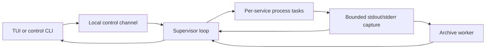

# Architecture and invariants

The [requirements](docs/requirements.md) define scope; the
[usage reference](docs/interaction.md) defines user-visible operations. This document
owns implementation mechanisms, resource budgets, and consequential tradeoffs.
The initial Linux/WSL2 MVP was accepted as 1.0.0. Logging shipped in 1.1.0; independent
self-update shipped in 1.2.0 and moved to release manifests in 1.2.1. Proposed dependency
orchestration, probes, and restart recovery remain separate from implemented behavior.

## Data flow and ownership



Keep one Cargo package. Loaded declarations remain stable except for the reviewed
[append-only project addition](#tui-project-addition). Changes to existing loaded
declarations/settings require reopening; external file edits are not automatically
reloaded. Projects
identify directories; services define argument arrays. The supported interactive
workspace has one service per project. The supervisor owns the Manager, service
states, stop senders, and task handles. Each process task exclusively owns its Child
and process-group identity until cleanup and reaping finish. Clients own presentation
and requests, not service resources; leaving a client does not drop process owners.

Independent long-running commands run concurrently rather than waiting for one
command to exit before starting another. There is no plugin engine, public SDK,
local HTTP API, or remote-control layer.

## Configuration identity

Resolve the selected path once at the CLI boundary using the
[discovery rules](docs/interaction.md#configuration). Explicit selection never falls
back; only missing default candidates are skipped. Loading errors do not trigger
a second search. Pass the selected canonical path explicitly to the supervisor.

Project paths resolve from the configuration directory. Service cwd defaults to the
project directory; an explicit relative cwd resolves from that project. Execute argv
without an implicit shell and inherit the supervisor's startup environment.
Configuration validation completes before any selected command starts. Preserve
existing dependency validation and planning, but reject dependencies unsupported by
the runtime rather than ignoring them. Reject unsupported multi-service TUI mappings
rather than silently choosing one service.

Canonical configuration identity determines the run lock and control endpoint.
Relative/absolute spellings and symlink aliases share ownership; hard-link aliases
are not merged. Connecting never replaces an existing supervisor's configuration
or environment with a new disk snapshot.

## Service state and concurrency

States are `Stopped`, `Starting`, `Running`, `Stopping`, and `Failed`. Running means
spawn was observed and completion has not been processed, not application readiness.
Each instance carries its own identity so late output or completion cannot mutate
a new instance. One service failure does not automatically stop or restart others.

Manager serializes control and completion events. A BTreeMap keyed by service ID
tracks ServiceTask values containing the stop sender and JoinHandle. Each task owns
a cloned service definition; Manager retains the original for explicit future starts.
Batch selection is preflighted before registration; registration does not await an
individual long-running task. Repeated Starting/Running requests do not duplicate
instances, and Stopping rejects starts.

A per-instance oneshot stop channel requests cleanup. Dropping its internal owner
also requests stop as a fail-safe; disconnecting a client must not drop that owner.
Signal handling belongs to the management entry point, not individual process tasks.
Borrow JoinHandles while waiting; cancellation must not lose ownership. Normal exit
requests stop and joins tasks rather than aborting service owners or dropping a runtime.

`request_stop_all` synchronously marks unfinished tasks Stopping and records the
pending IDs. It blocks new starts until all targeted completion results arrive;
a single stop restricts only that service. `stop_all` waits and aggregates errors
without skipping the remaining services. Cancelling the wait releases neither
registrations nor the stop-all constraint.

`wait_next` polls unfinished JoinHandles with the caller's Context/waker, consumes
each completion once, and applies the same release rules as an ID-specific wait.
Simultaneous completions are checked by ID, not promised exit-time order. `None`
means no unjoined tasks, not necessarily confirmed cleanup.

RunError distinguishes `SafeToRetry` from `CleanupUnconfirmed`. Validation/spawn
failure and observation errors after confirmed cleanup can release registration.
Cleanup errors and task JoinErrors do not prove safety. Preserve the typed result
until Manager decides ownership; never infer safety from error text. An unconfirmed
instance keeps its ID, Failed state, original error, and `cleanup_confirmed=false`.
Later stop/wait operations cannot overwrite it as stopped or safely retryable.
Confirmed failures may be explicitly restarted; automatic re-cleanup and crash
recovery are not implemented.

Foreground operation holds the same run lock, registers all selected services, and
reports each result without leaving other tasks behind. A normal requested stop
becomes Stopped; natural termination, including code 0, becomes Failed with its
reason. Spawn notification only promotes Starting to Running and never overrides
Stopping. Main control remains responsive while process tasks perform cleanup.

## Process cleanup and run locks

Each command starts in its own Unix process group. Its launcher and descendants
that remain in that group belong to this instance. Stop marks Stopping, sends TERM,
waits within the initial five-second stop budget, force-cleans remaining group
members, confirms no live member remains, explicitly waits the direct Child, drains
pipes within a separate bound, and reports completion.

Observe the leader with `waitid` and `WNOWAIT/WNOHANG` before reaping (nix on Linux,
libc on macOS, where nix does not expose that API). Retaining
its PID until the final group signal prevents PID reuse during cleanup. If the
leader exits during the grace period, force-clean remaining group members immediately
rather than granting another grace period. Natural exit, single/all stop, and supervisor
shutdown share this mechanism. Child drop or killing only the leader is insufficient.

Linux confirmation scans `/proc/<pid>/stat` state and pgrp on a blocking task. A
process disappearing during a scan is harmless; other read/parse errors are not
ignored. Cleanup means no live group members and the direct Child reaped; adopted
zombies are not live members. Post-KILL confirmation and reaping share an initial
one-second bound. macOS confirmation uses libproc's group enumeration and BSD
process information, excluding zombies and tolerating ESRCH races; an inspection
failure is an error. Grow the PID buffer on truncation, bounded at 65,536 members.
Darwin may return EPERM when signaling a group with only zombies; accept that only
after confirming the absence of live members. Retain the leader identity until confirmation; repeat KILL for
observed remaining members if necessary. Timeout cannot be reported as success.

Only a currently owned instance may be signaled. Do not read a stale PID from disk
and send signals. Processes deliberately escaping the group, SIGKILL, and power loss
are outside normal cleanup guarantees; unrelated terminal processes are never adopted.

RunLock owns an open File locked with nonblocking exclusive `File::try_lock`. Its
path is the canonical configuration path plus `.devctl.lock`. The file is neither
truncated nor automatically deleted, avoiding inode splits. Reject symlinks and
nonregular lock files. Exec'd services do not inherit its descriptor. Ownership is
the OS lock, not file contents; a released lock does not prove crash leftovers safe.
The configuration directory must be writable. Current guarantees are tested on local
Linux and macOS filesystems, not network filesystems. Foreground and background use the same
lock, held through normal cleanup.

## Logs and terminal

Each record identifies service, process instance, and stdout/stderr. Receive order
is not a cross-stream application ordering guarantee. Capture continuously even with
no client. Split long lines, replace invalid UTF-8, preserve valid split characters,
and escape control sequences before terminal rendering. Sanitized text remains bounded.

Initial budgets, still enforced:

| Resource | Limit |
| --- | --- |
| Record body | 16 KiB |
| Recent memory per service | 2 MiB and 4096 records |
| Capture queue | 256 entries; nonblocking drop-and-count on overload |
| Query page | 1–500 records and 64 KiB of bodies |
| TUI body window | 2 MiB and 4096 records for the selected service |
| Ordinary TUI request | At most 100 records within the page byte budget |
| Clipboard body snapshot | 64 KiB |

After process cleanup, pipe readers share a one-second drain bound. Reader failure,
lost tasks, or cancellation reports capture incompleteness independently of process
cleanup; only pure pipe-reader tasks may be cancelled this way. After completion,
Manager drains at most one capture-queue capacity before responding so trailing
output is processed without unbounded waiting.

Pages use exclusive `after`/`before` bounds and return ascending records. Continue
from actual returned sequence numbers, not the highest captured number. Responses
include retained boundaries, earlier availability, eviction/drop counts, and known
gaps/incompleteness. Service restarts retain recent output with distinct instance IDs.
Every supervisor has a random 128-bit workspace/session identity from `/dev/urandom`.
Cursors and instance numbers belong to that identity.

### TUI ownership and rendering

The entry point dispatches absent subcommands to the same TUI path as explicit `tui`.
Ratatui 0.30 and Crossterm 0.29 EventStream run on the existing Tokio current-thread
runtime; do not mix blocking event polling with the stream. See
[Ratatui](https://docs.rs/ratatui/latest/ratatui/) and
[Crossterm events](https://docs.rs/crossterm/0.29.0/crossterm/event/index.html).

`src/tui/mod.rs` coordinates input, timers, and request tasks. App exclusively owns
project snapshots, selection, focus, connection generations, feedback, and LogWindow.
The view borrows state; terminal.rs centralizes setup/restoration. App never owns
Manager, Child, or RunLock. Service IDs preserve selection across snapshots; disk
configuration does not replace an existing supervisor's list.

Initial Status uses `create=true` to create an idle supervisor, never Start. Every
later poll, reconnect, and control uses `create=false`. Disconnection clears live
state and disables control without recreating or replaying requests. Existing CLI
clients may create a new supervisor, or the user can leave and reenter the TUI.

Status, logs/search, and controls each have one in-flight slot tracked in JoinSet.
Cancelled requests occupy their slot until joined, preventing unbounded tasks.
Initial polling budgets are 500 ms for status, 200 ms for logs, and 33 ms between
redraws; missed ticks are skipped. These are engineering choices, not benchmarks.
Connection and selection generations reject stale results, including A→B→A switches.
Control completion invalidates earlier queries and requests new state; it does not
pretend its feedback is a fresh status snapshot. Connection, service failure, and
unknown operation completion retain separate diagnostics.

App owns monotonic presentation clocks for spinner frames and successful stop/copy
feedback. The existing draw tick advances spinners at most every 100 ms while busy
unless reduced motion is enabled, and invalidates the view once when feedback
expires. State changes never schedule a flash or reverse-video effect; idle
presentation does not request redraws. Feedback expiry hides only the matching
success text in the main view, retaining the full message in help. These clocks never
mutate service snapshots, request generations, or log anchors.

Appearance options are validated once before terminal entry and retained per client.
The view uses a bounded named-color vocabulary; a final buffer pass resolves foreground
and background roles to dark, light or terminal palettes for the whole frame including
overlays. It does not parse or alter log text. Monochrome rendering retains selection
and current-match emphasis with underline. It adds no timers, terminal queries or
runtime dependencies. The option contract is in [interaction.md](docs/interaction.md#layout-help-and-confirmation).

Focus does not change project selection, generations, or log cursor. Input precedence
keeps leaving, size constraints, confirmation, help, selection, search, and main
controls isolated. `gg` needs only one bounded pending prefix. Popups own their
scrolling and do not modify the underlying reading position. Layout computes shared
Rects for rendering and paging, using actual body height after fixed status lines.
Clip text by display columns and wrap popup text with grapheme/style preservation.
Dim the current Buffer and clear popup padding before drawing solid content; do
not mutate log records, queries, or selections to achieve the effect.

LogWindow separates fetch cursors from reading and selection anchors. Old pages
remove the tail; new pages remove the head. Pausing freezes the text window and
polls only boundaries/counts. Resuming reloads the tail. Bookmarks live only within
one App and supervisor identity; fresh clients follow the tail. Expired anchors
report eviction; expired selection endpoints cancel selection. Full user-visible
navigation, modal, and layout rules live in the [usage reference](docs/interaction.md).

Mouse handling uses the same log content rectangle as rendering and paging, excluding
panel chrome and the fixed notice row. A bounded snapshot of the last drawn rows,
prefix widths and horizontal offset maps clicks to what was displayed, even if new
output arrives before the next redraw; stale project/connection/size snapshots
cannot begin or extend a drag. Selection stores immutable record sequences
and original UTF-8 endpoint ranges, rather than screen coordinates. Hit testing
accounts for prefixes, timestamps, horizontal offset, sanitized control characters
and grapheme widths. `unicode-segmentation` is a direct dependency already present
through Ratatui; its raw grapheme iterator preserves controls that Ratatui's styled
iterator filters out. Rendering splits only at selection/search boundaries, then
sanitizes the spans. Search emphasis remains visible across selection boundaries.
Keyboard endpoint movement retains whole-line behavior; mouse snippets use exact
selected bytes. Wheel scrolling reuses bounded page requests without changing the
selection endpoints. A fresh drag advances the client generation, so an older
clipboard completion or log query cannot clear/replace the new selection. Resize,
modal input, endpoint eviction and project/connection changes end an active drag.
Mouse events never issue service controls. The operation contract lives in the
[selection reference](docs/interaction.md#line-selection-and-copying).

Clipboard work owns a bounded text snapshot and generations, not a mutable App
borrow. Only one request may run, with no queue. Local WSL detection uses environment
or kernel markers and excludes `SSH_CONNECTION`; invoke PATH's `clip.exe` directly
with BOM-free UTF-16LE. Write/wait share three seconds; kill and reap on failure or
timeout, with `kill_on_drop` on cancellation. Local macOS, also excluding SSH,
invokes PATH's `pbcopy` with UTF-8 and a child-only UTF-8 locale under the same bounds. Elsewhere, Crossterm's
OSC 52 feature writes to the display terminal. Do not read the clipboard. Success only clears the
same unchanged selection, and reports process completion or transmission rather
than independently verified clipboard contents.

Check TTYs before terminal changes. Establish a restoration guard before attempting
raw mode, alternate screen, cursor hiding, paste or mouse capture so partial setup
failures roll back.
Restore each terminal setting independently on normal/error exit, signals, and panic
best-effort handling. Ctrl-C in raw mode is an input event. Reap client request tasks
without implicitly stopping services. SIGKILL restoration is not guaranteed.

### Persistent history

Logging enhancements shipped in 1.1.0 for L01–L04. Scope and acceptance remain in
[requirements](docs/requirements.md#logging-enhancements-l01l04); user operations
are in [logs and search](docs/interaction.md#logs-and-search).

`logs::Store` belongs to the supervisor and assigns per-service sequences.
`archive::Archive` uses nonblocking `try_send` to a separate storage thread owning
append, rotation, retention, and queries. Manager does not await disk I/O on its
current-thread runtime. Disabled saving does not enqueue writes; memory reading
and searching remain available.

The worker holds an Arc of the same RunLock. Normal shutdown completes process
cleanup and pipe draining, then gives storage draining, sync, and metadata closure
an independent five seconds before replying. A save failure is returned without
restarting stopped services. A timeout cannot cancel a blocking filesystem syscall;
the worker retains ownership until completion or process exit.

Historical CLI queries never create a supervisor. Without an archive, do not create
a lock file. With an archive, acquire the same nonblocking run lock for direct
reading. If another writer holds it, use IPC or fail; never bypass it because its
socket is missing. Offline reading loads only log settings, not project directories.

Requests retain Logs for ordinary pages and add ReadLogs for session/text/fixed-bound
queries and LogSessions for listings. Old supervisors reject unsupported requests
rather than ignore fields. New Batch fields default for compatibility; ordinary
TUI logs retain the original request path. A new supervisor is required for the
full history/search feature set.

Merge overlapping memory/disk records by `(session, service, sequence)`. Retained
boundaries cover both, and persisted memory eviction is not capture loss. Keep only
a bounded candidate page; one frame is at most 128 KiB. File service keys and first
sequences skip unrelated segments; reverse frame lengths avoid whole-file rescans.
Search scans at most 1 MiB of effective range per query, with at most one additional
8 MiB segment for positioning or damaged-tail recovery. No per-record index is built.

### Storage identity, format, and budgets

Use absolute `$XDG_STATE_HOME/devctl/logs/<workspace-key>`, otherwise absolute
`$HOME/.local/state/devctl/logs/<workspace-key>`. If neither exists as an absolute
base, saving degrades. The workspace key is stable FNV-1a 64-bit over canonical path
bytes. `workspace.toml` records and checks the original path in hex; collisions
reject access. This is identity checking, not a security hash. Moving configuration
creates a new history identity without migrating old logs.

Each supervisor's random 128-bit identity is its session. Segment names contain
creation milliseconds, session, a hashed service key, and first sequence. Frames
keep the original service name to check same-session key collisions. Session TOML
records creation, services, checkpoints, normal closure, and known incompleteness.
A supervisor with no output creates no session data segment.

Version 1 `.dlog` frames are `[big-endian u32 length][UTF-8 TOML][same length]`.
They preserve format version, service, process instance, sequence, UTC Unix capture
milliseconds, stream, body, and truncation. Session identity is in filenames/metadata.
The existing TOML dependency replaces an earlier JSONL proposal, enabling reverse
paging without a database. Read/export through the CLI, not `tail`. Unknown versions,
invalid frames, or partial tails report incompleteness while retaining readable
prefixes without modifying files.

| Setting or resource | Default and bound |
| --- | --- |
| `[logs].enabled` | `true`; false keeps only recent memory |
| `[logs].max_mib` | 256; 8–4096 MiB shared by workspace services and sessions |
| `[logs].retain_days` | 7; 1–365 days |
| Segment | 8 MiB of actual serialized data; rotate before exceeding it |
| Data segments | At most 4096; related metadata is cleaned with them |
| Metadata read | At most 128 KiB per file |
| Session list | At most 100 retained sessions |
| Storage queue | 256 requests/records, separate from the capture queue |

Capacity and age independently evict the oldest complete segments; seven full days
are not guaranteed. Age is based on segment creation, so segment deletion can remove
some newer records. Cleanup runs at startup, segment creation, impending capacity
overflow, and each minute. Sync a closed segment before eviction. Offline queries
exclude expired segments but defer physical deletion to the next supervisor; there
is no cleanup daemon. Metadata has separate limits, so segment budget is not total
filesystem usage.

Writes are bounded per record, with file sync and checkpoint updates each second;
normal shutdown syncs files and directories. Queue acceptance, display, or one query
result does not mean durability. Crashes/power loss can lose unsynchronized tails;
the sync period is not a promise of at most one second lost. Queries confirm valid
file ends rather than trusting potentially stale checkpoints. Create directories
0700 and files 0600; reject final-path symlinks, nonregular files, and invalid segments.
Do not modify project configuration or application log files.

### Search, export, and storage failure

Search is case-sensitive literal `contains`, at most 256 UTF-8 bytes, within one
service/session. `query_matching` searches bounded memory; the worker scans retained
disk segments. The first request fixes `upper`; continuation returns `scanned_to`
and `search_complete`. Empty results may still require continuation. Memory hits
must not skip an unscanned disk range. A new query invalidates old generations even
if its cursor is identical. TUI search and context use the same single log slot and
can cancel between batches.

A match already in cache moves the cursor, preserving ordinary records. Otherwise
load unfiltered before/after context pages; ContextAfter can fetch further bounded
pages if byte limits leave the viewport short. Stop at limits, empty pages, or the
retained end. Expired matches report lost position. Highlight literal matches in
raw bodies before escaping display fragments, avoiding false matches from tab
expansion. Selection background takes precedence; copy uses original bodies.
Leaving search clears pending context; following may retain visible highlights,
while n/N use their existing fixed bound until a new query.

Export uses complete-line clipboard copy or one CLI page redirected to stdout.
Record identity and capture time remain in CLI text; session, save state, gaps,
completion, and continuation go to stderr. There is no separate export UI, database,
multi-format exporter, or implicit full-history export.

Distinguish capture-queue drops, memory eviction, storage-queue loss, and retention.
Storage overload counts unsaved records and reports degradation. I/O or cleanup
failure stops new disk writes for this supervisor while memory/control continue;
fix the cause and recreate the supervisor to resume saving. Read errors return
available memory plus explicit incompleteness, not a falsely complete empty page.
Damaged offline tails preserve complete prefixes; unclosed sessions stay marked
incomplete. History cannot adopt or recover service processes.

## Supervisor lifecycle and IPC

The supervisor is a local process for the current user, detached from the TUI's
controlling terminal. Services inherit no client terminal descriptors. The hidden
`supervise --detached` entry creates an idle Manager without applying autostart;
SIGINT/SIGTERM request cleanup. Start may create a supervisor; stop/status/shutdown
connect only to existing instances.

The socket path is the canonical configuration path plus `.devctl/control.sock`.
Its directory must belong to the effective user with mode 0700; reject mismatches
rather than silently chmod. This reuses configuration identity without a registry
or endpoint hash; writable directories and Unix path-length limits are the tradeoff.
ControlSocket borrows the corresponding RunLock. Bind once per owner, remove stale
sockets only after acquiring ownership, and reject regular files/directories/links
in the reserved socket location. Normal removal checks the bound device/inode;
crash leftovers can be handled only by a subsequent lock holder, not by signaling
old PIDs.

Identity probe: one connection, request `DEVCTL 1\n`, then the same header, a big-endian
u32 path length, and canonical raw Unix path bytes, at most 16 KiB. Reject malformed,
incomplete, or incompatible requests. Raw bytes avoid lossy non-UTF-8 identities.
Control transactions instead start with `CONTROL1\n`, receive the identity frame,
validate it, then exchange length-prefixed UTF-8 TOML. Request/response limits are
64 KiB/1 MiB; reject unknown request fields and incompatible identities. One transaction
per connection.

A JoinSet tracks at most 16 connections. Identity probe reads/writes share two
seconds; control input/output each have two seconds, operation waiting up to ten
seconds, and client transactions fifteen seconds. Accept backoff is 100 ms while
other events continue. Connections pass work through a capacity-32 channel and
oneshot response; they do not own Manager. Slow clients cannot hold the control loop.
A timeout reports unknown completion rather than replaying a possibly accepted operation.

Manager serializes start/stop/status/logs/shutdown and completion. Stop replies only
when selected targets finish. Shutdown blocks new starts and waits for cleanup;
client disconnect does not revoke accepted work. Explicit shutdown allows three
seconds to drain its response; signal shutdown cancels pure connection tasks first.
Unconfirmed cleanup preserves the supervisor, lock, endpoint, and original failure.
Affected instances cannot restart; other confirmed-safe services remain independently
controllable. Final ownership release requires confirmed safe exit.

The launcher executes the current binary rather than fork/daemonize inside Tokio.
On macOS, the hidden detached entry enumerates and closes inherited non-stdio
file descriptors before constructing Tokio. This prevents a long-lived supervisor
from keeping a caller's pipe open (including a descriptor leaked during concurrent
caller spawns), while preserving all descriptors subsequently owned by the runtime.
The child calls setsid; stdin/stderr use `/dev/null`, stdout is a private startup
pipe until initialization. It sends bounded READY, ERROR, or typed LOCKED feedback,
then redirects stdout. The launcher reads at most 4096 bytes within eight seconds
and verifies the real control handshake. A concurrent loser connects to the winner;
it does not start duplicate services. Cancellation/timeout must not kill a supervisor
already serving other clients. A shutdown client confirms bounded run-lock release
after the cleanup response. Attaching never applies autostart, configuration, or
new environment to an existing supervisor. Boot startup and crash/orphan recovery
are not attachment features and remain unimplemented.

## Self-update

The main entry dispatches Update before configuration discovery. The updater never
accesses Manager, workspace locks, sockets, or logs, and never stops services.
Offline rollback invokes the embedded `scripts/devctl-update`. The executing
binary's Cargo version is the comparison baseline; installation is always
`~/.local/bin/devctl`.

Since 1.2.1, fetch `https://github.com/Jackie733/devctl/releases/latest/download/update.json`,
or `releases/download/v<VERSION>/update.json` for an explicit stable version. These
[official release links](https://docs.github.com/en/repositories/releasing-projects-on-github/linking-to-releases)
avoid REST API discovery and its anonymous shared-IP quota. Ordinary download
service limits still apply. Do not read GitHub credentials, accept arbitrary source
URLs, scan all tags, or infer latest by sorting tags. Compare SemVer; default update
never downgrades, while explicit version selection may reinstall or downgrade.

### Update manifest contract

The per-version `update.json` attachment uses this schema:

| Field | Contract |
| --- | --- |
| `schema_version` | Integer 1; reject unknown schema versions |
| `version` | Plain stable MAJOR.MINOR.PATCH, without v, prerelease, or build metadata; exactly match explicit requests |
| `assets` | Platform array containing exactly one entry for the supported target |
| `assets[].target` | Native target: `x86_64-unknown-linux-musl` or `aarch64-apple-darwin` |
| `assets[].name` | Exactly `devctl-v<VERSION>-<TARGET>` for the selected target; never a path or URL |
| `assets[].size` | Actual byte length, greater than 0 and at most 128 MiB |
| `assets[].sha256` | 64 hexadecimal SHA-256 digits |

Each native packager generates a manifest from its tested binary. Publication
merges both distinct supported native targets after checking each checksum/size and
requiring identical source archives, installers and build-commit notes. All attachments upload
to a draft before publication as Latest. Tag, package, candidate, and manifest
versions must agree. After resolving latest once, construct a fixed version URL
for the program, avoiding mixed assets when Latest changes during download. Bound
streaming by the declared size and require exact final length, then verify digest
and candidate version through the installer. Check-only validates the manifest,
not the actual attachment contents or availability.

Keep SHA256SUMS and existing binary filenames for external/legacy installation;
include update.json in SHA256SUMS. The runtime uses the digest in JSON directly.
Manifest cap: 64 KiB; program cap: 128 MiB. Curl disables config files, permits only
HTTPS and HTTPS redirects, allows five redirects, uses ten-second connect and
180-second request bounds. Rust streams in 64 KiB chunks with a 190-second outer
deadline and kills/reaps a failed downloader. This bounds unknown Content-Length
without relying on older curl `--max-filesize` behavior. `--fail-with-body` requires
curl 7.76.0+; even error bodies are bounded, never treated as valid manifests, and
not echoed. Missing old manifests advise external installation; no API fallback,
automatic retry, or alternate source is introduced. Published 1.2.0 binaries keep
their old API behavior and need a newer binary to use the manifest protocol.

### Progress presentation

`update::progress::Progress` owns the transient stderr line, stage label, frame,
byte count, and elapsed time. It has no installation authority and owns no workspace
resources. The updater explicitly begins/completes stages around validated results;
its outer error path clears the line and marks the active stage failed before main
reports the cause. A guard clears unfinished output on normal future destruction.
No raw/alternate-screen/cursor-hidden modes are entered, so no persistent terminal
mode needs restoration. Existing signal behavior is unchanged.

A 100 ms Tokio interval, skipping missed ticks, is polled alongside download/installer
I/O. Readiness of network bytes is not required for spinner movement. Count only
successfully written program bytes against the validated size; compute mean speed
and approximate remaining time from monotonic elapsed time. Unknown totals use a
spinner, not a fabricated percentage. Layout rechecks terminal width per frame,
reserves the final column to avoid wrapping, and removes detail as width shrinks.

Animate only when stdout and stderr are terminals and TERM is not `dumb`; respect
NO_COLOR independently. All frame/stage writes are best-effort presentation and do
not change an installation result. Curl diagnostics and installer stdout/stderr are
piped and relayed in fixed-size chunks, clearing/pausing animation on first output.
There is no unbounded diagnostic buffer. A partial final stderr line is terminated
before the stage result. Installer output is drained for up to one second after the
child exits so inherited pipes cannot hold up completion; an omitted-output/read
problem is reported without replacing the actual exit status. Download deadlines,
limits, source selection, and the embedded installer's state machine remain intact.

Real PTY checks cover progress during delayed I/O, byte percentages, width limits,
NO_COLOR, TERM=dumb, output redirection, diagnostic isolation, checks/no-op updates,
and offline rollback. Actual process/installation outcomes remain the existing
integration tests' oracle; animation does not establish installation success.

### Installer protection and verification

Each request owns a 0700 temporary child of `~/.local/bin`; its guard cleans only
its own directory on normal/error return. SIGKILL/power loss may leave staging.
Downloads do not hold the install lock. The embedded Bash installer serializes
replacement with the external installer's `.devctl-update.lock` (Linux flock;
macOS Perl flock on an inherited descriptor), rejects symlink
targets, checks SHA-256 before executing a candidate, checks `--version` within five
seconds and for exact expected version, backs up the old program, then renames on
the same filesystem. Failure leaves installation/backup unchanged; identical bytes
preserve the backup. Hashes trust the same HTTPS release source, not an independent
signature authority. The Mac installer works with system Bash 3.2 and BSD tools,
uses shasum for SHA-256, Perl alarm/exec for the candidate deadline, and Perl rename
for atomic replacement without following destination symlinks or moving into a
raced-in destination directory. No Python or Homebrew is
needed by the installed updater.

Reuse this state machine rather than implement another in Rust. Existing serde_json
and semver are sufficient; no HTTP runtime or self-update framework is introduced.
Temporary-HOME tests and simulated downloads cover installation/failures/rollback.
Packaging tests make the real client consume the generated manifest and program.
The [release workflow](docs/releasing.md) additionally validates shipped native artifacts (static ELF on Linux, system-library-only
signed Mach-O on macOS) and anonymous public client after publication. Controlled tests and a
published version remain distinct from target WSL acceptance.

## Validation

Test configuration/path/error handling; process descendants, early leader exit,
ignored TERM, spawn/stop races, and cleanup; concurrent ownership, reconnect, slow
clients, and shutdown; bounded/high-output/invalid-encoding logs, history and search,
rotation/expiry/corruption/degradation; terminal layout/restoration and clipboard
encoding/failures; and actual packaged program updates with backup preservation.
Reuse meaningful coverage and record actual results in [tasks.md](docs/tasks.md).
Real-project acceptance remains separate. Do not prebuild dependency scheduling or
reboot recovery while those features remain proposals.

## Lightweight project onboarding (M7)

The user revised A01/A02 on 2026-10-17: keep the process/log manager small,
with language-independent command configuration and optional script discovery.
Environment diagnosis, runtime/package-manager version management, local bindings,
dependency inventory and installation are removed from the core. No language-specific
checks run during service startup. The previous environment design is superseded;
Git retains it. Scope belongs to [requirements](docs/requirements.md#directory-onboarding-and-environment-automation-a01a03),
and operations to [interaction](docs/interaction.md#adding-projects).

### Command configuration and discovery

`add` accepts a directory and explicit argv for any language, without reading project
manifests or looking for executable versions. Commands may invoke a project's own
entry point or an external environment tool. Existing direct argv execution, cwd,
inherited supervisor environment and one-service-per-project semantics apply.
There is no implicit shell. Missing executables and failed processes use ordinary
lifecycle errors and logs; devctl adds no repair, network requests or installation.
Explicitly configured commands can have their own network/setup behavior; devctl
does not inspect or promise to suppress that behavior.

`import` is an optional bounded npm/pnpm script convenience. Read package.json
names/scripts/workspaces/packageManager, pnpm-workspace.yaml member patterns and
lockfile evidence for the command name. Package-manager version text is displayed
as source evidence only, never resolved, compared, installed or persisted. Ignore
engines, devEngines, Volta settings and runtime version files. No executable probes,
repository commands, shell initialization or `.env` reads occur during onboarding.
The scanner is an aid, not a requirement for adding/running a project. Unsupported
managers/layouts use explicit `add` or ordinary configuration instead of a growing
language-adapter framework.

Discovery canonicalizes the supplied directory, stops ancestor inspection at the
nearest Git marker (up to 16 ancestors), and does not recursively scan parents.
Without Git, declarations remain contained in their own boundary. Do not traverse
symlink directories or dependency/build directories. Declaration links must resolve
to regular files within the source boundary; nonblocking no-follow opens reject
special files and substitution races. Ordinary pnpm YAML patterns are supported;
tags/anchors/aliases are rejected. Workspace globs support `*`, `?`, `**`, negative
patterns and subtree pruning; unsupported constructs report incomplete discovery.
Nested/conflicting workspace declarations and conflicting manager names require
explicit resolution or `add`; different declared versions of the same manager do
not conflict because devctl does not manage versions.

Budgets: depth 6, 10,000 entries, 200 manifests, 200 patterns, 4096 bytes/32 components
per pattern, 1 MiB per declaration, 16 MiB per lockfile, 64 MiB total reads, 5 seconds
checked between filesystem calls. A single filesystem call can exceed that deadline.
Incomplete scans cannot be applied. Hash bounded source bytes in memory so changes
during user review are detected without retaining private document contents.

Offer existing `dev`, `dev:*` and `start` scripts; suppress lifecycle/business/cleanup
names from suggestions. Other declared scripts require explicit selection. Multiple
projects/scripts require selection; libraries remain visible but disabled. Warn when
root scripts might also start members without interpreting script bodies as a graph.
Manager names come from explicit declarations/locks; missing evidence requires a
name selection. `--package-manager` selects npm or pnpm only, with no version.
Generated config contains project paths and selected command arrays. Workspace-root
information is display evidence and is not persisted as dependency ownership.

### Configuration transaction and supervisor boundary

Both `add` and `import` preview by default and share one save transaction. Existing
canonical directories reuse IDs; preserve comments, commands, cwd, autostart and
unrelated fields. Import can explicitly replace the selected command/cwd; add never
overwrites an existing canonical project or colliding requested name. New generated
IDs derive from path slugs with SHA-256 suffixes on collision. Removed manifests do
not delete entries. Identical plans preserve bytes/inode. Proposed full configs
are validated against the final destination before writing.

Use `toml_edit` 0.25 (MIT OR Apache-2.0) for comment-preserving edits; refuse changes
when unrelated formatting cannot round-trip. Existing/proposed configs are bounded
to 1 MiB, with UTF-8 paths and regular-file input. Reject hardlinked destinations.
Resolve configuration aliases and normalize missing destination components. Acquire
run then edit locks, recheck original bytes/metadata, alias and parent identity,
then revalidate sources and proposed resolved configuration. No lock is held while
waiting for user input. Source fingerprints are bounded in-memory SHA-256 values;
explicit add rechecks directory identity and configuration, without a scan.

Stage/fsync complete bytes in the destination directory. Preserve existing modes
on atomic rename; publish new files at mode 0600 using a no-clobber hard link, remove
the staging name, and sync the directory. Create private parents only on apply.
Keep stable sidecars. Concurrent creators/editors or changed evidence fail without
overwriting their work. External editors do not cooperate, so the final external
edit race cannot be eliminated by advisory locks.

CLI saves refuse while a foreground runner or supervisor (including idle background)
owns the workspace; preview remains available. The TUI uses the owner-mediated
append-only hot update below; existing services are never restarted for addition.
Both runner entry points validate without side effects, discard that snapshot, and
reread under run ownership before starting. This retains the import/start race fix.

### TUI project addition

`a` opens a path/choice/custom-command/review modal; `A` starts the default group.
Missing configuration opens a memory-only first-use view; normalize its destination
without creating files. Existing invalid/nonregular configs still fail. A save creates
normal v1 project/service entries using the same import `Draft` and transaction.
CLI output remains outside pure planning/publication; no stdout diagnostics corrupt
the TUI. Discover npm/pnpm scripts using existing bounded scanning, with canonical
source-byte fingerprints retained through confirmation. Other marker files label a
project type only; custom text is saved as explicit `/bin/sh -c` argv. Do not invent
framework commands, run probes or prepare environments.

Only one addition job exists per client. Scanning, planning and source recheck/write
run off the TUI loop. Modal input captures service shortcut letters, UTF-8
text capped at 4096 bytes and bracketed paste; restore bracketed-paste mode with other terminal state.
Esc cancels read-only work and discards its eventual result; a new job cannot start
until it joins. The dialog requires at least 50 columns/12 rows. Saving starts only after a visible
review; clipped windows cannot
confirm and overflowing reviews require scrolling to the end. Cancel/leave before
save never writes. After confirmation, publication remains atomic; leaving during
an in-flight save may leave its result unknown, so reopening rereads configuration.

Path Tab completion uses the same single background worker, reading only the typed
parent directory. Bound enumeration to 8192 entries, 256 matching directories and
250 ms between reads; never publish partial candidates after reaching a limit.
Skip files, non-UTF-8/control-character names and implicit hidden entries; follow
only directory symlinks for candidate classification. Preserve input spelling,
expand `~/` only for filesystem access, and share path parsing with inspection.
A unique match appends `/`; alternatives extend the Unicode-safe common prefix,
then cycle in sorted order with Tab/Shift-Tab. Typing clears cached alternatives;
stale results never replace edited input. Input and Esc remain active while reading;
Enter queues inspection of the eventual completed/current path. Completion performs
no shell execution or writes. Actual filesystem calls may be slow; they stay outside
the UI loop. Confirmation still validates the selected directory and saved evidence.

A confirmed TUI save sends internal `add_project` with the expected workspace
identity and compact reviewed intent: directory/argv, original file snapshot digest,
proposed resolved configuration digest/ID and optional discovery evidence digest.
Reject a stale workspace identity before dispatch. The supervisor accepts one save
worker at a time; disk reads, source rechecks and publication run off the manager
loop while starts/stops/logs remain responsive. Reject a simultaneous save with a
retry message; a later stale review fails its snapshot comparison.

The worker reconstructs the append-only draft, compares reviewed evidence and
checks the current disk declarations against the supervisor's loaded fingerprint.
External changes to existing declarations/settings require an explicit workspace
reopen; they must not be silently loaded during an addition. Comments-only changes
can be reviewed again and preserved. The worker retains the supervisor's run lock
and checks its target identity, then takes the same edit lock and uses the existing
snapshot/parent/atomic publication checks. CLI writers still cannot take the run
lock. First-use save without a supervisor uses the ordinary transaction, then opens
the new idle workspace.

After successful publication, register only new services, stopped statuses and log
sinks in the serialized manager loop; update its declaration fingerprint, then
acknowledge. Existing declarations/tasks/instances, service states, log sequences,
workspace identity and archive session remain intact. New log streams share the
bounded channel; the archive lazily registers them on first output. Other clients
see new entries on ordinary status polling. Preserve log reading bookmarks when
selecting the new project and invalidate stale client queries without disconnecting.
Shutdown waits for an accepted write to finish, even if the requesting client leaves.
Report unknown/partial save outcomes explicitly and reconcile by reopening; do not
replay starts. Older supervisors lacking this request close the connection before
dispatch; an addition EOF includes guidance to inspect configuration/status and
explicitly shut down/reopen with the current binary. EOF alone cannot distinguish
an unsupported request from a lost acknowledgement, so the save outcome remains
unknown. Current supervisors return a normal error response for invalid request
frames before dispatch, preserving existing response compatibility. This supports
reviewed additions only, not external-file watching or live replacement/removal of
existing declarations.
Existing CLI protocol operations remain unchanged.

### Removed environment compatibility and future extensions

The unreleased managed fields `node_environments`, `node_environment` and
`dependency_root` now fail with migration guidance. Never silently ignore them and
switch a previously bound command to a different executable. Users deliberately
choose their normal command/environment entry point, remove the fields, shut down
any old supervisor and reopen. Do not rewrite existing configurations or remove
private tool receipts automatically. Earlier released plain command configs keep
their behavior. Removed CLI commands/options fail as invalid usage.

Agent assessment is tracked separately in [AG01](docs/requirements.md#agent-assisted-troubleshooting-ag01)
and the proposed architecture below; no Agent runtime is currently implemented.
No performance improvement is claimed solely from removing code; verify runtime
behavior and measure performance separately when required.

## Agent-assisted troubleshooting (proposed)

This is an unimplemented design for [AG01](docs/requirements.md#agent-assisted-troubleshooting-ag01).
The confirmed product boundary is in-TUI analysis, follow-up and results. The
[interaction specification](docs/interaction.md#agent-assisted-troubleshooting-proposed)
owns presentation and keys; [research](docs/agent-research.md) owns alternatives and
sources. Manual packet export and public MCP are not prerequisites for this workflow.

### Responsibilities and data flow

```text
service stdout/stderr + process state
              |
existing supervisor / bounded log store
              | read-only, selected-service projection
TUI case ---- evidence broker ---- approved engine tools
   |             |                          |
   |        scope, identity, masking        |
   +---- asynchronous engine adapter -------+
   |             |
rendered events  local engine process --> configured model provider
```

Keep service ownership in the existing supervisor. It never owns model credentials,
conversations or an Agent process. The TUI owns one diagnosis case and a lazy engine
child; asynchronous I/O must not block keys, log polling or rendering. Diagnosis
state is independent of the existing pending service operation.

The evidence broker is a small in-package component, not a new daemon or generic
plugin framework. It reuses typed read paths, projects only approved fields, enforces
scope and limits, and returns structured evidence. Do not expose the internal TOML
control socket or give its client handle to the engine. Model-supplied arguments
cannot invoke Start/Stop/Shutdown/AddProject or broaden the approved scope.

A narrow read-only metadata request should return the selected service's actual
loaded command and working directory with its workspace identity. Do not reinterpret
changed disk configuration as the running declaration. Old supervisors without this
capability report unavailable metadata and retain usable diagnosis. Structured exit
code/signal is a separate missing field until recorded explicitly; do not parse an
error string into a guaranteed exit code. Do not create a generic supervisor RPC layer.

### Error hints and evidence anchors

Process failure comes from manager state. Application-error hints are advisory:
recognize a small tested set of explicit severity fields/line prefixes such as
`ERROR`, `FATAL`, `PANIC`, or an exception-style `Error:`. Do not use arbitrary
substring matching or stderr as the classification rule. The detector makes no
network requests. Detection is intentionally incomplete; manual selection covers
unrecognized frameworks and business problems.

Derive bounded per-service hints beside log ingestion, not by rescanning archives on
every TUI refresh. Retain the latest current-attempt anchor, a saturating match count
and a recent normalized fingerprint; coalesce identical adjacent hints within five
seconds. This is notification suppression, not root-cause grouping. Neutralize
terminal controls before showing excerpts. Reconnect displays the current summary
without replaying old notifications; client-local seen sequence controls unread state.
Restart resets current-attempt hints but does not rewrite an existing diagnosis.

A reference includes workspace identity, service ID, retained session ID, process
instance and log sequence. Time and stdout/stderr are display/provenance fields,
not unique identifiers. A spawn failure may have no log anchor. The case records an
explicit missing-log reason instead of manufacturing a record. Offline history has
no implied live state. Bound summary storage; no incident database or configurable
regular-expression rule engine is needed for this increment.

### Context and access boundary

The case captures a scope grant and a versioned evidence snapshot. All fields below
are reduced and previewable; service names, commands, paths and state errors need
masking as well as log bodies. Preserve missing/truncated/redacted markers. Ordinary
local log viewing remains unchanged. Treat logs, file contents and model output as
untrusted data, never as instructions to the host application.

| Data | Initial disclosure | Additional access |
| --- | --- | --- |
| Selected service | State, observed error, cleanup confirmation, actual loaded command/cwd when available | Same selected-service fields within the captured revision |
| Triggered logs | Selected lines, otherwise up to 30 records before and after the anchor; no anchor uses latest 100 records | Bounded search/page reads within the approved service, session, attempt and frozen upper sequence |
| Identity and gaps | Capture time, workspace/session/instance, snapshot revision, dropped/expired/truncated flags | Always accompany evidence; never hide gaps to make a complete-looking answer |
| Source files | Off by default | Optional selected-project read grant, summarized before Start; broker-enforced file/byte limits and exclusions |
| Other service, older attempt or new output | Excluded | Explicit in-TUI scope expansion showing exact target and reason; new evidence revision |
| Environment, secrets and host data | No raw environment, `.env`, credential stores, browser data or unrelated home-directory reads | No tool for these in the initial integration |
| Commands, edits, installs and service control | Unavailable | No expansion can grant these in the initial integration |

Initial log selection is capped at 500 records and 128 KiB of log text; the entire
initial payload is at most 256 KiB. Oversized selections require a visible reduction
and refreshed preview, never silent omission. Before/after means retained records
at capture time, not waiting for future output. Supplementary log reads can cover
retained records in the granted attempt up to the frozen upper bound; the preparation
sheet must disclose that range, not suggest only its displayed excerpt is accessible.

A source grant permits targeted reads, not uploading the whole tree. Resolve paths
and enforce containment under the approved root on each open; reject escaping
symlinks and special files. Exclude `.env*`, VCS internals, credential/key files,
dependency/build directories and binary files. Start with explicit manifest/lockfile
and text source reads; at most 64 KiB per file, subject to the turn budget below.
The full exclusion policy and fixtures must be finalized with the implementation;
file-name exclusions alone do not guarantee secrecy. Review reduced output before
release and indicate accessed file names in the activity list. No recursive scan
of the host, arbitrary URL fetch, shell command or engine-native filesystem access
can bypass the broker. Requests outside scope become structured access requests,
not tool errors inviting the model to find another route.

Use before/after identity reads around log/metadata capture. If workspace or instance
changes, retry once; then show capture changed and require refresh. This is a
validated bounded capture, not an atomic supervisor snapshot. Each subsequent result
carries its snapshot revision. Newly arriving logs do not silently alter a running
turn. User-approved refresh makes revision 2 and explicitly records changed attempts.

### Engine choice and enforceable isolation

Prefer evaluating one local Codex app-server adapter first because the confirmed
UX needs conversation turns, streamed events, questions and cancellation. This is
an engineering candidate, not a promise that Codex is required or that the installed
version is compatible. Use local stdio; pin/test a supported version range. Resolve
an explicitly configured executable, check availability/version, and never install,
upgrade or authenticate it automatically. On WSL both client and engine run inside
WSL; do not bridge Windows paths or assume a Windows installation is usable.

The adapter translates engine events into a small internal vocabulary: activity,
answer delta, evidence reference, user question, scope request, usage and terminal
outcome. The case maps its own ID/revision to engine thread/turn IDs. Late events
from an old turn/child epoch are ignored. Do not render protocol JSON or private
reasoning. Structured final output is preferred, but an incomplete/text-only answer
can be retained with validated references and an explicit incomplete-result label.

Critical feasibility gate: dynamic tools add capabilities; they do not remove an
engine's built-in shell, filesystem, MCP or web tools. A read-only filesystem sandbox
alone is also insufficient: it can still expose unrelated files or service sockets.
Before selecting this adapter, demonstrate that only broker-approved evidence can
be read or transmitted, built-in execution/network tools are unavailable, inherited
plugins/MCP and repository instructions cannot expand access, and no child can reach
the supervisor's mutation interface. Use isolated configuration and minimal child
environment, avoid project cwd as implicit authority, and pass model transport
credentials only through the supported authentication mechanism. Never expose
app-server shell/process escape APIs. Reject unsafe server-initiated tool requests.

The official app-server custom-tool interface is experimental in the inspected
version. Validate configuration and OS enforcement on both targets with hostile
fixtures; schema support is not proof of isolation. If these guarantees cannot be
met, evaluate a direct model API with only host-executed read tools, preserving the
same TUI workflow. That alternative adds authentication and turn-loop maintenance;
record the decision before implementation. Do not ship broader hidden access or
replace the agreed workflow with copy/paste to work around a failed feasibility gate.

### Case state and cancellation

```text
Draft -> Prepared -> Starting -> Analyzing -> Complete
                         |          |
                         |          +-> Waiting for input/access -> Analyzing
                         |          +-> Cancelling -> Cancelled
                         +---------------------------------------> Failed
Complete/Cancelled/Failed -> user follow-up or refresh -> Prepared/Analyzing
```

Unconfigured is a preparation condition. Evidence-stale is an independent flag,
not a reason to erase an answer. Scope expansion waits before any new read; denial
returns a structured denial and allows an appropriately uncertain answer. Access
requests expire after five minutes with denial, never approval. Model questions can
remain visible without keeping an active generation operation alive.

Allow one running turn per client. Drafted follow-ups are not sent or queued while
it runs. Service selection does not mutate the case's bound identities. Retry is a
user action; reconnecting a supervisor never retries a model request. Initial local
case history lives only in client memory. Use the engine's verified ephemeral mode
where supported; do not imply that this controls the provider's retention policy.
No history browser or persistent conversation database is added initially.

Cancel requests engine turn interruption. After two seconds without acknowledgement,
terminate only the client-owned engine process group and revoke its grants. Client
exit performs the same bounded cleanup. Never use the managed-service shutdown path
or a PID discovered in logs. Preserve partial results while the client remains open.
Engine EOF, protocol errors, unavailable auth and timeout terminate the turn with a
specific visible error. Normal log collection and service operations continue.

### Resource limits and failure containment

Initial defaults are design budgets, to be checked under real terminal load:

- Per turn: at most 10 successful broker reads and 1 MiB cumulative reduced tool data;
  source reads share this allowance. Invalid requests also count against a separate
  20-request ceiling to prevent an unbounded denial loop.
- Active engine work: 90 seconds before a visible timeout; time waiting for explicit
  user input/access does not count. Show a deliberate retry, not an automatic loop.
- Local transcript: at most 1 MiB, with bounded parsing and event frames. On overflow,
  cancel and retain a visibly truncated partial result. No unbounded channel backlog.
- Coalesce render updates to at most 10 per second without dropping terminal events;
  do not block process-log capture on a slow model or renderer.

Report unsupported engine usage/cost as unavailable. Do not invent a monetary budget
without a known provider contract. Enforce terminal-control escaping, bounded link
validation and output limits before rendering. These limits do not cap independent
service log storage or normal user operations.

### Avoiding redundant architecture

Reuse existing log search, history, identity, rendering primitives and service read
paths. Keep new responsibilities to advisory hints, a case model, an evidence broker
and one verified engine adapter. No public Agent server, permanent listener, generic
provider registry, workflow framework, vector store, multi-agent scheduler or repair
executor is required. Do not duplicate service state inside the Agent or maintain a
second log archive. Engineering work packages are internal to one complete user
workflow, as specified in the [roadmap](docs/roadmap.md#ag01-proposed-delivery-gates).
