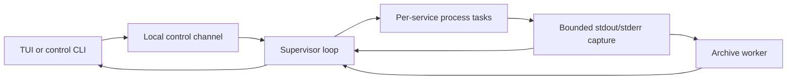

# Architecture and invariants

The [requirements](docs/requirements.md) define scope; the
[usage reference](docs/interaction.md) defines user-visible operations. This document
owns implementation mechanisms, resource budgets, and consequential tradeoffs.
The initial Linux/WSL2 MVP was accepted as 1.0.0. Logging shipped in 1.1.0; independent
self-update shipped in 1.2.0 and moved to release manifests in 1.2.1. Proposed dependency
orchestration, probes, and restart recovery remain separate from implemented behavior.

## Data flow and ownership

Keep one Cargo package. Configuration becomes read-only after loading. Projects
identify directories; services define argument arrays. The supported interactive
workspace has one service per project. The supervisor owns the Manager, service
states, stop senders, and task handles. Each process task exclusively owns its Child
and process-group identity until cleanup and reaping finish. Clients own presentation
and requests, not service resources; leaving a client does not drop process owners.

Independent long-running commands run concurrently rather than waiting for one
command to exit before starting another. There is no plugin engine, public SDK,
local HTTP API, or remote-control layer.

## Configuration identity

Resolve the selected path once at the CLI boundary using the
[discovery rules](docs/interaction.md#configuration). Explicit selection never falls
back; only missing default candidates are skipped. Loading errors do not trigger
a second search. Pass the selected canonical path explicitly to the supervisor.

Project paths resolve from the configuration directory. Service cwd defaults to the
project directory; an explicit relative cwd resolves from that project. Execute argv
without an implicit shell and inherit the supervisor's startup environment.
Configuration validation completes before any selected command starts. Preserve
existing dependency validation and planning, but reject dependencies unsupported by
the runtime rather than ignoring them. Reject unsupported multi-service TUI mappings
rather than silently choosing one service.

Canonical configuration identity determines the run lock and control endpoint.
Relative/absolute spellings and symlink aliases share ownership; hard-link aliases
are not merged. Connecting never replaces an existing supervisor's configuration
or environment with a new disk snapshot.

## Service state and concurrency

States are `Stopped`, `Starting`, `Running`, `Stopping`, and `Failed`. Running means
spawn was observed and completion has not been processed, not application readiness.
Each instance carries its own identity so late output or completion cannot mutate
a new instance. One service failure does not automatically stop or restart others.

Manager serializes control and completion events. A BTreeMap keyed by service ID
tracks ServiceTask values containing the stop sender and JoinHandle. Each task owns
a cloned service definition; Manager retains the original for explicit future starts.
Batch selection is preflighted before registration; registration does not await an
individual long-running task. Repeated Starting/Running requests do not duplicate
instances, and Stopping rejects starts.

A per-instance oneshot stop channel requests cleanup. Dropping its internal owner
also requests stop as a fail-safe; disconnecting a client must not drop that owner.
Signal handling belongs to the management entry point, not individual process tasks.
Borrow JoinHandles while waiting; cancellation must not lose ownership. Normal exit
requests stop and joins tasks rather than aborting service owners or dropping a runtime.

`request_stop_all` synchronously marks unfinished tasks Stopping and records the
pending IDs. It blocks new starts until all targeted completion results arrive;
a single stop restricts only that service. `stop_all` waits and aggregates errors
without skipping the remaining services. Cancelling the wait releases neither
registrations nor the stop-all constraint.

`wait_next` polls unfinished JoinHandles with the caller's Context/waker, consumes
each completion once, and applies the same release rules as an ID-specific wait.
Simultaneous completions are checked by ID, not promised exit-time order. `None`
means no unjoined tasks, not necessarily confirmed cleanup.

RunError distinguishes `SafeToRetry` from `CleanupUnconfirmed`. Validation/spawn
failure and observation errors after confirmed cleanup can release registration.
Cleanup errors and task JoinErrors do not prove safety. Preserve the typed result
until Manager decides ownership; never infer safety from error text. An unconfirmed
instance keeps its ID, Failed state, original error, and `cleanup_confirmed=false`.
Later stop/wait operations cannot overwrite it as stopped or safely retryable.
Confirmed failures may be explicitly restarted; automatic re-cleanup and crash
recovery are not implemented.

Foreground operation holds the same run lock, registers all selected services, and
reports each result without leaving other tasks behind. A normal requested stop
becomes Stopped; natural termination, including code 0, becomes Failed with its
reason. Spawn notification only promotes Starting to Running and never overrides
Stopping. Main control remains responsive while process tasks perform cleanup.

## Process cleanup and run locks

Each command starts in its own Unix process group. Its launcher and descendants
that remain in that group belong to this instance. Stop marks Stopping, sends TERM,
waits within the initial five-second stop budget, force-cleans remaining group
members, confirms no live member remains, explicitly waits the direct Child, drains
pipes within a separate bound, and reports completion.

Observe the leader with Linux `waitid` and `WNOWAIT/WNOHANG` before reaping. Retaining
its PID until the final group signal prevents PID reuse during cleanup. If the
leader exits during the grace period, force-clean remaining group members immediately
rather than granting another grace period. Natural exit, single/all stop, and supervisor
shutdown share this mechanism. Child drop or killing only the leader is insufficient.

Linux confirmation scans `/proc/<pid>/stat` state and pgrp on a blocking task. A
process disappearing during a scan is harmless; other read/parse errors are not
ignored. Cleanup means no live group members and the direct Child reaped; adopted
zombies are not live members. Post-KILL confirmation and reaping share an initial
one-second bound. Retain the leader identity until confirmation; repeat KILL for
observed remaining members if necessary. Timeout cannot be reported as success.

Only a currently owned instance may be signaled. Do not read a stale PID from disk
and send signals. Processes deliberately escaping the group, SIGKILL, and power loss
are outside normal cleanup guarantees; unrelated terminal processes are never adopted.

RunLock owns an open File locked with nonblocking exclusive `File::try_lock`. Its
path is the canonical configuration path plus `.devctl.lock`. The file is neither
truncated nor automatically deleted, avoiding inode splits. Reject symlinks and
nonregular lock files. Exec'd services do not inherit its descriptor. Ownership is
the OS lock, not file contents; a released lock does not prove crash leftovers safe.
The configuration directory must be writable. Current guarantees are tested on local
Linux filesystems, not network filesystems. Foreground and background use the same
lock, held through normal cleanup.

## Logs and terminal

Each record identifies service, process instance, and stdout/stderr. Receive order
is not a cross-stream application ordering guarantee. Capture continuously even with
no client. Split long lines, replace invalid UTF-8, preserve valid split characters,
and escape control sequences before terminal rendering. Sanitized text remains bounded.

Initial budgets, still enforced:

| Resource | Limit |
| --- | --- |
| Record body | 16 KiB |
| Recent memory per service | 2 MiB and 4096 records |
| Capture queue | 256 entries; nonblocking drop-and-count on overload |
| Query page | 1–500 records and 64 KiB of bodies |
| TUI body window | 2 MiB and 4096 records for the selected service |
| Ordinary TUI request | At most 100 records within the page byte budget |
| Clipboard body snapshot | 64 KiB |

After process cleanup, pipe readers share a one-second drain bound. Reader failure,
lost tasks, or cancellation reports capture incompleteness independently of process
cleanup; only pure pipe-reader tasks may be cancelled this way. After completion,
Manager drains at most one capture-queue capacity before responding so trailing
output is processed without unbounded waiting.

Pages use exclusive `after`/`before` bounds and return ascending records. Continue
from actual returned sequence numbers, not the highest captured number. Responses
include retained boundaries, earlier availability, eviction/drop counts, and known
gaps/incompleteness. Service restarts retain recent output with distinct instance IDs.
Every supervisor has a random 128-bit workspace/session identity from `/dev/urandom`.
Cursors and instance numbers belong to that identity.

### TUI ownership and rendering

The entry point dispatches absent subcommands to the same TUI path as explicit `tui`.
Ratatui 0.30 and Crossterm 0.29 EventStream run on the existing Tokio current-thread
runtime; do not mix blocking event polling with the stream. See
[Ratatui](https://docs.rs/ratatui/latest/ratatui/) and
[Crossterm events](https://docs.rs/crossterm/0.29.0/crossterm/event/index.html).

`src/tui/mod.rs` coordinates input, timers, and request tasks. App exclusively owns
project snapshots, selection, focus, connection generations, feedback, and LogWindow.
The view borrows state; terminal.rs centralizes setup/restoration. App never owns
Manager, Child, or RunLock. Service IDs preserve selection across snapshots; disk
configuration does not replace an existing supervisor's list.

Initial Status uses `create=true` to create an idle supervisor, never Start. Every
later poll, reconnect, and control uses `create=false`. Disconnection clears live
state and disables control without recreating or replaying requests. Existing CLI
clients may create a new supervisor, or the user can leave and reenter the TUI.

Status, logs/search, and controls each have one in-flight slot tracked in JoinSet.
Cancelled requests occupy their slot until joined, preventing unbounded tasks.
Initial polling budgets are 500 ms for status, 200 ms for logs, and 33 ms between
redraws; missed ticks are skipped. These are engineering choices, not benchmarks.
Connection and selection generations reject stale results, including A→B→A switches.
Control completion invalidates earlier queries and requests new state; it does not
pretend its feedback is a fresh status snapshot. Connection, service failure, and
unknown operation completion retain separate diagnostics.

Focus does not change project selection, generations, or log cursor. Input precedence
keeps leaving, size constraints, confirmation, help, selection, search, and main
controls isolated. `gg` needs only one bounded pending prefix. Popups own their
scrolling and do not modify the underlying reading position. Layout computes shared
Rects for rendering and paging, using actual body height after fixed status lines.
Clip text by display columns and wrap popup text with grapheme/style preservation.
Dim the current Buffer and clear popup padding before drawing solid content; do
not mutate log records, queries, or selections to achieve the effect.

LogWindow separates fetch cursors from reading and selection anchors. Old pages
remove the tail; new pages remove the head. Pausing freezes the text window and
polls only boundaries/counts. Resuming reloads the tail. Bookmarks live only within
one App and supervisor identity; fresh clients follow the tail. Expired anchors
report eviction; expired selection endpoints cancel selection. Full user-visible
navigation, modal, and layout rules live in the [usage reference](docs/interaction.md).

Clipboard work owns a bounded text snapshot and generations, not a mutable App
borrow. Only one request may run, with no queue. Local WSL detection uses environment
or kernel markers and excludes `SSH_CONNECTION`; invoke PATH's `clip.exe` directly
with BOM-free UTF-16LE. Write/wait share three seconds; kill and reap on failure or
timeout, with `kill_on_drop` on cancellation. Elsewhere, Crossterm's OSC 52 feature
writes to the display terminal. Do not read the clipboard. Success only clears the
same unchanged selection, and reports process completion or transmission rather
than independently verified clipboard contents.

Check TTYs before terminal changes. Establish a restoration guard before attempting
raw mode, alternate screen, or cursor hiding so partial setup failures roll back.
Restore each terminal setting independently on normal/error exit, signals, and panic
best-effort handling. Ctrl-C in raw mode is an input event. Reap client request tasks
without implicitly stopping services. SIGKILL restoration is not guaranteed.

### Persistent history

Logging enhancements shipped in 1.1.0 for L01–L04. Scope and acceptance remain in
[requirements](docs/requirements.md#logging-enhancements-l01l04); user operations
are in [logs and search](docs/interaction.md#logs-and-search).

`logs::Store` belongs to the supervisor and assigns per-service sequences.
`archive::Archive` uses nonblocking `try_send` to a separate storage thread owning
append, rotation, retention, and queries. Manager does not await disk I/O on its
current-thread runtime. Disabled saving does not enqueue writes; memory reading
and searching remain available.

The worker holds an Arc of the same RunLock. Normal shutdown completes process
cleanup and pipe draining, then gives storage draining, sync, and metadata closure
an independent five seconds before replying. A save failure is returned without
restarting stopped services. A timeout cannot cancel a blocking filesystem syscall;
the worker retains ownership until completion or process exit.

Historical CLI queries never create a supervisor. Without an archive, do not create
a lock file. With an archive, acquire the same nonblocking run lock for direct
reading. If another writer holds it, use IPC or fail; never bypass it because its
socket is missing. Offline reading loads only log settings, not project directories.

Requests retain Logs for ordinary pages and add ReadLogs for session/text/fixed-bound
queries and LogSessions for listings. Old supervisors reject unsupported requests
rather than ignore fields. New Batch fields default for compatibility; ordinary
TUI logs retain the original request path. A new supervisor is required for the
full history/search feature set.

Merge overlapping memory/disk records by `(session, service, sequence)`. Retained
boundaries cover both, and persisted memory eviction is not capture loss. Keep only
a bounded candidate page; one frame is at most 128 KiB. File service keys and first
sequences skip unrelated segments; reverse frame lengths avoid whole-file rescans.
Search scans at most 1 MiB of effective range per query, with at most one additional
8 MiB segment for positioning or damaged-tail recovery. No per-record index is built.

### Storage identity, format, and budgets

Use absolute `$XDG_STATE_HOME/devctl/logs/<workspace-key>`, otherwise absolute
`$HOME/.local/state/devctl/logs/<workspace-key>`. If neither exists as an absolute
base, saving degrades. The workspace key is stable FNV-1a 64-bit over canonical path
bytes. `workspace.toml` records and checks the original path in hex; collisions
reject access. This is identity checking, not a security hash. Moving configuration
creates a new history identity without migrating old logs.

Each supervisor's random 128-bit identity is its session. Segment names contain
creation milliseconds, session, a hashed service key, and first sequence. Frames
keep the original service name to check same-session key collisions. Session TOML
records creation, services, checkpoints, normal closure, and known incompleteness.
A supervisor with no output creates no session data segment.

Version 1 `.dlog` frames are `[big-endian u32 length][UTF-8 TOML][same length]`.
They preserve format version, service, process instance, sequence, UTC Unix capture
milliseconds, stream, body, and truncation. Session identity is in filenames/metadata.
The existing TOML dependency replaces an earlier JSONL proposal, enabling reverse
paging without a database. Read/export through the CLI, not `tail`. Unknown versions,
invalid frames, or partial tails report incompleteness while retaining readable
prefixes without modifying files.

| Setting or resource | Default and bound |
| --- | --- |
| `[logs].enabled` | `true`; false keeps only recent memory |
| `[logs].max_mib` | 256; 8–4096 MiB shared by workspace services and sessions |
| `[logs].retain_days` | 7; 1–365 days |
| Segment | 8 MiB of actual serialized data; rotate before exceeding it |
| Data segments | At most 4096; related metadata is cleaned with them |
| Metadata read | At most 128 KiB per file |
| Session list | At most 100 retained sessions |
| Storage queue | 256 requests/records, separate from the capture queue |

Capacity and age independently evict the oldest complete segments; seven full days
are not guaranteed. Age is based on segment creation, so segment deletion can remove
some newer records. Cleanup runs at startup, segment creation, impending capacity
overflow, and each minute. Sync a closed segment before eviction. Offline queries
exclude expired segments but defer physical deletion to the next supervisor; there
is no cleanup daemon. Metadata has separate limits, so segment budget is not total
filesystem usage.

Writes are bounded per record, with file sync and checkpoint updates each second;
normal shutdown syncs files and directories. Queue acceptance, display, or one query
result does not mean durability. Crashes/power loss can lose unsynchronized tails;
the sync period is not a promise of at most one second lost. Queries confirm valid
file ends rather than trusting potentially stale checkpoints. Create directories
0700 and files 0600; reject final-path symlinks, nonregular files, and invalid segments.
Do not modify project configuration or application log files.

### Search, export, and storage failure

Search is case-sensitive literal `contains`, at most 256 UTF-8 bytes, within one
service/session. `query_matching` searches bounded memory; the worker scans retained
disk segments. The first request fixes `upper`; continuation returns `scanned_to`
and `search_complete`. Empty results may still require continuation. Memory hits
must not skip an unscanned disk range. A new query invalidates old generations even
if its cursor is identical. TUI search and context use the same single log slot and
can cancel between batches.

A match already in cache moves the cursor, preserving ordinary records. Otherwise
load unfiltered before/after context pages; ContextAfter can fetch further bounded
pages if byte limits leave the viewport short. Stop at limits, empty pages, or the
retained end. Expired matches report lost position. Highlight literal matches in
raw bodies before escaping display fragments, avoiding false matches from tab
expansion. Selection background takes precedence; copy uses original bodies.
Leaving search clears pending context; following may retain visible highlights,
while n/N use their existing fixed bound until a new query.

Export uses complete-line clipboard copy or one CLI page redirected to stdout.
Record identity and capture time remain in CLI text; session, save state, gaps,
completion, and continuation go to stderr. There is no separate export UI, database,
multi-format exporter, or implicit full-history export.

Distinguish capture-queue drops, memory eviction, storage-queue loss, and retention.
Storage overload counts unsaved records and reports degradation. I/O or cleanup
failure stops new disk writes for this supervisor while memory/control continue;
fix the cause and recreate the supervisor to resume saving. Read errors return
available memory plus explicit incompleteness, not a falsely complete empty page.
Damaged offline tails preserve complete prefixes; unclosed sessions stay marked
incomplete. History cannot adopt or recover service processes.

## Supervisor lifecycle and IPC

The supervisor is a local process for the current user, detached from the TUI's
controlling terminal. Services inherit no client terminal descriptors. The hidden
`supervise --detached` entry creates an idle Manager without applying autostart;
SIGINT/SIGTERM request cleanup. Start may create a supervisor; stop/status/shutdown
connect only to existing instances.

The socket path is the canonical configuration path plus `.devctl/control.sock`.
Its directory must belong to the effective user with mode 0700; reject mismatches
rather than silently chmod. This reuses configuration identity without a registry
or endpoint hash; writable directories and Unix path-length limits are the tradeoff.
ControlSocket borrows the corresponding RunLock. Bind once per owner, remove stale
sockets only after acquiring ownership, and reject regular files/directories/links
in the reserved socket location. Normal removal checks the bound device/inode;
crash leftovers can be handled only by a subsequent lock holder, not by signaling
old PIDs.

Identity probe: one connection, request `DEVCTL 1\n`, then the same header, a big-endian
u32 path length, and canonical raw Unix path bytes, at most 16 KiB. Reject malformed,
incomplete, or incompatible requests. Raw bytes avoid lossy non-UTF-8 identities.
Control transactions instead start with `CONTROL1\n`, receive the identity frame,
validate it, then exchange length-prefixed UTF-8 TOML. Request/response limits are
64 KiB/1 MiB; reject unknown request fields and incompatible identities. One transaction
per connection.

A JoinSet tracks at most 16 connections. Identity probe reads/writes share two
seconds; control input/output each have two seconds, operation waiting up to ten
seconds, and client transactions fifteen seconds. Accept backoff is 100 ms while
other events continue. Connections pass work through a capacity-32 channel and
oneshot response; they do not own Manager. Slow clients cannot hold the control loop.
A timeout reports unknown completion rather than replaying a possibly accepted operation.

Manager serializes start/stop/status/logs/shutdown and completion. Stop replies only
when selected targets finish. Shutdown blocks new starts and waits for cleanup;
client disconnect does not revoke accepted work. Explicit shutdown allows three
seconds to drain its response; signal shutdown cancels pure connection tasks first.
Unconfirmed cleanup preserves the supervisor, lock, endpoint, and original failure.
Affected instances cannot restart; other confirmed-safe services remain independently
controllable. Final ownership release requires confirmed safe exit.

The launcher executes the current binary rather than fork/daemonize inside Tokio.
The child calls setsid; stdin/stderr use `/dev/null`, stdout is a private startup
pipe until initialization. It sends bounded READY, ERROR, or typed LOCKED feedback,
then redirects stdout. The launcher reads at most 4096 bytes within eight seconds
and verifies the real control handshake. A concurrent loser connects to the winner;
it does not start duplicate services. Cancellation/timeout must not kill a supervisor
already serving other clients. A shutdown client confirms bounded run-lock release
after the cleanup response. Attaching never applies autostart, configuration, or
new environment to an existing supervisor. Boot startup and crash/orphan recovery
are not attachment features and remain unimplemented.

## Self-update

The main entry dispatches Update before configuration discovery. The updater never
accesses Manager, workspace locks, sockets, or logs, and never stops services.
Offline rollback invokes the embedded `scripts/devctl-update`. The executing
binary's Cargo version is the comparison baseline; installation is always
`~/.local/bin/devctl`.

Since 1.2.1, fetch `https://github.com/Jackie733/devctl/releases/latest/download/update.json`,
or `releases/download/v<VERSION>/update.json` for an explicit stable version. These
[official release links](https://docs.github.com/en/repositories/releasing-projects-on-github/linking-to-releases)
avoid REST API discovery and its anonymous shared-IP quota. Ordinary download
service limits still apply. Do not read GitHub credentials, accept arbitrary source
URLs, scan all tags, or infer latest by sorting tags. Compare SemVer; default update
never downgrades, while explicit version selection may reinstall or downgrade.

### Update manifest contract

The per-version `update.json` attachment uses this schema:

| Field | Contract |
| --- | --- |
| `schema_version` | Integer 1; reject unknown schema versions |
| `version` | Plain stable MAJOR.MINOR.PATCH, without v, prerelease, or build metadata; exactly match explicit requests |
| `assets` | Platform array containing exactly one entry for the supported target |
| `assets[].target` | Currently `x86_64-unknown-linux-musl` |
| `assets[].name` | Exactly `devctl-v<VERSION>-x86_64-unknown-linux-musl`; never a path or URL |
| `assets[].size` | Actual byte length, greater than 0 and at most 128 MiB |
| `assets[].sha256` | 64 hexadecimal SHA-256 digits |

The packager generates the manifest from the tested binary. All attachments upload
to a draft before publication as Latest. Tag, package, candidate, and manifest
versions must agree. After resolving latest once, construct a fixed version URL
for the program, avoiding mixed assets when Latest changes during download. Bound
streaming by the declared size and require exact final length, then verify digest
and candidate version through the installer. Check-only validates the manifest,
not the actual attachment contents or availability.

Keep SHA256SUMS and existing binary filenames for external/legacy installation;
include update.json in SHA256SUMS. The runtime uses the digest in JSON directly.
Manifest cap: 64 KiB; program cap: 128 MiB. Curl disables config files, permits only
HTTPS and HTTPS redirects, allows five redirects, uses ten-second connect and
180-second request bounds. Rust streams in 64 KiB chunks with a 190-second outer
deadline and kills/reaps a failed downloader. This bounds unknown Content-Length
without relying on older curl `--max-filesize` behavior. `--fail-with-body` requires
curl 7.76.0+; even error bodies are bounded, never treated as valid manifests, and
not echoed. Missing old manifests advise external installation; no API fallback,
automatic retry, or alternate source is introduced. Published 1.2.0 binaries keep
their old API behavior and need a newer binary to use the manifest protocol.

### Installer protection and verification

Each request owns a 0700 temporary child of `~/.local/bin`; its guard cleans only
its own directory on normal/error return. SIGKILL/power loss may leave staging.
Downloads do not hold the install lock. The embedded Bash installer serializes
replacement with the external installer's `.devctl-update.lock`, rejects symlink
targets, checks SHA-256 before executing a candidate, checks `--version` within five
seconds and for exact expected version, backs up the old program, then renames on
the same filesystem. Failure leaves installation/backup unchanged; identical bytes
preserve the backup. Hashes trust the same HTTPS release source, not an independent
signature authority.

Reuse this state machine rather than implement another in Rust. Existing serde_json
and semver are sufficient; no HTTP runtime or self-update framework is introduced.
Temporary-HOME tests and simulated downloads cover installation/failures/rollback.
Packaging tests make the real client consume the generated manifest and program.
The [release workflow](docs/releasing.md) additionally validates the shipped static
artifact and anonymous public client after publication. Controlled tests and a
published version remain distinct from target WSL acceptance.

## Validation

Test configuration/path/error handling; process descendants, early leader exit,
ignored TERM, spawn/stop races, and cleanup; concurrent ownership, reconnect, slow
clients, and shutdown; bounded/high-output/invalid-encoding logs, history and search,
rotation/expiry/corruption/degradation; terminal layout/restoration and clipboard
encoding/failures; and actual packaged program updates with backup preservation.
Reuse meaningful coverage and record actual results in [tasks.md](docs/tasks.md).
Real-project acceptance remains separate. Do not prebuild dependency scheduling or
reboot recovery while those features remain proposals.
