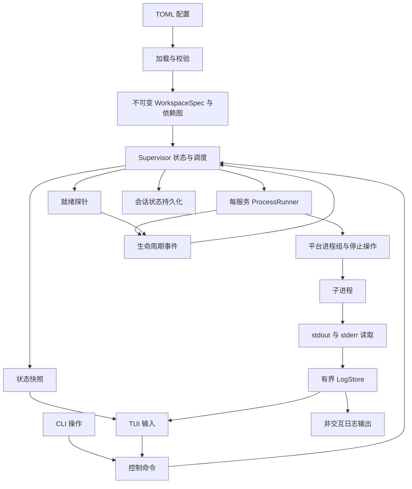
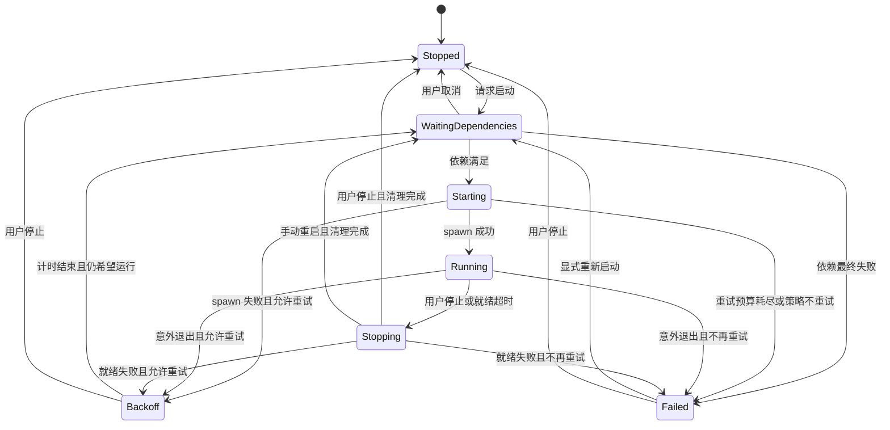

# devctl 技术架构提案

状态：规划，尚未实现。调研日期：2026-10-09。

当前事实：仓库只有 Rust 2024 单包、Hello World 入口、仅含工作区名称的 `devctl.toml`。本设计不表示已有对应能力，也不修改现有运行配置。

## 1. 目的与系统边界

devctl 将多个任意目录中的项目组织为一个本地开发工作区，启动和观察服务、等待就绪依赖、管理退出、聚合日志、恢复用户的服务选择。

输入是可信 TOML 配置、CLI/TUI 操作和操作系统事件；输出是托管进程、状态快照、日志和会话元数据。依赖外部工具的存在和项目本身的正确性，不替代它们。

P0 采用前台运行，退出 UI 等于结束会话并停止托管服务。P1 再引入后台 supervisor；核心模块从第一天就不依赖终端，以便复用。

## 2. 系统模型与数据流



MVP 保持一个 Cargo package，使用 `lib.rs` 暴露引擎、`main.rs` 负责入口。模块边界稳定后再判断是否拆 crate，不先构建 Cargo 多包 workspace。

建议逐步形成以下目录，不要求一次创建所有空文件：

```text
src/
  main.rs           # CLI 解析、运行时建立、退出码
  lib.rs            # 引擎入口
  config.rs         # TOML 解析、版本、路径与环境解析
  model.rs          # Spec、状态、命令和事件
  graph.rs          # 环检测、依赖闭包、启动/停止顺序
  supervisor.rs     # 状态唯一写入者与调度
  process.rs        # Child 所有者、等待退出、生命周期控制
  readiness.rs      # TCP/exec 探针与超时
  logs.rs           # 分帧、来源、限量缓存、查询
  session.rs        # 最近工作区、期望服务集合、原子持久化
  platform/
    mod.rs          # 小范围平台操作
    unix.rs         # Linux/WSL2/macOS 进程组与信号
    windows.rs      # P1 Job Object 与控制台事件
  tui/
    mod.rs          # 终端建立/恢复与事件循环
    state.rs        # 选择、过滤、滚动等纯界面状态
    view.rs         # Ratatui 渲染
tests/
  fixtures/         # 派生进程、延迟就绪、输出洪水等测试程序
```

## 3. 核心对象与状态所有权

| 对象 | 关键内容 | 所有者 |
| --- | --- | --- |
| WorkspaceSpec | 配置版本、配置路径、项目、服务、依赖图 | 加载后只读共享 |
| ProjectSpec | 稳定配置 ID、显示名、解析后目录 | WorkspaceSpec |
| ServiceSpec | 命令、cwd、env 引用、依赖、readiness、重启/停止策略 | WorkspaceSpec |
| ServiceRuntime | desired、phase、readiness、attempt、退出信息、重试预算 | Supervisor |
| ProcessRunner | 本轮 Child、进程组/Job 句柄、停止控制 | 每服务一个异步任务 |
| LogStore | 有界记录、接收顺序号、丢弃和截断统计 | 独立日志任务 |
| UiState | 当前服务、筛选、搜索、滚动和跟随 | UI 任务 |
| SessionState | 配置位置、期望服务 ID、界面偏好、异常退出标记 | 持久化模块，由 Supervisor 发起写入 |

`ProjectId`、`ServiceId` 是配置中的稳定键；改显示名不影响依赖。内部 `WorkspaceId` 由本地注册表分配，规范化的配置文件路径用于查找；工作区名称仅用于显示。配置移动后允许用户显式重新绑定，MVP 不通过名称猜测身份。

区分三个维度，避免一个枚举同时表达所有事情：

- 期望状态 `DesiredState = Running | Stopped`。
- 生命周期 `Phase = Stopped | WaitingDependencies | Starting | Running | Stopping | Backoff | Failed`。
- 本轮就绪 `Readiness = NotConfigured | Pending | Ready | Failed`。

派生可用性用于界面：自身未就绪、依赖不可用、最终阻塞、运行中降级。它不改变 OS 中进程真实的 Running 状态。



spawn 成功进入 Running，同时 readiness 可以仍为 Pending；只有 Ready 才满足 `ready` 依赖。用户停止 Starting 时撤销启动意图；如果并发 spawn 已成功，立即进入 Stopping 并清理。

## 4. 不变量

1. 每个工作区只有一个持有运行锁的 Supervisor，同一服务最多一个未清理完的实例。
2. Supervisor 是业务状态的唯一写入者，UI 不直接操作 Child 或修改运行状态。
3. 只有 desired = Running 且依赖条件满足才能 spawn。
4. 每次启动分配新的 `attempt_id`；探针、退出事件、日志都携带实例 ID。
5. 控制意图带递增版本；旧计时器、旧启动请求和旧探针不得覆盖新意图。
6. 每个直接 Child 最终 `wait`；重启必须等上一实例停止和进程组清理流程完成。
7. 停止集合内部按逆依赖顺序；无关服务可并行停止，范围外服务只在显式级联操作中加入。
8. 用户停止覆盖自动重启，取消探针和退避计时器。
9. 控制和退出事件可靠传递；显示日志允许有界丢弃，但要显示丢弃统计。
10. 缓冲、探针输出、并发启动和重试都必须有界。
11. 恢复依据配置和用户意图，磁盘上的 PID 不作为进程所有权证明。

## 5. 并发、接口与调度

使用 Tokio 处理进程等待、stdout/stderr、探针、信号和定时器。Ratatui 渲染保持同步，只消费快照和界面状态；官方 FAQ 也区分了渲染与应用的异步工作。[Ratatui FAQ](https://ratatui.rs/faq/)

引擎提供小接口，首版不追求公开稳定 SDK：

```text
EngineHandle.send(Command) -> 请求确认/错误
EngineHandle.subscribe_snapshot() -> watch<WorkspaceSnapshot>
LogHandle.query(filter, cursor, limit) -> LogPage

Command: Start(targets), Stop(targets, mode), Restart(targets), Shutdown
RunnerEvent: Spawned, Exited, StopCompleted, SpawnFailed
ProbeEvent: Ready, TimedOut, ProbeFailed
```

命令收到确认代表已受理；服务达到 Running/Ready 需要观察快照。P1 IPC 保持相同语义，增加 request_id 和协议版本。

入口可选择工作区、项目或服务，由引擎按操作规则解析为 ServiceId 集合；项目只是服务集合的选择范围，不增加另一套进程生命周期。`StopMode = SelectedOnly | CascadeDependents`，默认 SelectedOnly；所有批量操作共用现有图与状态机。具体交互与集合规则见[交互流程](docs/interaction.md)。

- 控制命令、Runner/Probe 事件通过有界 `mpsc`；生产者可等待，禁止静默丢弃生命周期事件。
- 每个 Runner 独占 Child；Supervisor 持有控制句柄，不共享 `Arc<Mutex<Child>>`。
- Supervisor 主循环只更新状态和发出动作，不等待探针完成、长时间停止或磁盘写入。
- `watch` 发布最新状态快照，适合 UI；历史事件不依靠 watch 重放。
- 高频日志走独立路径，UI 以有界分页拉取和节流刷新，避免日志洪水淹没控制通道。
- 所有任务被跟踪；退出时先停止产生新动作，再收集 Runner、探针、日志和持久化任务。

不能用可能丢失消息的广播通道驱动关键调度。Tokio `broadcast` 的慢接收者可能收到 `Lagged`，它适合可恢复的通知，不适合作为生命周期真相。[Tokio broadcast](https://docs.rs/tokio/latest/tokio/sync/broadcast/index.html)

依赖图规模较小，初版用邻接表和 Kahn/DFS 算法即可，不必引入通用图框架。初始启动并发上限建议 4，作为配置项与基准调优点。

## 6. 配置与跨仓库路径

沿用仓库已有的 TOML 方向。加载分四步：反序列化 → 解析路径和环境引用 → 语义校验 → 构建不可变图。

以下是拟定配置契约，**不是当前可执行配置**；不覆盖仓库已有 `devctl.toml`。

```toml
version = 1

[workspace]
name = "reader"

[projects.infra]
path = "/srv/dev/infra"

[projects.api]
path = "../reader-api"

[projects.web]
path = "${DEV_REPOS}/reader-web"

[services.db]
project = "infra"
cmd = ["postgres", "-D", "./.local/pgdata"]
autostart = false
env = { PGPORT = "5432" }

[services.db.readiness]
kind = "exec"
cmd = ["pg_isready", "-h", "127.0.0.1", "-p", "5432"]
interval_ms = 500
attempt_timeout_ms = 1000
timeout_ms = 30000

[services.api]
project = "api"
cmd = ["cargo", "run"]
env_files = [".env.local"]
autostart = false
depends_on = [{ service = "db", condition = "ready" }]

[services.api.readiness]
kind = "exec"
cmd = ["curl", "--fail", "--silent", "http://127.0.0.1:8080/health"]
interval_ms = 500
attempt_timeout_ms = 1000
timeout_ms = 60000

[services.api.restart]
policy = "on-failure"
max_retries = 3
initial_delay_ms = 500
max_delay_ms = 5000
reset_after_ms = 30000

[services.api.stop]
signal = "term"
timeout_ms = 5000

[services.web]
project = "web"
cmd = ["pnpm", "dev"]
autostart = true
depends_on = [{ service = "api", condition = "ready" }]
```

示例假设 PostgreSQL 数据目录已初始化，项目、环境文件、运行时和探针工具已经存在，API 提供 `/health`。`pg_isready` 是示例就绪信号；有业务条件时应换成能验证该条件的探针。API 编译时间较长，需要显式提高总就绪超时。

配置规则：

- `version` 必填；未知版本和未知字段报错，防止拼写错误悄悄使用默认值。
- `project.path` 相对配置文件所在目录；服务 `cwd` 相对 project.path，省略时使用项目目录；env_files 相对最终服务 cwd。
- 配置目录可以引用目录树之外的项目。运行时用 `PathBuf`，不通过字符串拼接路径；保留原路径用于报错。
- `${NAME}` 初版仅用于路径字段，从启动 devctl 的环境读取；缺失变量报错。明确支持开头的 `~/`，不进行命令替换和任意模板求值。
- `cmd` 是非空 argv 数组，不做 shell 展开；P0 需要 shell 时显式写 `cmd = ["sh", "-c", "..."]`，保证语义可见。
- 环境覆盖顺序：继承启动环境 → 按顺序加载服务 env_files → 服务 env；MVP 不增加另一套全局环境合并机制。
- 探针继承该服务的 cwd/env；exec 只按退出码判断成功，输出有上限，不计入普通服务日志。
- 默认 autostart = true、restart = never、stop = term/5s；未配置 readiness 显示 NotConfigured，只能满足 started 条件。
- 默认 TCP/exec 探针间隔 500ms、单次超时 1s、总超时 30s、一次成功即就绪；同一服务最多一个正在执行的探针。
- `ready` 依赖目标缺少探针、重复依赖、自依赖、环、未知项目/服务、零或溢出的时间参数全部在 spawn 前拒绝。
- P0 启动时载入配置；运行中修改文件不自动重载。恢复时重新校验，服务 ID 消失时给出差异，先不执行部分恢复。

## 7. 生命周期与平台适配

Linux/WSL2：每个服务创建独立进程组，优先使用 Tokio 的 `Command::process_group(0)`；停止给本轮进程组发信号，避免只停止 shell 而留下其子进程。[Tokio Command](https://docs.rs/tokio/latest/tokio/process/struct.Command.html#method.process_group)

停止流程：撤销期望运行 → 取消探针和退避 → 给组发送配置的 TERM 或 INT → 在总停止预算内等待 → 超时给组 KILL → 回收直接 Child → 有界排空输出 → 发布完成事件。不要只以组 leader 退出判断整组已经清理；停止预算同时覆盖仍存活的组成员。

若 leader 意外退出但子进程仍留在组内，先执行旧组清理再决定重启。清理期间持有本轮句柄和身份信息；不对从旧磁盘状态读出的 PGID 发信号。

Tokio 的 Child 被 drop 时默认不会停止进程；`kill_on_drop` 也不能代替完整的进程组停止与显式 wait。[Tokio process](https://docs.rs/tokio/latest/tokio/process/index.html)

平台层只封装建立托管组、优雅停止、强制停止、组清理和退出信息规范化，不做通用进程框架。

| 平台 | 策略 | 承诺边界 |
| --- | --- | --- |
| Linux | 进程组、信号、Child wait | 优先完成与集成验证 |
| WSL2 | 在发行版内部运行 Linux 二进制 | P0 管理 Linux 进程，不混合托管 Windows `.exe` |
| macOS | 复用 Unix 基础路径 | P1 验证信号、终端、路径和工具差异 |
| Windows | Job Object 托管后代，控制台事件尝试优雅停止 | P1 独立验证；TERM 不能直接映射为 Unix 信号 |

Windows Job Object 可作为一组进程的管理单位；后代关联、breakaway 和关闭行为有特定规则，不能仅以 `Child.kill` 宣称实现进程树清理。原生实现需要在进程继续执行前完成 Job 关联，处理“子进程先创建后代”的竞态。[Microsoft Job Objects](https://learn.microsoft.com/en-us/windows/win32/procthread/job-objects)

进程组不是不可逃逸的容器。自行 setsid、后台化或调用外部 daemon 的命令不纳入 P0 可靠清理承诺；SIGKILL、断电和不可恢复崩溃也无法保证清理。若后续需要更强的 Linux 约束，再单独评估 cgroup/systemd 集成。

## 8. 依赖与失败策略

`started` 表示本轮已 spawn 且未观测到退出；`ready` 表示本轮探针成功且进程仍运行。两者是启动门槛，不承诺后续业务一直健康。

1. 请求启动 web 时，计算 web 的传递依赖闭包并更新期望集合。
2. 只调度所有依赖条件都满足的服务；满足条件的独立节点并行启动。
3. 探针使用单调时钟计时；每轮启动重置 deadline。exec 超时清理探针进程组并 wait。
4. 就绪总超时使本轮失败，停止本轮实例，再进入受预算控制的重试或最终 Failed。
5. 上游 Backoff/Starting 时下游等待；上游最终 Failed 时下游显示 blocked 原因链；无关分支继续。
6. 已运行下游在上游退出时继续运行并标记 degraded，防止普通开发故障导致整个环境反复重启。
7. 上游手动启动成功后，重新评估被其阻塞且仍 desired = Running 的下游。
8. 手动停止默认仅停止选中集合，集合内部按逆拓扑处理；范围外的运行下游显示 degraded，等待下游显示依赖被手动停止，不自动拉起目标。显式级联停止将活动或期望运行的传递下游加入停止集合，取消其等待/退避；两种模式都不顺带停止上游。
9. 单服务重启保留下游；新实例重新检查依赖和 readiness。显式级联重启是 P1。

重试公式建议 `min(initial_delay × 2^retry_index, max_delay)`，使用有界计算。初版无需随机抖动；单机确定性更利于排查。重试预算只在服务满足就绪条件后稳定运行达到 reset_after 才重置，没有探针则从 spawn 开始计时。显式重新启动重置预算，用户停止永远不计为崩溃。

P1 增加 `Task` 和 `completed_successfully` 时，一次性任务退出 0 为完成；退出非 0 为失败。任务成功结果只在本会话有效，恢复默认重新执行，避免数据库迁移结果被错误缓存。

## 9. 日志模型与资源约束

```text
LogRecord {
  workspace_id, service_id, attempt_id,
  stream: stdout | stderr | system,
  received_at, sequence, text, truncated
}
```

sequence 由聚合器分配，表示接收顺序；不宣称不同进程或 stdout/stderr 之间的真实发生顺序。重启后的新日志保留实例标识，旧实例尾部输出不能混为新实例日志。

- stdout/stderr 各自持续读取，使用有界字节分帧；禁止为无限长无换行输出无限积累内存。
- 单条显示记录 16 KiB 上限；超长内容截断或拆成有标记片段，继续消费源流；增量解码处理 UTF-8 字符跨块。
- MVP 显示安全纯文本，解析/过滤 ANSI 与控制字符，不把子进程的终端控制序列直接写入管理器终端。颜色保留后续再加。
- 每服务文本预算 2 MiB、全局 32 MiB，同时给记录数、入口队列和查询结果设上限；先淘汰最旧记录。
- 每服务入口有配额；满时继续 drain OS 管道，丢弃显示记录并累加统计，不等待 UI 消费。
- UI 暂停只影响跟随；过滤和搜索限定当前有界缓冲。不一次 clone 整个日志库，不每帧扫描全部历史。
- 工具自己的 tracing 写独立目的地，在 TUI 模式不能混写 stdout。
- 子程序检测到 pipe 可能缓冲输出或关闭颜色；devctl 不承诺通用修复，针对程序使用其无缓冲选项。

P1 日志落盘采用单独的有界写入队列、按大小轮转和总容量上限；慢磁盘或写入失败可丢弃并显示缺口，不回压到服务。完整无损持久日志与“永远不阻塞输出”存在取舍，默认选择开发环境响应性。

PTY 会改变 stdout/stderr 分离、ANSI、信号、行编辑和终端模拟需求，作为 P2 独立能力研究。`portable-pty` 提供跨平台 PTY 抽象，可作为评估入口。[wezterm pty](https://github.com/wezterm/wezterm/tree/main/pty)

## 10. 环境恢复与持久化

明确两种不同能力：

| 能力 | P0 会话恢复 | P1 后台运行 |
| --- | --- | --- |
| 关闭界面 | 结束会话、停止服务 | detach，服务继续 |
| 再次进入 | 校验并创建新进程 | 连接仍存活的 supervisor |
| 重启机器 | 恢复工作区和期望服务集合 | 后台也不能恢复进程内存，仍需重建 |
| 真相来源 | 当前 Child 和状态机 | 当前 supervisor，而非磁盘 PID |

P0 持久化内容：schema_version、WorkspaceId、规范化配置路径、最近使用时间、期望服务 ID、选中的服务、会话是否正常结束。配置内容、环境值、Child 句柄和探针成功结果不保存。

使用平台用户配置/状态目录，不把本地会话数据写入项目配置。小体量 JSON 文件足够，无需 SQLite。状态目录限制为当前用户访问；日志等敏感数据后续沿用该权限边界。

先在同目录写临时文件、flush/sync，再用平台保证的替换方式更新；Unix 按需同步目录。实现 Windows 时不能假设 rename 覆盖语义完全一致。写失败保留旧文件并显示会话无法保存的错误，不能导致服务停止流程卡死。

运行互斥使用 OS 文件锁：同一规范化配置对应同一个工作区锁，保持整个前台生命周期；进程退出锁释放，单纯创建一个 PID 文件不够。注册表的短时更新另加锁，避免不同工作区同时覆盖最近记录。

正常退出前冻结用户期望集合，清理引发的 Stopped 不覆盖它。启动时先记录未正常结束标记，成功清理后再标记结束；损坏状态拒绝恢复并保留原文件，允许显式从配置重新运行。

恢复时不接管或杀死旧 PID。若上次异常退出，显示可能存在残留；端口冲突由新实例的实际错误暴露。移动项目、修改配置、删除服务 ID 都需要重新校验，P0 不静默降级为部分恢复。

P1 才加入 Unix domain socket / Windows named pipe、后台实例发现、协议版本、用户权限检查和 attach/detach。不预先使用本地 HTTP 端口、认证系统或远程 RPC。

## 11. TUI 模型

参考 Ratatui 的 Model/Update/View：界面状态、输入动作和渲染分开；这是 UI 组织方式，不代替 Supervisor 的状态机。[Ratatui TEA](https://ratatui.rs/concepts/application-patterns/the-elm-architecture/)

布局建议：顶部显示工作区与总体状态；左侧为工作区 → 项目 → 服务树；右侧显示选中范围的日志或详情；底部显示状态原因、当前操作范围和快捷键。颜色辅助区分，始终同时显示文本状态。项目和工作区行支持批量操作，项目汇总状态由服务状态派生，不单独维护生命周期。

首版键位建议：`j/k` 选择、方向键展开/折叠、`Tab` 切换区域、`s` 启动选中范围、`x` 停止选中范围、`r` 重启选中范围、`a` 聚合日志、`/` 搜索、`f` 跟随、`?` 帮助、`q` 结束会话；级联停止通过操作菜单明确选择，不与普通停止混用。输入搜索时快捷键不执行服务操作。

终端建立与恢复集中处理：正常退出、错误返回、Ctrl-C、可恢复 panic 都恢复 raw mode、光标和 alternate screen；UI 绘制失败也触发引擎退出流程。小窗口退化为简化布局，非 TTY 自动进入 no-tui。

## 12. 技术选型与取舍

以下是建议，依赖尚未添加；实现时依据官方 API、最低 Rust 版本和相互兼容性选择版本，保留 Cargo.lock。

| 领域 | 建议 | 理由与限制 |
| --- | --- | --- |
| 并发/进程 | Tokio | 同时处理等待、管道、探针与信号；仅启用需要的 features |
| CLI | clap derive | 参数、帮助和子命令结构清晰 |
| TUI | Ratatui + Crossterm | 使用应用入口 crate；匹配 backend 的 Crossterm 版本 |
| 配置/状态 | serde + toml + serde_json | TOML 面向用户，JSON 面向内部元数据 |
| 错误 | thiserror + anyhow | 领域错误可分类，入口增加上下文 |
| 工具日志 | tracing + tracing-subscriber | 内部诊断与用户服务日志分离 |
| Unix 系统调用 | 按需使用 nix 的窄 features | 把信号和组操作限制在平台模块 |
| 用户目录/env 文件 | directories、dotenvy 按需 | 不手写各平台目录约定和 dotenv 语法 |
| 图/存储 | 标准集合 + 小文件 | 当前规模不需要 petgraph、SQLite 或消息代理 |
| HTTP/PTY | P1/P2 再评估客户端 / portable-pty | MVP exec 探针已能覆盖业务就绪检查 |

Ratatui 当前官方架构采用多个 crate，但建议多数应用使用 `ratatui` 主入口。devctl 不必照搬 UI 库的多 crate 架构。[Ratatui architecture](https://github.com/ratatui/ratatui/blob/main/ARCHITECTURE.md)

| 关键选择 | 当前决定 | 暂不采用的方案与原因 |
| --- | --- | --- |
| 产品模型 | Workspace → Project → Service | 只列命令会弱化跨仓库组织和恢复上下文 |
| 执行方式 | 默认 argv、管道 | 隐式 shell 增加引用和跨平台差异；PTY 扩大边界 |
| 状态修改 | 单 Supervisor 写入 | 多处共享可变运行状态难以处理停止/重试竞态 |
| 依赖语义 | 明确 started/ready | 固定 sleep 不可靠，拓扑排序本身也不保证就绪 |
| 故障传播 | 等待者阻塞，运行者降级 | 自动重启全图会放大开发故障 |
| 首版运行 | 前台 | daemon/IPC 增加实例发现、权限和退出协议工作 |
| 会话保存 | 用户意图与路径 | PID 和已 Ready 状态不构成恢复证据 |
| 平台隔离 | 小平台模块 | 不先为所有可能执行后端定义插件系统 |

## 13. 验证策略

围绕需求、不变量和真实 OS 行为验证，UI 截图或 cargo build 不能证明进程清理正确。

- 纯逻辑：配置路径、env 覆盖、未知字段、依赖环与闭包、状态转换、退避预算。
- 调度：可控假 Runner/时钟验证启动顺序、取消、旧 attempt 事件和不相关分支隔离。
- OS 集成：真实测试程序派生后代、忽略 TERM、立即退出、延迟开放端口、exec 超时；验证组清理和直接 Child 回收。
- 日志：同流顺序、来源、重启实例、UTF-8 跨块、ANSI/控制符、无换行洪水、容量与丢弃计数。
- 恢复：临时目录中验证原子保存、损坏文件、配置改动、异常标记、正常退出期望集合和运行锁竞争。
- UI：Ratatui TestBackend 验证少量关键状态和窄窗口；真实 PTY 测试终端恢复，不写大量无价值截图快照。
- 系统验收：用 DB → API → web 和独立 worker 测试程序完成需求文档的场景；Linux 与 WSL2 分别运行。

实现每个切片时运行对应测试、fmt、clippy；版本发布前跑完整测试和目标平台场景。性能验收使用固定负载记录 CPU、内存和输入延迟，再决定优化。

## 14. 风险与待验证决策

| 问题 | 当前假设/处理 | 需要的证据 |
| --- | --- | --- |
| 用户是否必须关闭终端继续运行 | 默认可接受前台 MVP；若必须，则 P1 daemon 上移 | 日常工作流程试用 |
| 就绪探针能否证明业务可用 | exec 由用户定义，TCP 仅连通性 | 真项目冷启动、迁移和长编译场景 |
| npm/cargo 派生进程的组行为 | 可靠管理未脱离组的后代 | 真实启动器、leader 先退出测试 |
| 日志压力与可用内存 | 有界缓存、显示允许丢弃 | 20 服务和输出洪水基准 |
| Windows 启动/Job 关联/优雅停止 | P1 独立实现，不宣称现已兼容 | 原生 Windows 集成测试 |
| SIGKILL 后残留 | 明确 P0 无强保证，不自动接管 | 强制终止场景和诊断体验 |
| 一个服务被多个工作区使用 | 暂不共享，冲突报错 | 实际多工作区需求再评估共享 supervisor |

上述默认值足以开始实现；发现不同的产品需求时更新该设计与相应验收标准。
