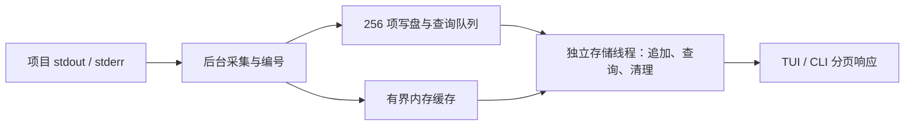

# devctl 首版设计

依据 [已确认需求](docs/requirements.md)：统一管理 web、微信小程序和 Node.js 中台的三个开发命令。首版已实现并由用户确认验收通过，版本为 1.0.0；尚未实现的 MVP 后方案单独标注。操作规则见 [interaction.md](docs/interaction.md)，验证证据见 [tasks.md](docs/tasks.md)。后台运行已纳入首版；依赖编排、探针与重启后恢复继续待评估，历史方案可从 Git 查询。

## 1. 数据流与职责

```text
TUI / 控制 CLI → 本地控制通道 → 后台管理循环 → 每项进程任务
                       ↑            ↑              ↓
                 状态与近期日志     退出事件    stdout/stderr
                       ↑                           ↓
                       └──────── 后台有界日志 ───────┘
```

保持一个 Cargo package，复用现有 cli、config、process 模块。多项目控制与界面按实际需要拆模块，不提前建立插件、公共 SDK 或多层通用引擎。

- 配置加载后只读；Project 指向目录，Service 保存开发命令。首版场景每个项目一个服务，沿用现有 schema。
- 独立后台管理进程持有每项运行状态和控制句柄；每个运行任务独占本轮 Child 与进程组标识，负责停止及回收。
- UI/控制 CLI 是客户端，只发送操作并显示后台返回的状态、日志；客户端退出不影响 Child 所有者。后台无客户端时也持续读取日志。
- 先完成单项进程管理，再扩展到三个独立任务；不因一个长期运行命令未结束而阻塞后续启动。

## 2. 配置

CLI 的 --config 为可选参数，未指定时按 [交互方案](docs/interaction.md) §1 的优先级发现单个配置。路径选择在入口完成一次，随后交给已有配置加载、规范化与实例发现流程；后台启动器仍显式传入选中的规范化路径，不在后台重新搜索默认位置。显式路径不回退，默认候选只跳过不存在的路径，目录、损坏的符号链接和检查错误直接报告；解析错误也不触发第二次搜索。这保持相对路径基准、运行锁及控制端点的配置身份一致，不依赖新增目录库。

以下路径为占位示例，替换为实际目录后使用。这里只展示已有配置结构，不修改用户运行配置。

```toml
version = 1

[workspace]
name = "daily-dev"

[projects.web]
path = "../web"

[projects.weapp]
path = "../weapp"

[projects.middle]
path = "../middle"

[services.web]
project = "web"
cmd = ["npm", "run", "dev"]

[services.weapp]
project = "weapp"
cmd = ["npm", "run", "dev:weapp"]

[services.middle]
project = "middle"
cmd = ["npm", "run", "dev"]
```

路径相对配置目录解析，服务 cwd 默认为项目目录；显式 cwd 沿用现有解析规则。使用 argv 数组保留参数边界，不隐式经过 shell。继承启动 devctl 时的环境，项目自己的开发脚本负责已有环境加载。

先完成全部配置校验再启动。已有依赖校验和 plan 保留；首版运行不支持的依赖配置须明确拒绝，不能直接忽略后启动。多个服务属于同一项目时，界面支持范围必须显式检查或实现，不能静默选择一个。

## 3. 状态与并发

首版只需表达 Stopped、Starting、Running、Stopping、Failed。每项保留退出原因；无需 desired/readiness/backoff 等尚无用途的状态维度。

1. 同一服务最多一个未清理完的实例；停止完成后才允许重新启动。
2. UI 请求和进程退出由管理循环串行更新状态；运行任务报告结果，不共享可变 Child。
3. 生命周期事件可靠传递；日志使用独立的有界通道，避免高输出淹没控制。
4. 停止全部或结束后台先禁止本次停止范围的新启动，再通知全部运行任务；并发 spawn 若已成功也必须纳入清理。客户端离开不触发该流程。
5. 自然退出也要清理本轮残留后代；先回收并完成清理，再允许重新启动。旧轮日志和退出事件不能污染新轮，事件携带实例标识。
6. 一个项目启动失败或意外退出只影响该项目，不自动停止或重启其他项目。

管理循环不能长时间等待单个进程或终端绘制；所有任务都要跟踪和回收，不以丢弃任务句柄作为停止方式。

每轮运行接收独立的 `oneshot::Receiver<()>`；管理者持有发送端，发送请求后仍须等待该轮清理结果。发送端意外丢失也触发停止，作为内部所有者消失时的兜底；客户端断开不能使后台丢弃发送端。终端信号由管理入口统一转换为停止请求，进程任务不各自监听信号。

运行任务拥有本轮服务配置与服务 ID，管理入口通过 ServiceTask 保存服务 ID、停止发送端和任务句柄。等待时借用句柄，取得结果后移除句柄；取消等待不丢失本轮任务。Tokio 任务提供运行时内的并发，不承担独立后台进程的生命周期；正常退出须通知停止并等待任务，不通过 abort 或关闭运行时结束服务。

Manager 持有加载后的服务定义、每项状态，以及按服务 ID 保存 ServiceTask 的 BTreeMap。启动请求先整批校验，再在无 await 的循环中登记；Starting/Running 项重复请求不创建第二实例，Stopping 项拒绝启动。配置为每轮任务克隆，管理者保留原定义以便显式重新启动。停止请求和取消等待均不释放登记；释放 ID 必须以未创建进程或本轮清理已确认的结果为依据，不能依据错误文本。清理无法确认或任务异常结束时保留登记，避免再次启动形成重复实例。

process 用 RunError 区分 SafeToRetry 与 CleanupUnconfirmed；spawn 前的校验失败、spawn 失败以及已确认清理后的观察错误可安全重试，清理错误和任务 JoinError 不能证明清理完成。ServiceTask 保留错误类型，Manager 判断登记是否释放后才转换为显示文本；可安全重试不触发自动重启。

request_stop_all 同步向所有未 join 的任务发出停止请求并标记 Stopping，同时登记本次全部停止仍待完成的 ID。等待集合非空时拒绝所有新启动，完成结果逐项移除 ID；单项停止只限制该项。该接口不等待清理，未来后台循环可继续处理状态查询和其他控制请求。前台收尾的 stop_all 复用该请求接口，再逐项等待并汇总带 ID 的错误；某项错误不跳过其他项，取消等待也不释放任务或全部停止约束。

wait_next 通过同一 Context 检查尚未 join 的任务句柄，JoinHandle 注册 waker 并在完成时唤醒等待者，无需周期扫描或额外结果队列。Pending 时保留句柄，Ready 后消费一次结果并执行与按 ID 等待相同的登记释放判断；已消费但清理未知的项保留 ID，后续等待跳过其句柄。None 仅表示没有未 join 的任务，不能作为全部清理完成的证据。多个结果同时可读时按 ID 检查，不保证退出时间排序。

前台入口选择显式目标或默认组合，由 Manager 整批校验后取得运行锁，再集中登记；重复 ID 通过登记表合并，登记阶段不 await 单项运行。完成结果由循环逐项接收，错误立即显示且记录本轮失败状态，不提前返回并丢下其他运行项；只有终端停止请求触发集中收尾，登记阶段意外失败也先收尾已登记项。完成结果写入状态快照：正常停止为 Stopped，自然退出（包括退出码 0）和错误为 Failed，并保留原因。spawn 成功通过每轮独有的 oneshot 报告；查询状态时仅将 Starting 更新为 Running，不覆盖 Stopping。Running 表示已观察到创建成功且尚未处理完成结果，不承诺业务就绪。尚未使用的 stop_selected/statuses 接口仅为下一步后台接线保留，使用局部 dead_code 说明，不引入新客户端入口。

清理未知时保留任务登记、Failed 状态、原始错误和 cleanup_confirmed=false；后续启动、停止、等待均不能把它当作可安全重试或覆盖为“已停止”。wait_next 不重复投递该完成结果，stop_all 仍汇报原始错误并清理其他项。已确认清理的失败可由用户显式重新启动，只有开始新一轮才清除上次失败原因。清理未知项的自动再次清理和崩溃残留恢复未实现；不能凭已释放的锁或旧 PID 判断安全。

## 4. 进程停止与运行互斥

沿用当前 Linux/Unix 方向，每个命令建立独立进程组。npm/pnpm 启动器及其未脱离组的后代都属于本轮管理范围。

停止流程：标记 Stopping → 给组发 TERM → 在停止预算内等待 → 强制清理残留组 → 确认组内无存活成员 → wait 直接 Child → 有界排空输出 → 报告完成。初始停止预算提议为 5 秒，真实项目试用后再调整。

停止期间观察 leader 退出但暂不回收，保留其 PID 直到最后一次进程组信号发送完成，避免回收后 PID 复用。Linux 使用 waitid 的 WNOWAIT/WNOHANG 实现该观察，再由 Tokio Child 显式 wait 回收。leader 在宽限期内退出时立即强制清理残留组成员，不额外给予它们另一轮宽限期。

leader 退出不等于整组清理完成；服务自然退出、单项停止、全部停止与后台管理进程退出共用清理机制。Child 的 drop 或仅对直接子进程 kill 不能作为进程组清理的验收证据。

Linux 清理完成定义为组内没有存活成员，并且直接 Child 已 wait；非直接后代的 zombie 由其新父进程回收，不等同于仍在运行。通过 `/proc/<pid>/stat` 的状态与 pgrp 检查，扫描交给阻塞任务；进程在扫描期间消失可以跳过，其他读取或解析错误必须报告。强杀后的确认与回收共用初始 1 秒预算，超时不能报告成功；确认完成前保留 leader 身份，发现仍存活成员时可再次给本轮组发 KILL。

只使用当前持有的实例身份，不从磁盘读取旧 PID 后发送信号。自行脱离组、SIGKILL 或断电不在正常退出保证内；其他终端的进程不接管。

同一规范化配置对应一个 OS 运行锁。已实现的前台 run 在路径规范化、整批校验和信号注册后取得锁，再登记任务；RunLock 持有 File，作用域覆盖运行和正常清理。标准库 File::try_lock 使用非阻塞排他锁，锁文件为规范化配置路径追加 .devctl.lock；不截断、不自动删除，以免原子替换配置或删除锁文件造成 inode 分裂。拒绝符号链接和非普通锁文件，exec 后的服务不继承锁句柄；相对/绝对路径及符号链接配置别名共用锁，硬链接别名不合并。

锁由 guard 或进程退出释放，文件内容不决定占用状态；配置目录需可创建锁文件，过长文件名等文件系统错误在启动前返回。已验证当前 Linux 本机文件系统，未验证网络文件系统。锁不负责崩溃恢复或证明残留已清理。后台持有同一锁到正常清理结束，客户端通过控制通道连接，不重复争抢服务所有权；前后台冲突时拒绝重复托管。不引入 PID 文件作为所有权依据或状态数据库，其他平台另行评估。

## 5. 日志与终端

每条日志标识服务、本轮实例和 stdout/stderr 来源。两条流持续读取，顺序仅代表接收顺序。后台按项目保存近期记录，客户端重连可读取仍在缓冲中的日志。日志增强分阶段实施，源码增强的缓存、持久化与搜索机制见 §5.3。

已实现的初始工程预算：单条记录文本最多 16 KiB，每服务文本最多 2 MiB 且不超过 4096 条；全局日志入口队列容量 256。每项任务持续读取两条管道，不按行无限累积：长行分帧，无效 UTF-8 替换显示；正常 UTF-8 的跨帧字符保留完整。终端控制字符转成可见转义，渲染后文本仍受单条上限约束。队列满时 try_send 丢弃并计数，继续排空管道；缓存按最旧记录淘汰，不因客户端缺席积累无界数据。

服务任务清理完成后，日志读取任务共享最多 1 秒排空期限；读取错误、意外丢失读取任务或超时取消会单独标记 capture incomplete，不伪造精确丢弃记录数。只有纯管道读取任务可以在此期限后取消，进程清理结果仍独立保留。管理者消费完成事件后最多排空一个队列容量，再响应停止完成，避免近期末尾输出滞留在队列中。

日志查询默认返回尾部记录；--after 从指定序号之后按升序分页，--before 取指定序号之前最近的一页再按升序返回，两者互斥。每次 1–500 条且文本合计不超过 64 KiB；返回累计丢弃/淘汰数、游标缺口、读取不完整、当前最高序号、最早保留序号与是否还有更早记录。分页游标应取最后一条实际收到的序号，不能直接跳到最高序号。服务重启保留近期历史，记录携带单调运行实例号，旧轮记录不会被当成新轮输出。后台每次创建从 /dev/urandom 生成独立 workspace_id，放入所有控制响应；服务实例号和日志序号仅在该后台内有效。TUI 在断连时丢弃正文缓存与增量游标，同一后台重连按 §5.3 书签恢复；workspace_id 改变时同时丢弃旧书签，不盲目重放操作。

子进程控制字符不能直接控制 devctl 的终端。日志显示与进程控制分开；终端绘制错误只断开客户端并恢复终端，不停止后台服务。raw mode、光标和 alternate screen 的建立与恢复集中管理。

窗口布局和快捷键只在交互文档维护。stdin 交互需求尚未确认，不提前引入 PTY。

### 5.1 TUI 实现

对应 U01、P01、P07、P02、P05、L01、L03。入口分发在未提供子命令时使用 Command::Tui，与显式 tui 复用配置发现与同一个终端入口；显式子命令不走此默认分支，帮助和版本由 Clap 在执行入口前处理。操作约定见 [interaction.md](docs/interaction.md) §1。使用 Ratatui 0.30.x、Crossterm 0.29.x 的 EventStream 和 futures-util StreamExt，沿用 Tokio current_thread 运行时及原有 feature；具体版本写入 Cargo.lock。事件读取不混用阻塞 read/poll，版本线与 Ratatui 后端保持一致。参考 [Ratatui](https://docs.rs/ratatui/latest/ratatui/) 与 [Crossterm 事件文档](https://docs.rs/crossterm/0.29.0/crossterm/event/index.html)。

模块边界：src/tui/mod.rs 协调终端事件、计时和请求任务；app.rs 独占项目快照、选择、连接信息、操作反馈、有界日志及滚动锚点；view.rs 借用状态绘制；terminal.rs 集中建立和恢复终端。App 不持有 Manager、Child 或运行锁，也不需要共享锁。项目列表来源于后台快照，按 Service ID 保留选择，不以磁盘配置替换已有后台的列表。

初次进入用 Status + create=true 按需创建空闲后台，不发送 Start；之后的自动轮询、手动重连和控制全部 create=false。后台消失后显示状态未知并禁用控制，自动尝试连接现存实例；不会由刷新重建后台。用户可在其他 CLI 创建后台，或离开后重新进入 TUI 创建空闲实例。连接恢复不重放控制、不应用默认 autostart。

client::transact 保留完整 Response 以及后台身份，ClientError 区分本地准备失败与连接/协议/传输失败；execute 作为 CLI 包装保留原来的报错行为。后台 Response.error 也可能表示完成情况未知，不能统一解释为未受理。失败反馈保留原文并重新查询状态；传输中断不重发启停操作。成功 shutdown 仍沿用原有运行锁释放确认后才退出界面。

状态、当前项目日志、控制操作分别最多一个在途任务，统一用 JoinSet 跟踪；取消的查询在 join 前仍占槽位，快速按键不会产生无界任务集合。慢停止期间仍可查询状态、切换项目、滚动和离开；控制槽繁忙时拒绝排队新操作并提示等待。初始状态轮询 500 ms、日志轮询 200 ms，过期 tick 跳过；内容或窗口变化标记重绘，绘制间隔 33 ms。这些是工程参数，不是已测量的性能承诺。

连接代次与日志选择代次随请求返回；项目 A → B → A 也拒绝首次 A 的过期结果。状态查询建立当前 workspace_id；日志或控制结果发现不同身份只触发重新同步，不能把旧结果切回当前视图。断线重连即使身份相同，也重新取状态与日志；有效书签可恢复阅读位置，见 §5.3。控制结果不覆盖状态快照；其完成后使此前查询失效，并重新发起状态查询。界面分开保存连接诊断、服务状态和操作反馈，重连成功不会抹掉操作完成未知的反馈；启动受理也不会直接把项目改成 Running。

客户端只缓存当前项目：文本最多 2 MiB、最多 4096 条，元数据同样受记录数约束；切换项目从后台重新查询，书签与窗口机制见 §5.3。分页游标取最后实际收到的序号，不跳到后台最高序号；每次最多 100 条并遵守后台字节预算，不无限追赶输出。每条记录占一个显示行，超宽文本水平滚动；仅转换当前可见记录，不展开整个缓存。向上滚动按序号锚定，新增日志不移动阅读位置；本地淘汰导致锚点丢失时提示并移到现存最旧记录。后台丢失/淘汰、缺口、读取不完整、单条截断与本地淘汰分别显示。日志沿用后台控制字符转义，其他名字和诊断在绘制前也转义控制字符。

终端修改前检查输入/输出 TTY，先建立 guard，再记录将要尝试的 raw mode、alternate screen、隐藏光标设置，以处理写入部分成功后报错。初始化错误显式回滚；恢复逐项尽力执行并保留所有错误，不因一项失败跳过后续步骤。正常退出、输入/绘制错误和 SIGINT/SIGTERM/SIGHUP 均回收客户端请求并恢复；Drop 兜底，panic hook 在打印诊断前尽力恢复。raw mode 的 Ctrl-C 作为按键处理。退出不撤销后台已受理操作，不发送隐式 stop/shutdown；不承诺 SIGKILL 后恢复。

验证包括 App 状态转换和日志边界、TestBackend 的正常/窄窗口及弹窗、真实 PTY 中的控制/重连/退出/高输出。PTY 使用独立临时配置及受控程序，CLI 状态和进程启动记录作为独立证据；Running 不保证程序已写入测试启动标记。测试和限制见 [任务记录](docs/tasks.md)；2026-10-15 用户另行确认三个真实项目的完整体验通过。

### 5.2 TUI 焦点、布局与上下文反馈

2026-10-15 用户要求参考 lazygit、支持 Vim 风格导航，并选择先完善快捷键与界面。操作规则统一维护在 [interaction.md](docs/interaction.md) §2.2–§2.6；本节记录已实现的状态与模块边界。

- 延续现有模块：App 新增小型 `Focus` 枚举（Projects / Logs），选择继续使用 Service ID。焦点不拥有后台资源，也不改变连接代次、选择代次或日志游标；只有真实项目选择变化才触发原有查询取消与日志重取流程。
- 键盘分发仍在 mod.rs；顺序为全局离开、窗口可操作性、结束确认框、组合键前缀、帮助滚动、行选择模式、主界面导航和控制。`Ctrl-u/d` 在通用修饰键过滤之前识别，不因现有过滤被吞掉；Release 不处理，组合前缀和控制键只处理 Press，避免重复事件提交操作。
- `gg` 只需要一个有界待完成前缀状态；弹窗、焦点、连接与工作区切换清除该状态，不建立任意长度命令缓冲或通用 Vim 解析器。帮助有自己的滚动位置，弹窗期间不修改主体选择与日志位置。
- view.rs 从实际终端尺寸统一计算主体、反馈和日志内容 Rect。渲染和键盘翻页共用这一布局结果，替换仅按总高度减常数的计算；窗口缩放不修改后台状态，普通阅读保持锚点；选择模式调整视口以保持当前端点可见。文本裁剪按终端显示列处理，复用现有依赖提供的能力。日志边框内统一分配状态说明与正文 Rect，翻页/选择只使用扣除固定说明后的正文高度；状态说明与旧实例标记属于视图，不写入日志记录或复制正文。状态来源仅为后台快照，不解析 ready/URL 等输出。仅记录实例号小于快照实例号时标为 old，避免日志查询先于状态刷新时把新轮记录误标旧轮。底部高度固定为反馈一行、快捷键一行；异常标记与最近操作结果合并，完整诊断仍由帮助读取。
- 日志请求的读取中/失败信息与空缓存分开保存，只描述当前选择代次；旧请求不得清除新项目的读取提示。操作结果保留请求发出时的目标，不能按完成时选中项重新命名。连接诊断、服务失败和操作反馈继续分别保存，视图负责展示优先级。仅 Failed 且 cleanup_confirmed=false 显示清理未确认告警；活动实例的 false 表示尚未清理，不能当作清理失败。
- 不修改后台协议、生命周期、配置加载或日志容量。新增显示只使用现有状态与记录；启停仍通过原有 `Operation` 和 `App::begin`，客户端继续不持有托管服务的 Child 或运行锁。

按行为缺口验证：焦点与导航用键盘状态转换测试；布局、帮助和长诊断用 TestBackend；在原有真实 PTY 场景中补充焦点导航、弹窗隔离及离开后服务存活的证据。具体场景见交互文档 §2.6，实际命令与结果见任务文档；受控验证不能代替用户 WSL2 的完整项目试用。帮助和确认文本按终端列宽预先折行，保留 grapheme 与 Span 样式，渲染、滚动边界与确认可见性复用同一组行，不依赖 Ratatui 的不稳定行数接口。浮窗在主界面绘制完成后统一压暗底层 Buffer、清空含外侧隔离带的矩形，再绘制实色背景与内容；仅影响当前帧，不修改日志数据、查询或选区状态。

阅读光标与行选择直接存放在 LogWindow 中，以记录序号定位；阅读光标 reading 与拉取日志的 cursor 分离，不复制整份缓存。j/k 先移动阅读光标，靠近边缘才调整视口；v 从该行建立锚点与端点，尚未定位时使用第一条可见记录。阅读或选择时按序号固定视口，后台继续采集，客户端按 §5.3 暂停窗口追加并轮询边界；淘汰阅读光标则清除并告警，淘汰任一选区端点即取消选择。缩放窗口会保持阅读光标或选区端点可见，翻页会清除普通阅读光标，跟随会清除光标和选区。焦点返回项目、项目/后台变化或断连会清除选区。视觉样式与选择按键只在 TUI 内消费，不能成为服务请求。

复制在事件循环内取得不超过 64 KiB 的正文快照，只允许一个在途复制任务，不排队，也不引入后台管理协议请求。terminal.rs 在本机 WSL（环境标记或内核标识，且没有 SSH_CONNECTION）直接启动 PATH 中的 clip.exe，不经过 shell；正文转为无 BOM 的 UTF-16LE，保留中文、制表符与换行。子进程标准输出/错误不继承终端，写入与等待共用三秒期限；失败或超时终止并回收子进程，任务取消时 kill_on_drop 防止遗留运行的复制程序。其他环境和 SSH 会话复用 Crossterm 的 osc52 feature 向显示终端发送命令，避免写入远端 Windows 桌面的剪贴板。

复制任务只持有已选正文、连接/项目代次与选区快照，不借用 App。执行期间界面继续处理输入；成功时只退出代次与端点均未改变的原选区，失败或超限保留选区，退出客户端取消复制任务。反馈区分 clip.exe 成功退出与 OSC 52 已发送，两者都提示实际粘贴核对，不自动读取剪贴板。单元测试验证编码、失败、超时与日志锚点；真实 PTY 分别通过独立 base64 解码和隔离的假 clip.exe 核对正文与资源清理，测试不触碰宿主真实剪贴板。

### 5.3 MVP 后日志增强方案

1.1.0 已实现并发布 L01–L04 本轮收敛的日志增强。产品范围与验收由 [requirements.md](docs/requirements.md) §4.2 维护，操作与反馈见 [interaction.md](docs/interaction.md) §2.7–2.8，当前验证及真实项目试用状态见 [tasks.md](docs/tasks.md)。不实现跨退出书签、跨项目聚合或复杂组合筛选。

#### 职责与所有权



`logs::Store` 仍属于 supervisor，负责单服务递增序号及近期内存；`archive::Archive` 将已编号的记录以非阻塞 `try_send` 交给独立线程。Manager 不等待写盘；文件 I/O 不在 Tokio current_thread 控制循环中执行。存储线程独占追加、轮转和清理，查询也在此线程串行处理，避免读取与清理竞争。关闭保存时不向写盘队列发送记录，内存查询与搜索仍可用。

线程持有同一工作区 `RunLock` 的 `Arc`，收尾未结束前不能让另一后台取得所有权。正常结束先完成服务清理与管道排空，再等待存储队列排空、文件同步和会话元数据收尾，独立期限为 5 秒；最后回复 shutdown。保存失败会返回错误，已停止服务不会因此重新启动。超时不会取消阻塞中的文件系统调用；线程仍持锁直到完成或进程结束，不能冒充安全释放。

CLI 历史读取不创建后台。没有归档时不创建运行锁文件；有归档时必须先取得同一个非阻塞运行锁才能直接读磁盘，读完释放。锁被占用时只能走 IPC，即使 socket 缺失也不擅自离线读取。离线读取只加载日志设置，不要求项目工作目录仍存在；在线后台继续使用创建时的配置与环境。

#### 分页与界面窗口

- `Request::Logs` 保留原有尾部、排他 `after/before` 语义；新增 `ReadLogs { query }` 用于会话、字面文本和固定上界查询，`LogSessions` 用于近期会话列表。旧后台会拒绝新命令，不能静默忽略参数；新 TUI 的普通日志仍使用原命令。`Batch` 的新增字段采用缺省值，旧客户端可忽略新增日志字段，空的会话列表不序列化。
- 记录按 `(会话, 服务, 序号)` 合并内存与磁盘重叠区；每页 1–500 条、正文最多 64 KiB，TUI 普通页为 100 条。正向从排他下界取最近页，反向从排他上界取最近页，最终均按升序返回。`oldest` 覆盖磁盘和内存保留边界，`latest` 与实际已返回的游标分开，不能直接用最高序号跳过未读取页。已落盘的内存淘汰不再误报为采集丢失。
- 每次查询只保留有界候选页，不把全部文件装入内存；读取单帧最多 128 KiB。文件名中的服务键与首序号用于跳过无关分段，双向帧长度支持从文件尾读取。单次搜索的有效范围扫描预算为 1 MiB；段内定位及异常尾部恢复额外扫描最多一个 8 MiB 分段，不建立逐记录索引。
- `LogWindow` 独占一个 2 MiB/4096 条的正文窗口、实时游标、阅读/选区锚点及暂停状态。加载旧页从窗口尾淘汰，加载新页从窗口头淘汰；实时游标始终指向实际缓存尾。暂停时只请求空正文边界，收到新输出只更新计数，不推动阅读位置。恢复跟随重新取尾部。
- 查询携带连接、选择代次及方向，方向改变取消旧请求并在原单槽回收；搜索沿用同一日志槽。书签只属于当前 App，切换项目或短暂断连重新加载视口；后台身份改变清除书签，新 App 从尾部开始。选区随项目或连接变化清除；清理导致锚点过期时明确反馈。

#### 持久身份、格式与预算

日志目录为绝对 `$XDG_STATE_HOME/devctl/logs/<工作区键>`，否则回退到绝对 `$HOME/.local/state/devctl/logs/<工作区键>`；两者都不可用时保存降级。工作区键是规范化配置路径原始字节的稳定 FNV-1a 64 位摘要；`workspace.toml` 保留原路径的十六进制编码并核对，摘要碰撞时拒绝访问，不作为安全哈希使用。配置搬迁视为新工作区，不迁移旧历史。

每个后台沿用随机 128 位 `workspace_id` 作为会话 ID。文件名为 `<创建毫秒>-<会话>-<服务键>-<首序号>.dlog`，服务键不直接采用外部 ID；帧内保留原服务名并核对，同会话服务键碰撞时停止保存。会话元数据 `<会话>.toml` 记录创建时间、服务、最新检查点序号、正常结束与已知不完整；没有输出的后台不创建会话数据文件。

`.dlog` 版本 1 采用 `[大端 u32 长度][UTF-8 TOML][相同长度]` 帧，复用已有 TOML 依赖，替代早期提案中的 JSONL。帧保留版本、服务、运行实例、序号、UTC Unix 采集毫秒、stdout/stderr、正文和截断标记；会话在文件名及元数据中。双向长度避免反向分页时重扫全部历史。它不是直接 `tail -f` 的纯文本格式，阅读与导出走 CLI。读到未知版本、无效帧或不完整尾部会反馈不完整；完整前缀可继续读取，不修改原文件。

| 参数 | 默认值与范围 |
| --- | --- |
| `[logs].enabled` | `true`，关闭后只保留近期内存 |
| `[logs].max_mib` | `256`，允许 8–4096 MiB；整个工作区、所有服务与会话共用 |
| `[logs].retain_days` | `7`，允许 1–365 天 |
| 分段 | 8 MiB，序列化后的实际字节计入预算；超限前切段 |
| 文件与元数据 | 最多 4096 个数据分段，元数据随对应数据清理；读取单个元数据最多 128 KiB；会话列表最多 100 项 |
| 队列与记录 | 采集队列及存储队列各 256 项；原单条正文 16 KiB、内存及响应预算继续保留 |

容量与期限先达到者淘汰最早完整分段，不保证保留完整七天。期限以分段创建时间计算；整段清理可能同时移除其中较新的记录。后台启动、创建分段、即将超过容量及每分钟检查时清理；关闭的旧段退出活动句柄前同步。没有后台时离线读取排除过期段，物理删除留到下次后台启动，不启动清理守护进程。元数据有独立上限，不将分段预算宣称为文件系统总占用。

写盘使用有界单记录追加，每秒执行文件同步与会话检查点，正常关闭再次同步并同步目录。进入队列或一次查询返回都不表示已经持久化；崩溃、断电可能丢失尚未同步的尾部，不承诺最多只丢一秒。查询从有效文件尾确认最新序号，不只依赖可能滞后的元数据。目录和新文件分别用 0700/0600 创建，拒绝最终路径的符号链接、非普通文件及无效段，不更改项目配置或项目日志。

#### 单项目检索与导出

`query_matching` 搜索有界内存，存储线程扫描同会话所选服务的保留分段；不解析业务日志级别，不提供组合筛选。采用大小写敏感的字面 `contains`，最多 256 UTF-8 字节。第一次搜索固定 `upper`，后续 continuation 携带 `scanned_to` 和 `search_complete`，空结果不等于已经扫完；合并时不能用越过未扫描磁盘范围的内存命中跳过更早匹配。TUI 扫描批次之间可以取消，搜索与上下文请求沿用一个日志槽。新搜索即使复用相同游标，也显式使旧请求代次失效并取消旧任务，避免旧关键词结果覆盖新搜索。

TUI 搜索定位与日志展示分开：命中在当前缓存时只移动阅读光标与视口，保留全部普通记录；在缓存之外时用已有 before/after 协议取命中前后普通页。`ContextAfter` 区分定位期间的后续页，若字节限制导致可见上下文不足，继续逐页补齐到视口所需范围；预算不足、空页或保留末尾停止，仍受原内存、响应和单槽上限约束。前后页始终无文本过滤，不把搜索匹配页用作展示列表。匹配过期时给出定位丢失反馈并落到可用历史。

高亮属于渲染层：在原始正文上进行大小写敏感的字面匹配，再分别转义各片段，保持与后台 contains 语义一致，避免制表符显示成空格后产生假匹配。可见正文所有非重叠匹配均高亮，当前命中记录更醒目；选区背景优先，匹配文字采用强调与下划线，复制仍读取原记录。视口根据实际高度定位，长行横移按 Ratatui 显示列宽计算。Esc 清除搜索状态及未完成上下文任务，保留阅读位置；G 跟随保留可见词高亮，n/N 仍使用原固定查询上界。详细键位由 interaction.md §2.8 维护。

导出沿用 TUI 选区复制以及 CLI 文本输出重定向，不新增导出面板、多格式或全量导出命令。CLI 每次只输出本页结果，来源、实例、时间和序号随正文保留；会话、保存状态、缺口、搜索是否完成及下一页游标写 stderr，可单独保存。不能把单页或一个客户端窗口称为全部历史。

#### 故障与验证边界

采集队列丢弃、内存淘汰、保存队列丢弃、期限清理分别表达。保存过载累计未保存条数并标为 degraded；I/O 或清理失败时停止本次后台的新磁盘写入，继续使用内存和服务控制，修复后重新创建后台才能恢复保存。读盘错误回退内存并明确不完整，不返回伪装完整的空历史；离线损坏尾部保留完整前缀，未正常结束的会话始终提示不完整。历史文件不能接管或恢复服务进程。

自动化覆盖分页去重、会话隔离、真实超过内存预算的回看与断连恢复、轮转和期限清理、损坏尾部、保存失败退化、搜索 continuation/上界/上下文/复制和新 TUI 默认跟随。受控环境通过不等于目标 WSL 三项目体验已经验收，证据与限制以 tasks.md 为准。

## 6. 后台生命周期与控制通道

后台是本机、当前用户的独立管理进程，不依附 TUI 的控制终端。后台及服务不得继承客户端的终端 stdin/stdout/stderr；客户端关闭、断开或收到 Ctrl-C 不转成服务停止。脱离终端与启动握手已通过真实 PTY 关闭和重连的受控测试，用户已确认目标 WSL2 的完整项目验收通过。

已实现隐藏的 supervise 内部入口：加载配置、注册信号、持锁创建空闲 Manager，不应用 autostart；空闲也保持运行，SIGINT/SIGTERM 后收尾。该入口可前台调试，也可由启动器以 --detached 创建独立会话。start 按需创建后台，stop/status/shutdown 只连接已有实例。

已实现的控制端点为“规范化配置路径 + .devctl/control.sock”。目录由当前有效用户拥有，权限要求 0700；已有目录不符合要求时拒绝使用，不静默改权限。选择配置旁目录以复用规范化路径身份，暂不引入端点哈希、用户级注册表或 XDG 路径发现；代价是配置目录需可写，过长 Unix socket 路径在绑定时明确报错。

ControlSocket 借用对应 RunLock，使端点存活期间锁不能提前释放；调用方负责传入同一规范化配置及其锁，并且每个管理者只绑定一次。取得锁后才删除保留位置的残留 socket，拒绝覆盖普通文件、目录或符号链接。正常退出尽力移除本次绑定的设备号/inode 对应 socket，保留运行目录；失败或崩溃可能留下端点，由下次锁持有者处理。这不等于恢复或清理崩溃残留服务。端点已接入身份探测和服务控制请求。

已实现的身份探测使用单连接单请求：固定 9 字节 `DEVCTL 1\n`，响应为相同版本头、4 字节大端无符号路径长度，以及规范化配置路径的原始 Unix 字节。原始字节避免非 UTF-8 文件名被有损转换；长度上限初始为 16 KiB。不兼容或不完整请求关闭连接，不返回成功响应；固定请求以外的后续字节不处理。这是独立的最小探测协议，控制事务使用下述帧格式。

监听句柄注册到 Tokio I/O 驱动，管理循环用 JoinSet 跟踪最多 16 项连接任务，每项读写共享 2 秒期限；达到上限时暂停 accept，回收完成任务后恢复。慢客户端不独占管理循环，客户端错误只结束本次探测；accept 错误用 100 ms 定时退避重试，期间继续处理信号、现有请求及完成事件，不释放管理所有权。退出时取消并回收仅拥有连接的探测任务，再收尾 Manager；不能用相同方式取消持有服务进程的任务。以上数值为工程初始预算；探测响应不表示服务启动或业务就绪。

控制事务以固定头 CONTROL1\n 开始；服务端先返回同一身份帧，客户端核对后才发送请求。请求/响应为 4 字节大端长度 + UTF-8 TOML，分别限制为 64 KiB/1 MiB，不兼容身份、未知请求字段及超限帧均拒绝；每连接一次事务。网络任务通过容量 32 的通道和一次性响应通道与管理循环通信；它们不拥有 Manager 或服务任务。输入及输出阶段各有 2 秒期限，等待操作完成最多 10 秒；客户端请求期限 15 秒，超时或断连后报告完成未知，不自动重放操作。

管理循环串行处理 start/stop/status/logs/shutdown 与 wait_next 完成结果。start 先整批预检，回报受理；stop 记录目标和响应端，先发请求，全部目标完成后才回报。stop-all 对所有已启动项生效，包含手动启动的非默认项；shutdown 同时拒绝新启动，并在清理结束后发送完成结果。客户端断连不撤销已经受理的操作；清理未知的原始错误仍保留，不虚报成功。信号关闭立即回收纯连接任务；显式 shutdown 则给完成响应最多 3 秒排空，再退出。若存在清理未知项，shutdown 返回原始错误，后台不退出并保留锁、状态和控制端点；信号触发的清理也不能把未知项视作安全退出。该项禁止再次启动，其他已确认安全的项仍可独立控制；自动再次清理与崩溃残留恢复不在当前实现中。只有确认安全退出后才最终收尾并释放端点和锁。

启动器不在异步运行时中 fork/daemonize：执行当前二进制的隐藏 supervise --detached。新进程调用 setsid，stdin/stderr 指向 /dev/null；stdout 暂为私有启动管道。完成配置、信号、锁和 socket 初始化后写 READY，并将 stdout 改到 /dev/null；初始化失败发送有界 ERROR，锁竞争额外用 LOCKED 明确分类，不依据错误文本判断所有权。启动器读取最多 4096 字节、共用 8 秒启动期限，随后核对真实控制握手；并发失败者连接获胜实例，不再次启动服务。启动客户端取消或超时不强杀可能已服务其他客户端的后台。shutdown 客户端收到清理完成后，再有界确认运行锁释放。现存后台继续使用创建时的配置和环境，连接不重新加载磁盘配置。

Linux 初版采用本地 Unix socket，运行目录仅当前用户可访问。只传必要的启动、停止、查询、日志和结束工作区请求；不引入本地 HTTP 服务、远程控制或插件协议。接口带协议版本，限制消息大小和日志返回数量，拒绝不兼容客户端。

- 客户端规范化配置路径后定位对应端点；后台返回工作区身份和当前状态，不能把磁盘 PID 当作连接成功。
- 启动请求可按需创建后台；新实例先拿锁、绑定端点并报告可用，再由客户端发送操作。并发创建的失败方连接获胜实例，不重复启动服务。
- 再次 attach 只查询当前状态，不应用默认 autostart，不重启用户已经停止的项目。
- 后台从创建时加载配置与环境；连接已有实例不重新加载配置或覆盖环境。显式结束工作区后重建才使用新配置。
- 控制请求串行更新状态；受理与完成分开报告，断连时不能宣称停止成功。客户端重连先查询状态，不盲目重放旧操作。
- 状态与日志传输有界；慢客户端可丢弃日志并看到缺口，不能阻塞后台读取管道或执行停止。
- stop-all 停止全部服务但保留后台；shutdown 清理全部进程、关闭端点后释放运行锁。发起结束工作区的 TUI 确认成功后恢复终端并退出；其他已连接界面显示断开与状态未知，等待现存后台重连或由用户离开。
- 连接失败时显示不可连接/状态未知；残留端点须在确认无锁持有者后处理，不对旧 PID 发信号，也不静默创建重复服务。

后台进程不可恢复崩溃或机器重启后的重建不属于 attach。开机自启、会话持久化及孤儿进程恢复尚未确认，不能凭后台运行能力宣称支持。

## 7. 验证与取舍

- 配置：三个目录、空格路径、调用目录变化、无效字段和引用；已有测试能覆盖的直接复用。
- 生命周期：派生后代、leader 先退出、忽略 TERM、启动失败、停止与 spawn 交错；验证实际清理和回收。
- 多项目：从全部停止状态只启动任一项目；三个长运行命令都能启动；单项停止及失败互不影响；停止全部覆盖启动中实例。
- 后台：关闭客户端终端后保持运行；重新连接原实例且日志可见；并发创建只产生一个后台；慢客户端不阻塞停止；shutdown 清理全部；前后台模式互斥。
- 日志与界面：高输出、超长行、坏编码、容量上限、切换项目、基本滚动和终端恢复。
- 真实验收：用户的三个 npm/pnpm 命令在目标平台完成需求文档中的日常流程。

不为未确认的依赖调度预建状态机，不为重启后恢复保存会话；本地 IPC 只服务于已确认的后台控制。可靠进程清理和有界日志是首版使用体验的必要实现，不因功能范围收缩而省略。每步按风险补测试，协作流程见 [AGENTS.md](AGENTS.md)。

## 8. 命令内自更新（X03，1.2.0）

`main` 在配置发现前将 Update 分支交给 `update` 模块。它不访问 Manager、工作区锁、控制 socket 或日志目录，也不停止服务。回退直接调用嵌入的 `scripts/devctl-update`，不执行网络请求。安装目标与外部安装器一致，固定为 `~/.local/bin/devctl`；当前版本是运行中二进制的 Cargo 包版本。

用户已将现有 `Jackie733/devctl` 仓库公开，更新源固定为该仓库的 GitHub Releases。按 [GitHub Releases API](https://docs.github.com/en/rest/releases/releases) 请求 latest 或指定 `vMAJOR.MINOR.PATCH` 标签，拒绝草稿、预发布、版本不符及缺失/重复/未上传/过大的附件。latest 由 GitHub 的发布标记决定，不扫描全部标签推断版本；用 SemVer 比较，默认不降级当前运行版本，指定版本可显式降级。运行时不接受任意来源 URL，不读取 GitHub 凭据；发布入口与附件由自动工作流交付，目标 WSL 完整验收仍待用户完成。

保留现有附件名 `devctl-v<VERSION>-x86_64-unknown-linux-musl` 与 SHA256SUMS。程序自行组合固定 HTTPS 下载路径，从同一发布取回清单并要求唯一、格式正确、文件名精确匹配的 SHA-256。元数据、清单、程序的下载上限分别为 1 MiB、64 KiB、128 MiB。curl 禁用配置文件、仅允许 HTTPS 及 HTTPS 重定向、最多 5 次跳转、连接期限 10 秒、请求期限 180 秒；Rust 以 64 KiB 缓冲流式写盘并限制总量，外层期限 190 秒，避免旧版 [curl --max-filesize](https://curl.se/docs/manpage.html#--max-filesize) 在未知 Content-Length 时无法限制下载。失败时结束并回收下载子进程。

curl 使用 [--fail-with-body](https://curl.se/docs/manpage.html#--fail-with-body) 保留受上述大小约束的 HTTP 错误正文，需要 curl 7.76.0+；HTTP 失败仍返回错误，正文不作为成功的发布数据。元数据失败且错误 JSON 的 message 表明 rate limit 时，返回明确的限流与重试提示，不输出原始响应，不将其混同为私有仓库。匿名 API 额度可能由共享出口耗尽，遵循 [GitHub 限流说明](https://docs.github.com/en/rest/using-the-rest-api/rate-limits-for-the-rest-api)，不自动重试、加入凭据或切换来源。固定附件的匿名下载不依赖 REST API 额度，可用于外部安装入口。

每次调用独占一个安装目录下 0700 的暂存子目录，资源守卫在正常返回和错误返回时清理，仅删除自身创建的目录；强杀或掉电后的暂存目录不保证自动回收。下载阶段不持安装锁，实际替换由嵌入的原安装脚本串行化，和外部更新器共享 `.devctl-update.lock`。安装器先校验摘要，再以 5 秒期限运行候选的 --version，并核对其与发布版本完全相等，最后备份旧程序、以同文件系统 rename 替换。校验或下载失败不改变当前程序及备份；相同内容不覆盖备份。校验值信任同一 HTTPS 发布来源，不声称独立签名验证。

复用脚本而非重写安装状态机，保持符号链接拒绝、失败保护、单份回退及并发互斥规则一致；内嵌脚本使程序脱离源码与外部脚本也可更新。新增 serde_json 解析受限元数据、semver 解析和比较版本，不引入 HTTP 运行时或自更新框架。自动化使用隔离 HOME 与模拟下载覆盖完整安装、失败保护和回退；不会修改用户实际安装、配置或后台。自动构建发布机制见 [发布维护](docs/releasing.md)：构建任务只读，发布任务仅在完整验证和附件校验后写入同标签草稿；草稿上传齐全才公开，已发布版本拒绝覆盖。源码归档与二进制来自同一干净提交，发布说明记录提交身份。目标 WSL 线上升级/回退验收仍待用户完成。
