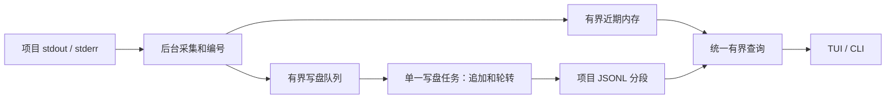

# 日志后续设计建议

2026-10-16，根据用户“按最佳实践、符合产品定位，并非所有功能都需要”的要求重新评估。本文是可审阅的收敛方案，尚未取代 [requirements.md](requirements.md) §4.2 的已确认范围；采用前不删除既有承诺。已实现机制仍由 [DESIGN.md](../DESIGN.md) §5 维护，当前状态见 [tasks.md](tasks.md)。

## 1. 产品目标与取舍

devctl 服务于本机三个开发项目的集中启停和排错。日志后续只围绕两个结果：离开或重启后台后能找回近期输出；在一个项目中快速找到问题并复制必要上下文。依据当前使用场景，本轮建议交付“有界保存、历史回看、简单搜索”，而非把原规划全部实现。

| 能力 | 建议 | 理由 |
| --- | --- | --- |
| 实时查看、暂停、翻页、选区复制、同一客户端内阅读恢复 | 保留已有实现，完成真实项目验收 | 已直接解决日常阅读问题 |
| 自动落盘、容量轮转与保留清理 | 必须一起交付 | 保存日志才有意义，容量也必须可控 |
| 跨后台重启查询、内存之外的历史回看 | 保留 | 避免报错被新输出覆盖，或结束开发后丢失排查材料 |
| 单项目字面文本搜索、上下文定位 | 保留，排在持久化之后 | 比继续增加滚动操作更能缩短排错时间 |
| 退出 TUI 后保存阅读书签 | 延后 | 新一次进入以近期输出为主，同一客户端内的恢复已经覆盖主要切换场景 |
| 跨项目聚合视图 | 延后，待实际关联排错场景出现 | 现阶段仍可直接切换三个项目，混排会增加输出干扰与顺序解释成本 |
| 时间范围、运行实例、来源等组合筛选 | 延后 | 先保留清楚的元数据和文本查找，再依据真实使用补充筛选维度 |
| 独立导出命令、导出面板、多种导出格式 | 延后 | 片段分享沿用选区复制；CLI 输出可重定向，范围仍由查询参数决定 |

“延后”表示本轮调整建议，不表示用户已经取消原需求。自动落盘与历史查询仍属 L04；容量与过载约束属 L03；阅读与查找分别关联 L01、L02。工程默认值属于本方案的初始选择，不能据此宣称经过负载验证。

## 2. 最终使用体验

1. 用户按现有方式启动三个项目，devctl 自动采集各自的 stdout/stderr，并保存到本机独立日志目录。
2. TUI 默认查看当前开发会话的选中项目；向上滚动可继续读取磁盘中仍保留的同会话日志，暂停和选区不被新输出推动。恢复跟随直接回到尾部。
3. 在选中项目内按 `/` 输入字面文本，用 `n/N` 定位匹配；定位后显示普通日志上下文并继续使用现有复制操作。这是拟议键位，尚未实现。
4. 结束工作区后仍可通过 CLI 查看保留日志。当前无后台时，默认读取最近一次有该项目日志的保存会话；有后台时默认当前会话。历史查询须明确标识会话，不把历史输出当成当前运行状态。
5. CLI 提供有限的近期会话列表与指定会话读取入口，便于选择上一次出错的开发记录。具体参数在实现时定稿；本轮不增加 TUI 会话管理页。
6. 容量不足时自动淘汰最早分段；读取已清理的记录时说明“已过期”，有采集或写盘缺口时说明“不完整”，不能用同一个空列表代替这些状态。

重新进入 TUI 默认读取当前会话尾部。保持已有的“首次进入可创建空闲后台，但不启动项目”语义；单纯 CLI 历史读取不创建后台或启动项目。

## 3. 保存方式与初始预算

### 3.1 位置与文件

Linux/WSL 按 XDG 状态目录保存：优先使用绝对路径的 `$XDG_STATE_HOME/devctl/logs`，变量未设置、为空或为相对路径时回退到 `~/.local/state/devctl/logs`。这是应用历史状态，目录选择依据 [XDG Base Directory Specification](https://specifications.freedesktop.org/basedir/latest/)。

按工作区、后台会话、服务分开保存 JSONL 分段；一个文件只写一个服务的记录，stdout/stderr 在字段中区分。分段用于控制容量，不能把“一项目一个无限增长的文件”当作完成持久化。

工作区使用规范化配置路径的稳定摘要定位，元数据保留原路径以核对身份；会话使用每次后台创建的独立标识。服务路径使用受控内部键，不直接拼接外部服务名。配置搬迁暂按新工作区处理。目录与文件仅当前用户可读写，不依赖项目目录中的忽略规则。

每条记录保留：会话、服务、运行实例、序号、UTC 采集时间、stdout/stderr 来源、正文、截断标记。时间取自 devctl 采集，显示时可转本地时间；同一会话、服务内的分页仍按序号，不依靠系统时钟先后。会话元数据标识正常结束或未完成收尾，便于识别异常退出。

### 3.2 初始默认值（建议）

| 参数 | 建议初值 | 含义 |
| --- | --- | --- |
| 本地保存 | 默认开启，可关闭 | 关闭后保留当前实时内存行为，并显示未保存状态 |
| 日志分段总预算 | 每工作区 256 MiB | 三个项目、所有保留会话共同使用，不是每个项目各 256 MiB |
| 保留期限 | 7 天 | 容量与期限先达到者触发清理，不保证始终有完整 7 天历史 |
| 分段大小 | 8 MiB | 内部工程参数，不作为首批用户配置项 |
| 内存与查询 | 沿用现有上限 | 每服务 2 MiB/4096 条；单条文本 16 KiB；每次查询正文 64 KiB |

首批只暴露保存开关、容量和保留天数。日志分段预算按序列化后的实际文件字节计算；元数据、任务队列与读取批次另设有界预算，不把正文限制误称为磁盘整体限制。空会话不创建无用日志分段，历史元数据随对应分段清理。

按完整分段清理，保留时长按采集时间判断；物理清理在后台启动和运行时周期维护触发。离线查询忽略已过期分段，物理清理留待下次后台启动。没有运行中的 devctl 时不承诺恰在第七天物理删除文件，也不另起清理守护进程。被容量或期限清理均需有可解释的边界提示。

默认轮转和有界缓冲分别解决磁盘耗尽与慢日志消费者拖住业务的问题；该取舍参考 [Docker 日志交付与轮转说明](https://docs.docker.com/engine/logging/configure/)，上述数值是 devctl 的建议值，并非照搬 Docker 默认值。

## 4. 实现边界

### 4.1 所有者与数据流

有后台时，由后台持有当前会话的采集、写入与清理权；日志任务不持有服务进程，也不决定项目启停。写入、查询使用受跟踪的任务，文件 I/O 不在当前线程的管理循环中同步等待。写盘队列按字节和条数限制，不能为每条日志创建新任务。

CLI 查询当前无后台的工作区时，通过与启动路径相同的工作区锁协调，只读已保存会话；锁只覆盖一个有界读取批次，长查询分批释放，不能占锁遍历全部历史。发现已有后台则走控制接口。不能仅依据一次连接失败就与仍存活的写入者并发接管存储。离线查询不清理正在写入的文件，也不通过历史 PID 管理进程。

实时内存与已写入磁盘的记录以 `(会话, 服务, 序号)` 合并去重。记录进入队列或内存不表示已经持久化；查询返回保留边界及已知缺口。默认不建立全文索引，先按分段扫描和分页预算实现，只有实际数据证明需要时再调整。

### 4.2 写入与异常

- 定时或按批次写入，每批正文和条数都有上限；正常停止后台在有限期限内排空、flush、sync 并报告结果。常规刷新不对每条记录执行磁盘同步。
- 正常关闭且收尾成功后，历史应可读取；崩溃或断电可能丢失未完成同步的尾部，不能承诺“最多只丢一秒”或绝对不丢。重启时识别未完成会话与损坏尾部，完整记录仍可读取。
- 磁盘满、权限错误、写入队列满或 I/O 错误时，显示“保存降级/不完整”；继续保留有界内存查看和服务控制。可恢复写入时记录已知缺口；无法持久记录的故障不能编造完整计数。
- 清理与查询通过存储所有者协调。过期的在途页可失败并返回明确边界，不能为维持历史查询无限保留被淘汰文件。清理失败时停止增加磁盘占用并进入保存降级。
- 开关关闭、后台结束、服务停止和日志保存失败是不同状态，界面不能混为同一提示。

### 4.3 搜索

第一版搜索只覆盖选中项目、选中会话仍保留的记录。采用字面文本查找与匹配跳转，保留上下文；不能只搜 TUI 当前窗口却声称搜完历史。采集时间、来源和运行实例继续显示，用来判断上下文，不同时增加组合筛选面板。

搜索与普通查询同样限制扫描批次、响应大小和在途任务，支持取消；持续输出时固定搜索上界，用户重新搜索才能包含之后的新增记录。大小写规则、无匹配、未完成扫描及取消的反馈在该功能实现时写入 interaction.md。

## 5. 实施与完成标准

| 小阶段 | 交付 | 必须验证的结果 |
| --- | --- | --- |
| A 有界持久化 | 记录身份与时间、写盘、轮转/期限、CLI 历史查询、保存状态 | 正常结束后可查；后台重建不串会话；超过预算会清理；磁盘失败不拖住启停 |
| B TUI 历史回看 | 同会话的内存/磁盘统一分页 | 超过内存缓存仍能回看；重叠页不重复；暂停阅读和选择稳定；清理造成的过期明确提示 |
| C 简单搜索 | 单项目单会话字面搜索、跳转与上下文 | 搜索覆盖保留历史；可取消；没有匹配与尚未完成有区别；选区复制仍正确 |

不先实施跨退出书签，也不为以后可能出现的聚合、筛选和 AI 预建接口。每阶段补充有价值的边界、集成与真实终端测试，最后由用户在 WSL 的三个真实项目上验收。A–C 完成并通过试用后，才判断本轮日志增强是否足够，延后项不自动启动。
